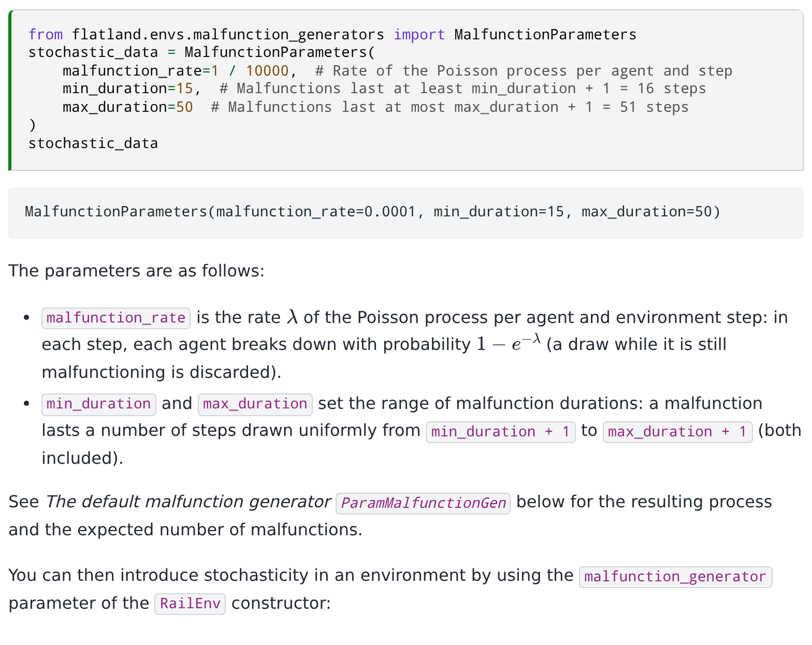
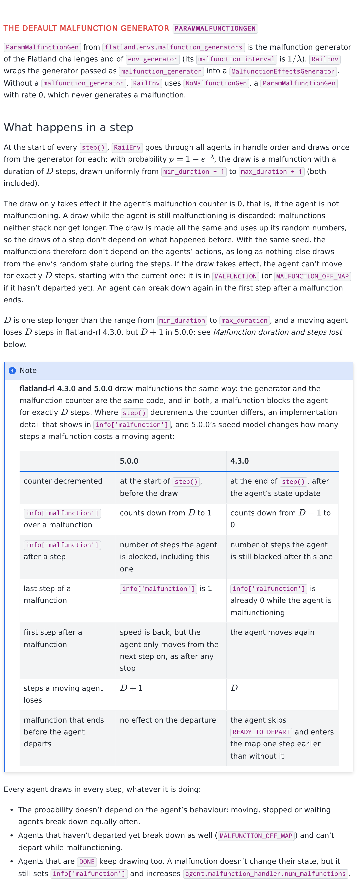
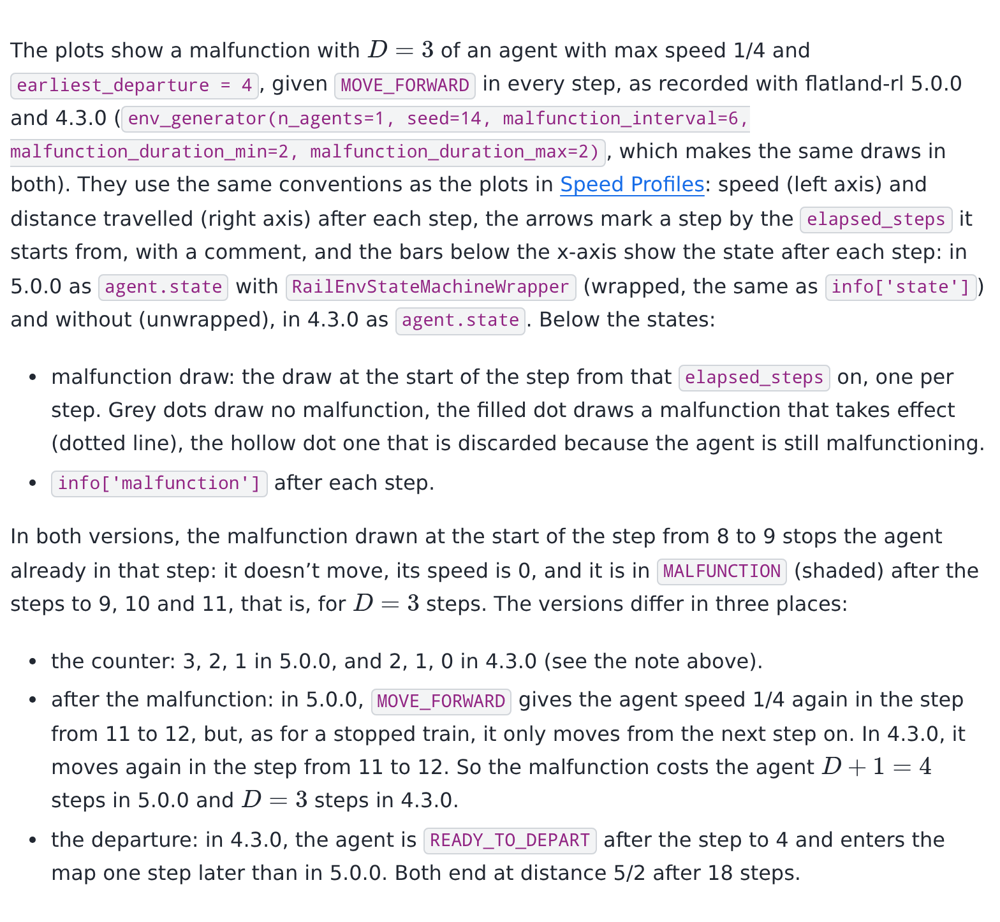
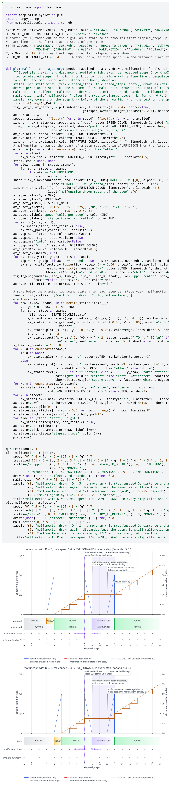
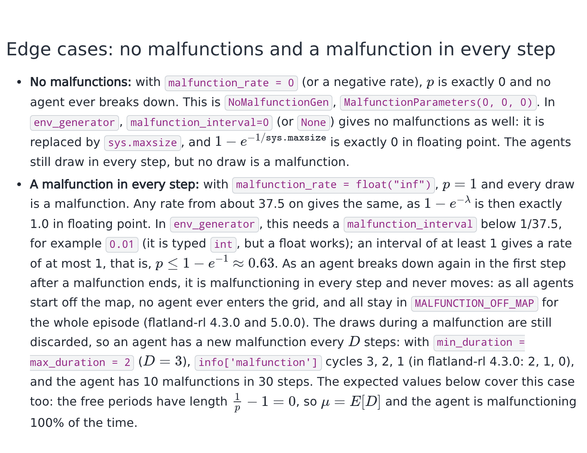
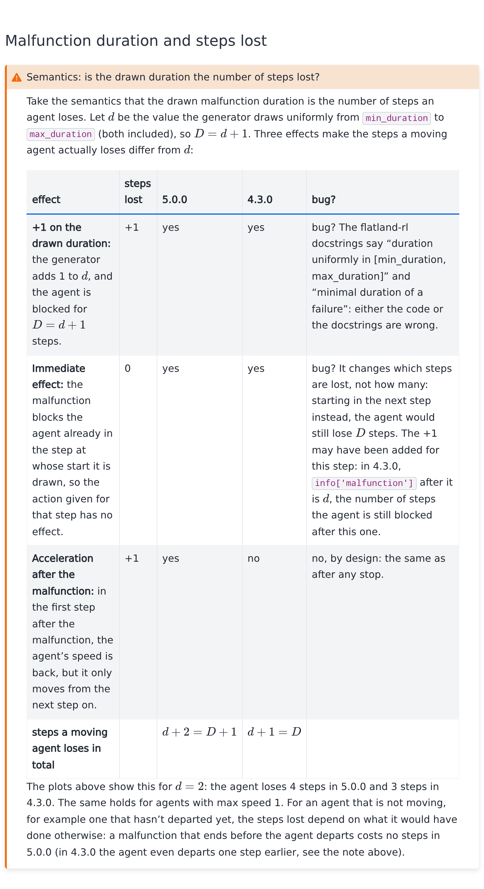
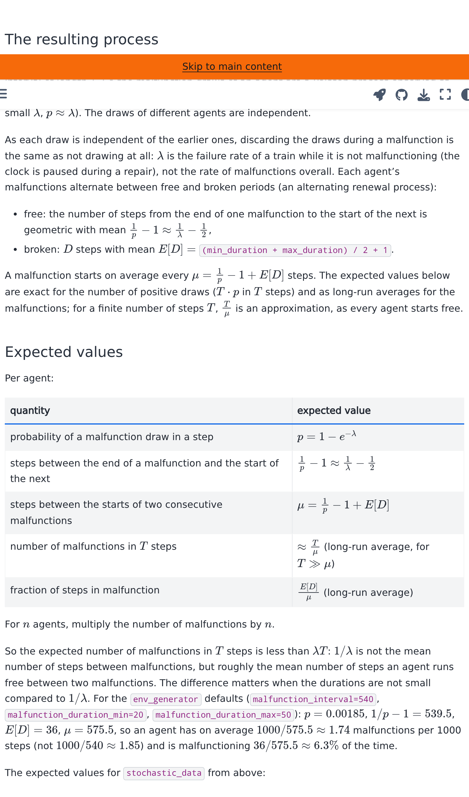
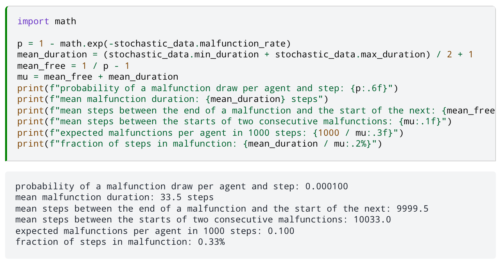
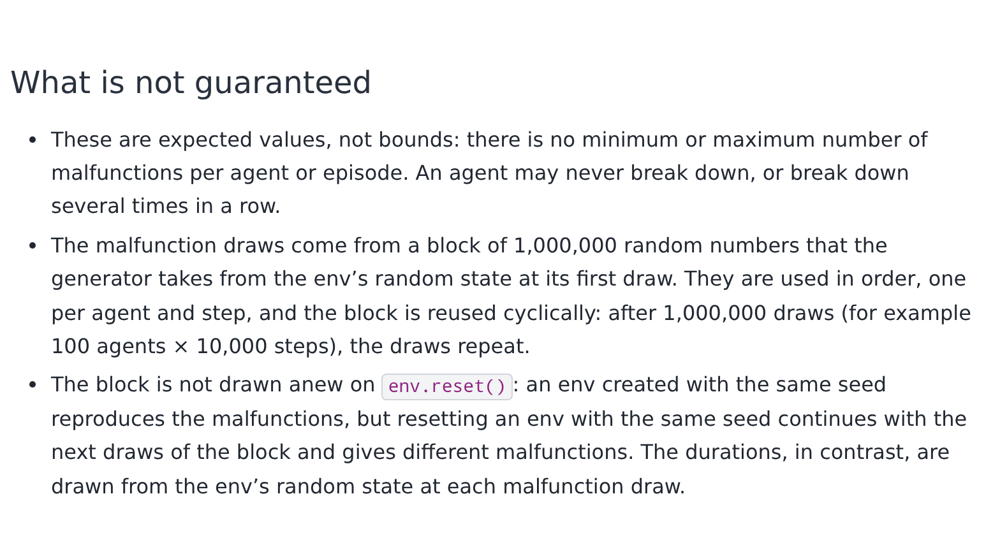

# Plan: document the default malfunction generator (PR #43)

Branch `docs/default-malfunction-generator`, PR [#43](https://github.com/flatland-association/flatland-book/pull/43).

## Changes

Describes the default malfunction generator `ParamMalfunctionGen` (as in flatland-rl `main`) in the Malfunctions part of [Stochasticity](../../environment/environment/stochasticity.ipynb). The docstrings were the starting point, and each claim was checked against the code and by runs on flatland-rl 4.3.0 and `main`.

- **Parameters:** `malfunction_rate` $\lambda$ (`env_generator`'s `malfunction_interval` is $1/\lambda$) and `min_duration`/`max_duration`. Also how `RailEnv` wraps the generator, and `NoMalfunctionGen` as the default.
- **What happens in a step:**
  - One draw per agent and step, in handle order, with probability $p = 1 - e^{-\lambda}$.
  - The duration $D$ is uniform in `min_duration + 1 … max_duration + 1`: the generator adds 1 to the documented range.
  - A draw while the agent is malfunctioning is still made but discarded, so malfunctions neither stack nor get longer, and with the same seed they don't depend on the actions.
  - A malfunction blocks the agent for $D$ steps, starting with the step in which it is drawn. A moving agent loses $D$ steps in 4.3.0 and $D + 1$ in 5.0.0, where it only moves again in the second step after the malfunction.
- **Note box, flatland-rl 4.3.0 vs 5.0.0:**
  - Malfunctions are drawn the same way, and in both versions a malfunction blocks the agent for $D$ steps.
  - The versions differ in where `step()` decrements the counter: `info['malfunction']` counts $D … 1$ in 5.0.0 and $D-1 … 0$ in 4.3.0.
  - They also differ in the first step after a malfunction (5.0.0 accelerates first) and so in the steps lost ($D + 1$ vs $D$).
  - In 4.3.0, a malfunction that ends before departure lets the agent skip `READY_TO_DEPART`.
- **Timeline diagrams, 5.0.0 and 4.3.0:**
  - Speed, distance and state over time for one agent given `MOVE_FORWARD` in every step, with the same draws in both versions.
  - They mark each step's malfunction draw (none / takes effect / discarded), when the malfunction starts and ends, and `info['malfunction']`.
  - The values come from real runs on each version.
- **Malfunction duration and steps lost (warning box):** under the semantics "the drawn duration is the number of steps an agent loses", three effects make the
  steps a moving agent loses differ from the value $d$ drawn from `min_duration` to `max_duration`:
  - +1 on the drawn duration (bug? the code contradicts the flatland-rl docstrings): +1 step, in 4.3.0 and 5.0.0.
  - Immediate effect in the step in which it is drawn (bug?): 0 steps, it only decides which steps are lost.
  - Acceleration after the malfunction (by design, as after any stop): +1 step, 5.0.0 only.
  - In total, $d + 2 = D + 1$ steps in 5.0.0 and $d + 1 = D$ in 4.3.0.
- **Edge cases:**
  - No malfunctions: rate ≤ 0, or `env_generator`'s `malfunction_interval=0`/`None`.
  - A malfunction in every step: rate `inf`, or any rate from about 37.5 on, or an interval below 1/37.5. All agents then stay `MALFUNCTION_OFF_MAP` for the whole episode and none enters the grid, in 4.3.0 and 5.0.0.
- **The resulting process:** a Poisson process observed at integer steps (a Bernoulli process), where $\lambda$ is the failure rate while the agent is not malfunctioning. Free and broken periods alternate (an alternating renewal process), with mean cycle $\mu = \frac{1}{p} - 1 + E[D]$.
- **Expected values** per agent and per episode. The number of positive draws ($T \cdot p$) is exact; malfunctions per $T$ steps ($T/\mu$) are long-run averages.
- **What is not guaranteed:**
  - These are expectations, not bounds.
  - The block of 1,000,000 random numbers is reused cyclically.
  - The block is not drawn anew on `env.reset()`, so resetting with the same seed does not reproduce the malfunctions.

## Notes

- **Relation to #42 (speed profiles):**
  - The diagrams follow #42's `plot_trajectory` conventions (matplotlib, speed/distance axes, step arrows, state bars).
  - The caption links to Speed Profiles, which only exists once #42 is merged, so merge #42 first.
  - `plot_malfunction_trajectory` repeats most of `plot_trajectory`, because one notebook can't import from another.
- **Build:** the plotting cell doesn't import flatland, and the whole notebook runs against the book's current flatland-rl 4.3.0.
- **Follow-up in flatland-rl (not in this PR):** the drawn duration is one step longer than its docstrings say ("duration uniformly in [min_duration, max_duration]"). Either the code or the docstrings need fixing.

## Screenshots

The changed and added cells, as rendered by jupyter-book against flatland-rl 4.3.0:

| Section | Screenshot |
|---|---|
| Parameters (modified) |  |
| The default malfunction generator, what happens in a step, 4.3.0 vs 5.0.0 note |  |
| Caption of the timeline plots |  |
| Timeline plots, 5.0.0 and 4.3.0 |  |
| Edge cases |  |
| Malfunction duration and steps lost |  |
| The resulting process, expected values |  |
| Expected values for the example parameters |  |
| What is not guaranteed |  |
