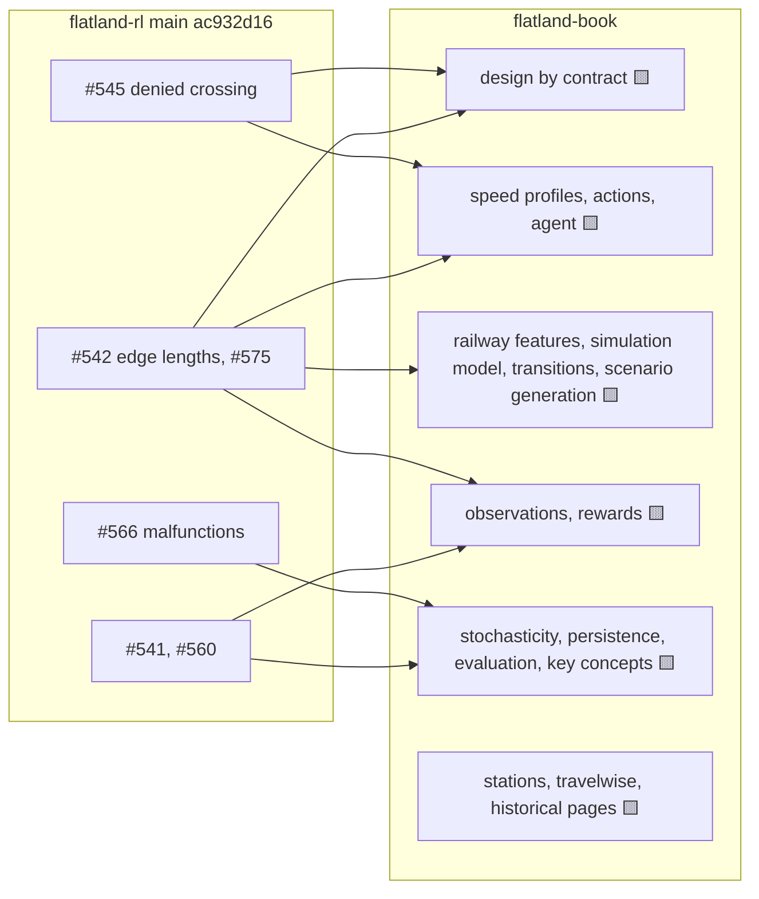

# Bring the book in line with flatland-rl `main`: edge lengths, denied crossings, reproducible malfunctions ([flatland-rl#577](https://github.com/flatland-association/flatland-rl/issues/577))

> **Status:** plan of 2026-11-23, carried out (S-1-S-12). Based on flatland-book `main` 3676d14 (after PR
> [#42](https://github.com/flatland-association/flatland-book/pull/42)), checked against flatland-rl `main` ac932d16.
> Issue [flatland-rl#577](https://github.com/flatland-association/flatland-rl/issues/577) ("docs(book): document edge
> lengths in the flatland-book.", chenkins), widened on 2026-11-23 to the whole book. Branch
> `577-flatland-rl-main-consistency`, PR [#62](https://github.com/flatland-association/flatland-book/pull/62). No open questions (§9.1).
>
> **Why:** PR #42 brought the book to flatland-rl `main` as it stood before #545 and #542. Since then `main` gives
> every edge a length, keeps a train's distance when its move is denied, and repeats the malfunctions on a reset
> with the same seed. The book still says the opposite in about 80 places, and it is to be published together with
> flatland-rl 5.0.0.

## 1. Introduction and goals

*What the change is for: the requirements, the qualities that matter, who has a stake, and what it leaves out.*

### 1.1 Requirements overview (functional requirements)

*The issue's text and the numbered requirements the rest of the plan refers to.*

> #542 (merged 2026-11-14, closes #526) gives each edge `(current entry point, next entry point)` a length, and #545
> (merged 2026-11-11) lets a denied crossing keep the agent's distance. The flatland-book still describes every cell
> as one step long, with `SEGMENT_LENGTH`, and a denied train as waiting at the end of its cell (distance 1).
> flatland-book PR #42 documents flatland-rl `main` before #545 and #542 and leaves both out. This issue collects
> everything the book needs for them, to be done in a flatland-book PR on top of flatland-book#42.

The issue then lists the places per page (checklists "denied crossings (#545)" and "edge lengths (#542)"); two
comments add the tense of 5.0.0 hints ([r4485715712](https://github.com/flatland-association/flatland-book/pull/42#discussion_r4485715712))
and #566 (reproducible malfunctions). §4.3-§4.7 take all of them over, with line numbers checked on 3676d14.

Requirements:

- **REQ-1** A denied crossing (resource check or invalid action at the cell exit) keeps the train's distance and
  sets its speed to 0, on every page (flatland-rl #545).
- **REQ-2** Every edge has a length (≥ 1, `int` or `Fraction`, default 1): speed, distance, cell exit, distances
  of the distance map and observations, persistence, the graph model; no `SEGMENT_LENGTH`, no "cell length 1"
  (flatland-rl #542, #575).
- **REQ-3** The speed profiles page illustrates an agent on a long edge, as a timeline recorded from a `RailEnv`
  run like the existing ones ([#542's Q-7](https://github.com/flatland-association/flatland-rl/blob/e06c323c01210e28599f2c17f9272f9521ba0c7e/docs/plans/edge-lengths.md) left this to the book).
- **REQ-4** A reset with a seed reproduces the malfunctions; `max_num_malfunctions` counts per episode; a saved
  conditional malfunction effects generator continues as recorded (flatland-rl #566; issue comment).
- **REQ-5** No hint at flatland-rl 5.0.0 in the future tense for what is on `main`; nothing called "planned for
  5.0.0" that may not ship in it (issue comment, r4485715712).
- **REQ-6** The whole book is consistent with flatland-rl `main` ac932d16, also beyond the issue's checklist:
  reloaded envs keep their state machine setting (#541), effects generator callbacks get the env and fixed
  examples (#560), and older inconsistencies found on the way (user, 2026-11-23).

### 1.2 Quality goals (non-functional requirements)

*The few qualities the design must reach, each with a concrete scenario.*

| ID | Priority | Quality goal | Scenario |
|---|---|---|---|
| NFR-1 | 1 | Correct against the code | Every changed claim names or follows a line of flatland-rl ac932d16; every number in a table comes from a run (the speed profiles assert their tables, F218 of PR #42). |
| NFR-2 | 2 | The book builds | `build.sh` against flatland-rl `main` runs every executed notebook without error (its own failure check). |
| NFR-3 | 3 | Reviewable | One commit per page group, each a targeted edit; no rewording of untouched paragraphs. |

### 1.3 Stakeholders

*Who asks for the change, decides on it, reviews it or works with the result, and what they expect.*

| Role | Name | Expectations |
|---|---|---|
| Issue author, maintainer | chenkins | The book matches 5.0.0 when it is released; the book's design-by-contract page can replace flatland-rl's copy. |
| Reviewer of PR #42 | CleverManu | The review threads handed over to #577 are addressed; tenses fit a book published after 5.0.0. |
| Readers | Flatland users, challenge participants | The book describes the simulator they install. |

### 1.4 Follow-ups (not in this PR)

*What this PR leaves out, why, and where it goes later.*

| Follow-up | Why not in this PR | From | Findings | Issue |
|---|---|---|---|---|
| Question for flatland-rl 5.0.0: redesign the restart of a blocked train, which alternates between `MOVING` and `STOPPED` (and is penalised every second step) until the next cell is free? | A design question for flatland-rl, not for the book; the book documents `main`. | Q-1 | - | - |
| Remove flatland-rl's `design_by_contract.md` and `snippet.tex`, point their 13 references at the book page, note in `AGENTS.md` that a change to `step()`'s contract needs a flatland-book PR. | Another repo. The book page now holds everything of both files (it added the cell entry formula of `snippet.tex`); flatland-rl branch `docs/remove-design-by-contract` is prepared, without an issue. | Issue, "Afterwards in this repo" | - | - (flatland-rl PR to open) |
| Build the book against flatland-rl 5.0.0 from PyPI: `requirements.txt` (`flatland-rl>=5`), drop `FLATLAND_DOCS_VERSION` in `checks.yml` and `main.yml`. | Waits for the release. | C-2 (TODO) | - | - |
| Recheck "issue #557" and "issue #559" on the railway features page once 5.0.0 is released (closed or moved). | Their outcome is not known yet. | Q-4 | - | [flatland-rl#557](https://github.com/flatland-association/flatland-rl/issues/557), [flatland-rl#559](https://github.com/flatland-association/flatland-rl/issues/559) |
| flatland-rl: `rail_env.py:318-319`'s docstring still says a target-reached agent is "parked … exactly at the edge boundary (distance == edge_length)". | Another repo. | §3 | - | - |
| flatland-rl: `rollout()` in `flatland/ml/ray/examples/flatland_inference_with_random_policy.py` never counts episodes ("through 0 Episodes" in the RLlib demo's stored output). | Another repo; the notebook is not executed. | §3 | - | - |
| flatland-rl: `graph_demo.ipynb` and `Agent-Close-Following.ipynb` import from flatland-rl's `tests` package and are not in its `notebooks/notebook-list`, so only the book build catches their breakage. | Another repo; works today. | §3 | - | - |
| The shortest path predictor ignores the agent's progress along its current edge. | Open in flatland-rl; the book only links it. | §4.6 | - | [flatland-rl#570](https://github.com/flatland-association/flatland-rl/issues/570) |
| flatland-rl: "transition" in the shared step code, as in the book: `edge_length`/`edge_lengths` (unreleased, #542) → `transition_length`/`transition_lengths` before 5.0.0, `is_cell_exit`/`is_cell_entry` → `is_transition_exit`/`is_transition_entry` with deprecated aliases, the internal `cell_exit` names alike; widen `AgentTransitionData`'s entry point types to `EntryPointT`. | Another repo, a breaking rename; until then the book keeps the code names and explains them once (Q-8). | Q-8 | - | [flatland-rl#580](https://github.com/flatland-association/flatland-rl/issues/580) |
| `sparse_rail_generator` generating edge lengths. | Not in flatland-rl yet (untracked follow-up of #542). | §4.4 | - | - |

## 2. Constraints

*What limits the design from outside: platform, organisation and conventions.*

| ID | Constraint | Kind | Explanation |
|---|---|---|---|
| C-1 | The book describes flatland-rl `main` ac932d16 as 5.0.0. | Organisational | It is published together with 5.0.0 (PR #42's rule); a later change on `main` reopens the affected step. |
| C-2 | The build installs flatland-rl from `main` until 5.0.0 is on PyPI. | Technical | `requirements.txt:4-6`, `checks.yml`, `main.yml` (TODOs); notebooks run against `main`. |
| C-3 | `graph_demo.ipynb` and `Agent-Close-Following.ipynb` are copied from flatland-rl by `build.sh`. | Technical | Fixed upstream, never in the book (PR #42, F151/F152). |
| C-4 | `challenges/ecml2026/training_envs.ipynb` keeps its flatland-rl 4.2.6 outputs and is not executed. | Technical | PR #50; its prose only. |
| C-5 | The design-by-contract page keeps the book's notation and additions. | Convention | Imported from flatland-rl at 1053169c; the upstream diff is translated, not copied ([r4541978571](https://github.com/flatland-association/flatland-book/pull/42#discussion_r4541978571)). |
| C-6 | Historical challenge pages describe past competitions. | Convention | Only claims that read as current get a version label. |
| C-7 | The sandbox must not write into the checkout's build output; `build.sh` rewrites files in place. | Technical | Verification builds in a copy (§4.2). |

### 2.1 Limitations

*What the built code gets wrong or ignores, each with the TODO or issue that tracks it.*

- The book states what flatland-rl ac932d16 does; a change merged into flatland-rl `main` before 5.0.0 can make a
  page stale again (C-1). Tracked by rechecking `main` before the PR is merged (§11.2).
- `#557` and `#559` are cited as open issues; their 5.0.0 outcome is not written into the book (Q-4, §1.4).

### 2.2 Assumptions

Not checked in code; they hold by construction of the release process (book and flatland-rl 5.0.0 published together).

- #545, #542, #566, #541, #560 and #575 ship in flatland-rl 5.0.0, so "since flatland 5.0.0" stays correct.
- The book's readers install flatland-rl ≥ 5.0.0; 4.x behaviour is only named where the book compares versions.

## 3. Context and scope (checked 2026-11-23 on flatland-book `main` 3676d14, flatland-rl `main` ac932d16)

*The code on the base branch that the change works in, as it is before the change, and where the change stops.*

Context, flatland-rl changes since PR #42's baseline (`git log --first-parent ac932d16`):

| flatland-rl PR | What changed | Book pages hit |
|---|---|---|
| [#545](https://github.com/flatland-association/flatland-rl/pull/545) (40ee6582) | A denied crossing keeps the distance, speed 0; `is_cell_entry` from `SpeedCounter.set()`'s `crossed`. | design by contract, actions, speed profiles, key concepts |
| [#542](https://github.com/flatland-association/flatland-rl/pull/542) (e1cc8109) | Edge lengths; `SEGMENT_LENGTH` removed; `edge_length` parameter; a target reached without removal keeps the step's leftover (e4ee29e2); distances sum lengths; lengths persisted; graph type aliases `GridNode`/`GridEdge` (grid) and `GraphNode`/`GraphEdge` (graph). | design by contract, speed profiles, actions, agent, railway features, simulation model, transitions, scenario generation, observations, rewards, persistence |
| [#575](https://github.com/flatland-association/flatland-rl/pull/575) (ac932d16) | `SpeedCounter.set(speed, distance, edge_length, *, crossed)`. | design by contract, speed profiles |
| [#566](https://github.com/flatland-association/flatland-rl/pull/566) (3e30f9ef) | Malfunctions restart each episode (`on_episode_start`); `max_num_malfunctions` per episode; conditional generator state saved. | stochasticity, persistence, key concepts, railway features, observation builder |
| [#541](https://github.com/flatland-association/flatland-rl/pull/541) (9eec95df) | Reloaded envs keep `skip_state_machine_update`; CLI default `None`. | evaluation, persistence |
| [#560](https://github.com/flatland-association/flatland-rl/pull/560) (d1417769) | Effects generator callbacks get the env; examples decide at the next entry point. | stochasticity, custom observations |

Facts the plan relies on, read from the code:

- `RailEnv._candidate_distance` (`flatland/envs/rail_env.py:1398-1435`): `distance` for done, stopped, malfunction
  and invalid action at the cell exit; `distance_after_crossing(distance, speed, edge_length)` for moving and for
  target reached without removal; `None` for removal and staying off map; `0` for map entry.
  `SpeedCounter.distance_without_crossing` is not used by `step()` (`speed_counter.py:110`). This corrects the issue,
  which still names it for done and target reached.
- A denied crossing (`rail_env.py:812-829`) keeps `agent_transition_data.distance` and sets speed 0.
- A blocked train at max speed 1/2 given `MOVE_FORWARD` in every step alternates `MOVING` (1/2) and `STOPPED` (0)
  at distance 1/2, with -0.5 every second step (simulated on ac932d16; also
  `tests/test_flatland_envs_rail_env.py:2595`).
- Edge lengths: `TransitionMap.edge_length(u, v)`, `has_edge_lengths()` (`flatland/core/transition_map.py:211-225`),
  `DEFAULT_EDGE_LENGTH = MIN_EDGE_LENGTH = 1`; set from `optionals["edge_lengths"]` (`rail_env.py:1695-1696`) or the
  graph's `length` edge attribute (`graph_rail_env.py:126-128`).
- `EffectsGenerator` has three hooks, `on_episode_start` included (`flatland/core/effects_generator.py:19-55`).
- `flatland-trajectory-generate-from-policy --skip-state-machine-update` defaults to `None`
  (`flatland/trajectories/policy_runner.py:416-424`).

Scope: the book's pages, notebooks and their stored outputs. Read only: flatland-rl, the notebooks the build copies
from it (C-3), `apidocs/` (generated).

## 4. Solution strategy

*The fundamental choices and why, the rules the design follows, how it is verified, and the design of each part.*

| Quality goal | Scenario | Solution approach | Details |
|---|---|---|---|
| NFR-1 | Every claim follows the code | Each place below names its flatland-rl evidence; numbers come from runs. | §4.3-§4.8 |
| NFR-2 | The book builds | Build in a copy against `main` after every step touching a notebook. | §4.2 |
| NFR-3 | Reviewable | One commit per page group, in the order of the step's dependency (contract first). | §11.1 |

### 4.1 Design principles

*The rules the design follows, each with its decision, the concepts it reuses instead of building new ones, and what
is not new on purpose.*

- **DP-1 The code decides.** Where the issue, a review comment and the code disagree, the code at ac932d16 wins and
  the plan says so (`distance_without_crossing`, §3; the "alternates" sentence, Q-1).
- **DP-2 One page explains, the others link.** Edge lengths are explained once in the speed profiles page (speed,
  distance, crossing) and once in the transitions page (the API); the other pages say it in one clause and link.
- **DP-3 The design-by-contract page follows flatland-rl's diff.** The diff since the import
  (`git diff 1053169c ac932d16 -- design_by_contract.md`, `git diff ad9b659a^ ac932d16 -- snippet.tex`) is taken over
  in the book's notation (C-5).
- **DP-4 Present tense for what is on `main`, no version promise for what is open.** (Q-4)
- **DP-5 Targeted edits.** Untouched paragraphs stay as they are; historical pages only get a version label (C-6, Q-3).
- **DP-6 "Transition" in prose, code names verbatim.** The pages call the way from the current to the next entry point a
  transition, as the railway features page defines it, on the grid and on the graph; not "cell" (grid only) or "edge"
  (graph only). Code names (`edge_length`, `is_cell_exit()`) stay as they are, and the speed profiles page says once
  that the code calls a transition an edge and its start and end a cell entry and exit (Q-8). Where §4.3-§4.8 write
  "edge" for the new text, the pages say "transition".

Reused concepts:

| Need | Reused concept | Instead of |
|---|---|---|
| Long-edge illustration | `record_trajectory`/`plot_trajectory` of the speed profiles page, asserted against a table (PR #42, F218) | A new plotting helper or a rendered still with `show_agent_progress` |
| Graph example with lengths | `GraphRailEnv.from_graph` with the `length` edge attribute, as in flatland-rl's tests | A new example env |
| Code links | `blob/main` links as elsewhere in the book (Q-5) | Pinning a 5.0.0 tag that does not exist yet |

Not new on purpose: no new page, no new table of contents entry, no build change, no new dependency.

### 4.2 Verification

*How each requirement and quality goal is shown to work: tests, CI checks, before and after screenshots.*

Build: Linux-only copies of the branch (`$WS/cache/flatland-book-build/`) and of the base 3676d14
(`$WS/cache/flatland-book-base/`), each built with `$WS/cache/build-book.sh <copy>` (`build.sh` rewrites files in place,
C-7). The script runs `build.sh` with the `jupyter-book` env's tools, a `python` and a Jupyter kernel from
`/claude/envs/flatland-rl`, and `PYTHONPATH` set to the flatland-rl `main` snapshot `$WS/cache/flatland-rl-main-ac932d16`,
a `dist-info` giving it the version `5.0.0.dev0` (`$WS/cache/bookmeta`) and `pypandoc_binary` for the bibliography
(`$WS/cache/bookpkgs`); nothing is installed into an env. Screenshots: the changed sections of both builds' `_build/html`,
by a Chromium DevTools script, in `docs/plans/flatland-rl-main-consistency/` (`NN-<section>-before.png` /
`-after.png`; new sections have only `-after`).

| ID | Requirement | Test or check | Result | Screenshots |
|---|---|---|---|---|
| REQ-1 | Denied crossing keeps the distance | `grep -rn "banked\|distance 1\b\|distance_without_crossing"` finds nothing outside this plan; the actions table matches a run on ac932d16 (§3). The pages say "end of its transition" for `is_cell_exit` (Q-8). | ✅ 2026-11-23 | `01-contract-collect-*`, `02-contract-distribute-*`, `03-actions-blocked-train-*`, `15-key-concepts-restart-*` |
| REQ-2 | Edge lengths | `grep -rn "SEGMENT_LENGTH\|cell length\|equally long"` finds nothing outside this plan; the graph example's output is from a run on ac932d16. | ✅ 2026-11-23 | `04-speed-and-distance-*`, `05-edge-lengths-after`, `06-update-formulas-*`, `08-railway-features-*`, `09-graph-example-after` |
| REQ-3 | Long-edge illustration | The new cells assert the recorded trajectories against their tables (lengths 2 and 3/2); they run in the build. | ✅ 2026-11-23 | `07-long-edges-after` |
| REQ-4 | Reproducible malfunctions | Text checked against `malfunction_effects_generators.py:25-30,88-152`; a run on ac932d16: a second seeded reset gives the same malfunctions as the first and as a new env. | ✅ 2026-11-23 | `10-stochasticity-effects-*`, `11-stochasticity-not-guaranteed-*`, `12-stochasticity-conditional-*`, `13-persistence-*`, `14-evaluation-*` |
| REQ-5 | Tense | `grep -rn "coming with\|planned for 5\|to be fixed in"` finds nothing outside this plan ("planned for 5.0.1" for flatland-rl#528 stays: that is its milestone). | ✅ 2026-11-23 | - |
| REQ-6 | Whole book | The five-part audit of 2026-11-23 (§4.3-§4.8) worked off; deviations recorded in §4.4-§4.8. | ✅ 2026-11-23 | - |
| NFR-2 | The book builds | Build above: `build.sh` exits 0 on branch and base, no failed notebook; the same warnings on both (Sphinx: 315 on each, none new). | ✅ 2026-11-24 | - |

### 4.3 Design by contract (REQ-1, REQ-2; DP-3)

`key-concepts/design_by_contract.md`, lines on 3676d14:

| Place | Now | Becomes | Cause |
|---|---|---|---|
| :20 invariant | speed, distance `None` off map | also `edge_length`; on map `edge_length == env.rail.edge_length(current, next)` (`rail_env.py:941-947`) | #542 |
| :27 | "fractions of the cell length 1" | of the edge length ‖c_i^t‖ ≥ 1, default 1, from `optionals["edge_lengths"]` or the graph's `length` | #542 |
| :35, :54 | `>= 1`, `mod 1` | `>= edge_length`, `distance + speed - edge_length` | #542 |
| :48, :49 | Done, Target reached | `distance` unchanged; leftover `distance + speed - edge_length` along the target edge (`None` if removed) | #545, #542 |
| :53, :78, :81 | `min(distance + speed, 1)`, "waits at the end of its cell" | `distance` unchanged; "An agent that stays within its cell is always granted."; a denied agent keeps entry points and distance, speed 0 | #545 |
| :66-67 | "a `stopped` agent at the end of its cell" | "a `stopped` agent" | #545 |
| :106, :107, :112 (Table 1) | `distance_without_crossing(...)` | Done and invalid action: `distance`; target reached: `distance_after_crossing(distance, speed, edge_length)` | #545, #542 |
| :114-116 | `distance_after_crossing(distance, speed)` | with `, edge_length` | #542 |
| :128, :176 | "banked" | "denied"; `cached_cell_exit(max_speed, speed, distance, edge_length)` | #545, #542 |
| :236 (Table 3) | denied crossing distance | `distance`, unchanged | #545 |
| :248-257 | `is_cell_entry` from distances, `SEGMENT_LENGTH` | from `SpeedCounter.set(speed, distance, edge_length, *, crossed)`'s `crossed` | #545, #542, #575 |
| :265 | "at the time of writing" | "not consulted by any control flow of `step()`" | tense |
| :292, :294 (Table 4) | `SEGMENT_LENGTH` (1) | `edge_length`, `env.rail.edge_length(u, v)`, `speed_counter.edge_length` → ‖c_i^t‖ | #542 |
| :343-347 | $\tilde d$ with `min{d+s,‖c‖}` | $d_i^t$ for done, malfunction, $s=0$, invalid action at cell exit; $(d+s) \bmod ‖c‖$ otherwise, target reached without removal included | #545, #542 |
| :383-387 (Table 4d) | `distance_without_crossing` row | dropped; `distance` row covers done, malfunction, stopped, invalid action; `distance_after_crossing(…, edge_length)` | #545, #542 |
| :418, :422, :439 | `min{d+s,‖c‖}` for a denied crossing | $d_i^t$, `agent_transition_data.distance` | #545 |

Already right, unchanged: Table 4a :300 (`self._elapsed_steps`), the #566 and #541 parts (:424-437, :457-459).

### 4.4 Speed, actions, agent (REQ-1, REQ-2, REQ-3; DP-2; Q-1, Q-2, Q-7)

`environment/environment/speed_profiles.ipynb` (JSON lines, 3676d14):

| Place | Becomes | Cause |
|---|---|---|
| :11 (cell 0) | speeds are fractions of a unit length per step; an edge of length L takes L/speed steps | #542 |
| :30-35 (cell 1) | distance in `[0, speed_counter.edge_length)`; row for `speed_counter.edge_length` (`None` off map); the paragraph on edge lengths (≥ 1, `int`/`Fraction`, floats rejected, default 1, `env.rail.edge_length(u, v)`, `optionals["edge_lengths"]`, graph `length`, not generated by `sparse_rail_generator`, fixed per episode) | #542 |
| :38-39 | on the map distance < edge length; after a denied crossing the pre-step distance with speed 0 | #545, #542 |
| :50, :56-57 (cell 2) | `distance_after_crossing(distance, speed, edge_length)`: at most one boundary per step, overshoot carried, also for target reached without removal; `distance_without_crossing` row dropped (Q-2), "All four" → "All three" | #545, #542 |
| :68 | denied crossing: distance "unchanged"; new row: target reached, not removed: leftover of the step, often 0 | #545, #542 |
| :142, :168 (Mermaid labels) | `1/2 + 1 - 1 = 1/2` form | #542 |
| :484 (cell 9) | `set(speed, distance, edge_length, *, crossed=False)` | #545, #542, #575 |
| new cells after cell 8 | long-edge timeline (REQ-3): `record_trajectory` gets `edge_lengths`, passed into the hints via `rail_from_grid_transition_map(rail, {**hints, "edge_lengths": {...}})`; distance travelled sums the passed edge lengths; axes "speed (per step)" and "distance travelled"; cases: length 2 and 3/2 at max speed 1 (Q-7), table asserted; the new plots mark each cell entry ("cell n"), since the
distance travelled alone rises by 1 per step and hides the long edge; in-page links use MyST labels, as `_config.yml`
sets no heading anchors (prototype run: length 2 → (3,0,0),(4,1,0),(5,1,1),(6,2,0); length 3/2 → (5,1,1),(6,2,1/2)), as `tests/test_flatland_edge_lengths.py:163-230` | #542 |

`environment/environment/actions.ipynb`:

| Place | Becomes | Cause |
|---|---|---|
| :20 (cell 0) | "holds it where it is in the cell in front of the switch"; "with max speed 1 on unit-length edges every step is a crossing"; "end of its edge" | #545, #542 |
| :24 | "stays where it was (`STOPPED`, speed 0, distance unchanged)" | #545 |
| :176 (cell 5) | "A denied crossing keeps the train at the pre-step distance with speed 0." | #545 |
| :216-217, table :223-226 (cell 6) | tries to cross when distance plus restart speed reaches the edge length; distance 1/2 in steps 175-177 | #545 |

`environment/environment/agent.ipynb`: :113 and :179 (cell 5) "the cell is left when the distance reaches 1 … the
cell length (currently the same for all cells)" → the edge length `agent.speed_counter.edge_length`, entered with
the leftover; speed 1 also takes several steps on a long edge; at the target without removal the leftover of the
arriving step (#542).

`key-concepts/key_concepts.md`: :402 "at the edge exit (distance + speed ≥ edge length)"; :408 "the speed is set to
0, the distance and edge length keep their pre-step values"; :498-502 "(speed 0, distance as before the step)" and
the "alternates" sentence kept, reworded "…until the next cell is free; it loses no distance" (Q-1) (#545, #542).

### 4.5 Model, graph and generation (REQ-2, REQ-5; DP-2, DP-4; Q-4)

- `getting-started/railway_features.md`:
  - :13 grid "each transition has a length (default 1; via `optionals["edge_lengths"]`, not from
    `sparse_rail_generator`)";
  - graph "each edge has a length, the optional `length` attribute; `GraphRailEnv.from_rail_env()` copies the
    grid's";
  - Not covered: drop "Real track lengths … coming with 5.0.0", keep the geometry sentence;
  - :7-9 a graph example with lengths (`length=3`, `Fraction(3, 2)`, default 1; distance map
    a run trace on ac932d16: steps 1-3 on a→b, 4-5 on b→c, which shows the steps per edge and the carried overshoot);
  - :18, :29 #557/#559 per Q-4; :19 speed as a fraction of a transition of length 1 per step; :21 "up to a maximum number of malfunctions per
    episode"; :35 #549 link per Q-6.
- `key-concepts/simulation_model.md`: :74-77 and :148 `edge_length(u, v)`, `has_edge_lengths()`; :140-141 distances
  sum edge lengths, `int`/`Fraction` (grid: float array for whole numbers, object array of `Fraction`s otherwise),
  as do the decision point graph, `shortest_path_length()`, tree observation and shortest path predictor, timetable
  entries stay whole steps; :149-150 `0 ≤ distance < speed_counter.edge_length`; :162 rail generators may return
  edge lengths; :134 `EntryPointT` names `GridNode`/`GraphNode`.
- `environment/environment/transitions.ipynb` :180-191 (cell 9): `edge_length(u, v)` and `has_edge_lengths()`,
  the page explaining the API (DP-2).
- `environment/scenario_generation.ipynb` cell 12 (:196-200): a rail generator may return `edge_lengths`; timetables
  round up to whole steps.

### 4.6 Observations and rewards (REQ-2, REQ-6; Q-5)

- `environment/observation_builder/provided_observations.md` :110-120, :136: tree distances are sums of edge lengths
  (the number of cells with unit lengths), floats that can be fractional; the shortest path predictor ignores the
  agent's progress along its edge (flatland-rl#570, which is about the predictor, not the tree observation).
- `environment/observation_builder/custom_observations.md`: :89-91 `geometric_distance` is the minimum total edge
  length, can be a `Fraction`, the grid array can be an object array; :197-203 `if done["__all__"]: break`;
  :206-208 drop "applies them one cell late" (#560 fixed the example).
- Code links pinned to `v4.3.0` (`provided_observations.md:44,78,141`, `custom_observations.md:16,32,81,82`,
  `scenario_generation.ipynb:212`) per Q-5.
- `environment/environment/rewards.md`: :27 `is_cell_exit` against the edge length; :19-28 the `edge_length` field
  of `AgentTransitionData`.
- `environment/environment_information.md:38`: the penalty is for a forced stop (denied move or invalid action),
  not for entering an occupied cell.

### 4.7 Malfunctions, persistence, evaluation (REQ-4, REQ-6)

- `environment/environment/stochasticity.ipynb`:
  - :27-33 (cell 1) three hooks, `on_episode_start` included; callbacks get the env and `on_episode_step_end` gets
    `action_dict=` (#560); typos "stochstasticity", "used called";
  - :499-505 (cell 16) the block is drawn anew at the first draw of each episode from the env's random state, so
    `env.reset(random_seed=s)` reproduces a new env with seed `s`; from the second reset on the malfunctions differ
    from 4.x; drop the bug sentence and the #564 link;
  - :517 (cell 17) `max_num_malfunctions`: per episode, over all agents, `env.reset()` sets the count to 0.
- `environment/observation_builder.md:47-49`: the perturbed tree observation starts its random numbers over each
  episode (#566).
- `key-concepts/key_concepts.md`:
  - :512-527 the reset flowchart: `on_episode_start` restarts the malfunction generators; `obs_builder.reset`;
    `regenerate_schedule`;
  - :128 infos example `"speed": {0: Fraction(1, 1), 1: Fraction(0, 1)}` (agent 1 is in a malfunction, on the map,
    so its speed is 0, not `None`).
- `key-concepts/persistence.md`:
  - edge lengths saved with the rail (`(u, v, numerator, denominator)`), older files load with length 1;
  - a conditional malfunction effects generator saved mid-episode continues as recorded;
  - the env records `skip_state_machine_update` and `load_new` restores it (#541);
  - :164 add why 4.x fails on 5.x files (`Agent.__new__` arity, verified).
- `environment/evaluation.ipynb` :232-234 (cell 7): the setting is saved with the env; loading, evaluating and
  running keep it unless `skip_state_machine_update` is passed; `flatland-trajectory-generate-from-policy` generates
  without the update, `--env-path`/fork keep the saved setting (#541).

### 4.8 Other pages (REQ-5, REQ-6; Q-3)

- `environment/environment/stations_links.md`: :164 "(since 4.3.0)", the guarantee dates from 4.3.0. :182 stays "As of
  4.3.0": stations and links shipped in 4.3.0 ([flatland-rl#441](https://github.com/flatland-association/flatland-rl/pull/441)),
  `flatland/envs/stations_links.py` is identical on `main`, and the limitations listed there (only `sparse_rail_generator`,
  saved by `RailEnvPersister`, not carried by `GraphRailEnv`) already hold in v4.3.0.
- `resources/travelwise/data_model.md:58-64,110-116`: mark `events_generator`, `register`/`deregister`,
  `timetable`, `next_stop` as planned; `distance: Fraction` under `speed_counter`; `TransitionMap.edge_length()`.
- `resources/travelwise.md:37`: `InfrastructureEnv` builds on the existing `AbstractRailEnv`/`GraphRailEnv`.
- Historical pages, version labels only (C-6): `challenges/flatland3.md:4` "newest" → "of 2021";
  `challenges/amld2021/first-submission.md:49`, `challenges/neurips2020/first-submission.md:49` "Flatland 2.2.2 is
  tested with Python 3.6 and 3.7".
- `intro.md:76`, `getting-started/why-flatland.md:28` "2D grid environment": "(or as a graph, with `GraphRailEnv`)",
  without a version (`GraphRailEnv` exists since 4.2.4); `intro.md:43` stays, its feature list already names the graph.

## 5. Building block view

*The components the change adds or changes: an overview, why the system is split this way, what each is responsible
for, the important interfaces, and the planned data model.*

### 5.1 The book's pages and the flatland-rl changes they follow

*One white box: its building blocks, why it is split this way, and the interfaces between them.*

Notation: [flowchart in Mermaid](https://mermaid.js.org/syntax/flowchart.html); an arrow means "the page group must
follow this change"; 🟨 modified.

**Motivation:** the page groups are the steps of §11.1. The contract comes first because the other pages state
its consequences in their own words (DP-2, DP-3).

**Contained building blocks:**

| Component | Responsibility | Change |
|---|---|---|
| Design by contract page | The authoritative `step()` contract, to replace flatland-rl's copy. Not a tutorial. | 🟨 modified: states the 5.0.0 contract with edge lengths and denied crossings. |
| Speed profiles page | Explains speed, distance and crossing with recorded timelines. Not the API. | 🟨 modified: readers see a train on a long edge and the distance kept after a denial. |
| Actions, agent pages | What an action does to a train, the agent's attributes. | 🟨 modified: the numbers in their examples match a run. |
| Railway features, simulation model, transitions, scenario generation | What Flatland models, and its API for the network. | 🟨 modified: edge lengths exist, with a graph example. |
| Observations, rewards pages | What the observations and reward signals report. | 🟨 modified: distances are lengths, possibly fractional. |
| Stochasticity, persistence, evaluation, key concepts | Malfunctions, saving and replaying, the step and reset flow. | 🟨 modified: a seeded reset repeats the malfunctions; reloads keep their state machine setting. |

## 8. Crosscutting concepts

*What the change introduces that other code will follow, and what it changes for existing callers.*

### 8.1 New patterns

*What is new compared with the base branch.*

Compared with flatland-book `main` 3676d14. What is reused, and what is not new on purpose, is in §4.1.

| ID | New | Defined in |
|---|---|---|
| PAT-1 | Speed as a fraction (at most 1) of a transition of the default length 1 per step, instead of "a fraction of a cell"; plot axes without a unit. | §4.4 |
| PAT-2 | "Transition" for what carries a length and what an agent reaches the end of, instead of "cell" or "edge"; headings "Transition lengths" and "Long transitions". | DP-6, Q-8 |

### 8.2 Breaking changes

*What breaks for whom, and the migration path.*

None for readers: no page, anchor or table of contents entry is removed or renamed. The design-by-contract page's
table rows change content, not their anchors.

## 9. Decisions

*The decisions behind the plan: the questions still open, the decisions taken, and how each review finding was settled.*

### 9.1 Open questions

*Choices not made yet, each with its options and a proposal.*

✅ ~~**(Q-1) Drop the "alternates … without progress" sentence in `key_concepts.md:501-502`, as the issue asks?**~~
**Decided 2026-11-23:** b), keep it reworded. Whether the behaviour itself should be redesigned for 5.0.0 is a
follow-up question (§1.4).
- a) Drop it, as the issue and [r4658620806](https://github.com/flatland-association/flatland-book/pull/42#discussion_r4658620806) ask.
- b) Keep it, reworded: "…alternates between restarting and being stopped until the next cell is free; it loses no
  distance." The code still does this (§3, simulated; `tests/test_flatland_envs_rail_env.py:2595`), and the actions
  table shows it.

*Proposal:* b), by DP-1; the reviewer (CleverManu) decides.

No flatland-rl issue changes this behaviour (checked 2026-11-23: no open issue of milestone 5.0.0 is about it).
#577 lists the alternation under #545's "Breaking in timing" as the behaviour of `main` (MOVING at 1/2 and
STOPPED at 0, distance 1/2 throughout, -0.5 every second step), so it is intended, not a bug awaiting a fix.
Nearest neighbours, not about it: [flatland-rl#519](https://github.com/flatland-association/flatland-rl/issues/519)
(the invalid action/intervention penalty term) and [flatland-rl#563](https://github.com/flatland-association/flatland-rl/issues/563)
(entering the map with `STOP_MOVING`).

✅ ~~**(Q-2) What happens to `distance_without_crossing` in the speed profiles' formula table?**~~
**Decided 2026-11-23:** a), drop the row.
- a) Drop the row; the table lists what `step()` uses ("All four" → "All three").
- b) Keep the row with the three-argument signature and "not used by `RailEnv.step()`".

*Proposal:* a): the API reference lists the method; the page explains `step()`.

✅ ~~**(Q-3) How far does "the whole book" go into historical and roadmap pages?**~~
**Decided 2026-11-23:** a), the one-liners of §4.8.
- a) Version labels on historical pages, "planned" marks on the TravelWise data model, the "2D grid" wording in the
  intro (§4.8).
- b) Only the pages that describe the current simulator; historical, TravelWise and intro pages untouched.

*Proposal:* a): each is one line, and they read as current today.

✅ ~~**(Q-4) How to word #557 and #559, open with milestone 5.0.0?**~~
**Decided 2026-11-23:** a), neutral wording without a version.
- a) Neutral, without a version: "(issue #557)", "issue #559 proposes moving it to the controller", as
  `key_concepts.md:106` already does; recheck at the release (§1.4).
- b) Keep "planned for 5.0.0" and fix it at the release.

*Proposal:* a) (DP-4).

✅ ~~**(Q-5) Where do the code links pinned to `v4.3.0` point?**~~
**Decided 2026-11-23:** a), `blob/main` now.
- a) `blob/main` with the anchors of ac932d16, as the book's other links; they drift with `main`.
- b) `v5.0.0` once the tag exists, in the follow-up that switches the build to PyPI.

*Proposal:* a) now; b) as part of the PyPI follow-up (§1.4).

✅ ~~**(Q-6) `railway_features.md:35` cites flatland-rl#549 ("Extract agent state", open) for `current_entry_point`/`next_entry_point`, which exist on `main`. Keep the link?**~~
**Decided 2026-11-23:** b), keep it for the remaining renames.
- a) Drop it.
- b) "see issue #549 for the remaining renames".

*Proposal:* b), it still tracks the rest.

✅ ~~**(Q-7) The long-edge illustration (REQ-3): which cases?**~~
**Decided 2026-11-23:** a), lengths 2 and 3/2 at max speed 1.
- a) Lengths 2 and 3/2 at max speed 1 (shows the carried overshoot).
- b) a), plus 3/2 at max speed 1/2.

*Proposal:* a): two plots make the point; b) adds a plot without a new effect.

✅ ~~**(Q-8) Which word do the pages use for what an agent reaches the end of ("end of its cell" vs. "end of its edge")?**~~
**Decided 2026-11-24:** b), "transition".
- a) "cell/edge", naming both models.
- b) "transition", the book's model-neutral term (`railway_features.md`: a pair of entry points, a directed edge of
  the graph); on the grid a transition leads through one cell, and it is what carries the length (a switch cell has
  several).
- c) "edge", as `edge_length`.

*Proposal:* b). The code mixes "cell" and "edge" itself; renaming both to "transition" there is a flatland-rl
follow-up (§1.4).

### 9.2 Decision log

*Every decision by date, with why it was taken and what follows from it.*

| Date | Decision | Why | Consequences |
|---|---|---|---|
| 2026-11-23 | ✅ The PR covers the whole book against flatland-rl `main` ac932d16, not only #577's checklist (REQ-6). | The user's request; #541 and #560 also changed documented behaviour. | §4.7-§4.8, S-9-S-11. |
| 2026-11-23 | ✅ `distance_without_crossing` is described as unused by `step()`, against the issue's text (DP-1). | `rail_env.py:1398-1435`, `speed_counter.py:110` at ac932d16. | §4.3, Q-2. |
| 2026-11-23 | ✅ Q-1: keep the "alternates" sentence, reworded ("it loses no distance"). | flatland-rl `main` still alternates (DP-1); no 5.0.0 issue changes it. Not taken: dropping it as the issue asks. | S-6; follow-up question on a redesign in 5.0.0 (§1.4). |
| 2026-11-23 | ✅ Q-2: the speed profiles' formula table drops the `distance_without_crossing` row. | The table explains `step()`, which no longer uses it; the API reference keeps the method. Not taken: keeping it marked "unused". | S-3; "All four" becomes "All three". |
| 2026-11-23 | ✅ Q-3: historical, TravelWise and intro pages get one-line labels. | Each reads as current today and costs one line. Not taken: leaving them untouched. | S-11. |
| 2026-11-23 | ✅ Q-4, Q-5, Q-6: #557/#559 without a version; code links to `blob/main`; the #549 link kept for the remaining renames. | The proposals, accepted with "implement all". | S-7, S-8; recheck at the release (§1.4). |
| 2026-11-23 | ✅ Q-7: the long-edge timeline plots lengths 2 and 3/2 at max speed 1. | Length 3/2 shows the carried overshoot; a third plot at speed 1/2 adds no new effect. | S-4. |
| 2026-11-24 | ✅ Speed is described as a fraction of a transition of length 1 per step (PAT-1), not in "length units", also on the design-by-contract page (which deviates there from flatland-rl's "units of length", DP-3); the stations and links page keeps "As of 4.3.0" (§4.8). | Review: "fractions" reads easier than a new unit; stations and links shipped in 4.3.0 and are unchanged on `main`. | S-3, S-7, S-11; plots re-run. |
| 2026-11-24 | ✅ Q-8: the pages say "transition"; code names stay verbatim and are explained once (DP-6). | "Cell" is grid-only and "edge" graph-only; "transition" is already the book's term for both. Not taken: "cell/edge" (wordy), "edge" (graph term on grid pages). | PAT-2; S-3-S-8 pages reworded, the long-transition plots re-run; flatland-rl rename follow-up (§1.4). |

### 9.3 Code Review Findings

*Findings from code reviews, PR comments and TODOs, with their status and the commits that fix them.*

None yet: no PR. The review threads of PR #42 handed over to this work are the issue's checklist (§1.1), all taken
over in §4.3-§4.7; PR #42 has no unresolved thread left (checked 2026-11-23).

## 10. Glossary

*The domain and technical words the plan uses, with their code symbols.*

- **Transition**, in the code **edge** (`GridEdge`, `GraphEdge`): a pair (current entry point, next entry point), a
  directed edge of the graph; the pages say "transition" (DP-6). On the grid it leads through one cell, but it is not
  a cell: a switch cell has several. Not `get_transitions()`'s transition bits.
- **Cell entry, cell exit** (`is_cell_entry`, `is_cell_exit()`): the code's names for the start and end of a
  transition, also on the graph.
- **Edge length** (`TransitionMap.edge_length(u, v)`, `speed_counter.edge_length`): the length of a transition, `int` or
  `Fraction` ≥ 1, default 1 (`DEFAULT_EDGE_LENGTH`). Not a number of steps; timetables stay in whole steps.
- **Speed** (`speed_counter.speed`): a fraction, at most 1, of a transition of the default length 1 travelled per step
  (PAT-1); a transition of length L takes L/speed steps. Not "cells per step".
- **Denied crossing**: a crossing refused by the resource check or by an invalid action at the cell exit; the agent
  keeps its distance and gets speed 0. Not a malfunction.
- **Leftover** (`distance_after_crossing`): `distance + speed - edge_length` after a crossing, the distance on the
  next edge.
- **Conditional malfunction effects generator** (`ConditionalMalfunctionEffectsGenerator`): malfunctions under a
  condition, at most `max_num_malfunctions` per episode.

## 11. Execution plan and status

*The commits that build the change, in order, and which of them are done: the source of the PR's status.*

### 11.1 Steps

*One row per commit: what it does, the findings it fixes, its message, and its SHAs once committed.*

| ID | Findings | Step | Category | Severity | Commit message | Commit(s) | Needs | Blocked by |
|---|---|---|---|---|---|---|---|---|
| ✅ S-1 | - | Add this plan. | docs | low | `docs(plans): plan the book update to flatland-rl main for edge lengths, denied crossings and malfunctions.` | 592ecf8 | - | - |
| ✅ S-2 | - | Design by contract (§4.3). | needs update for >4.3.0 | high | `docs(design-by-contract): take over edge lengths and denied crossings from flatland-rl main.` | f6bcafa | S-1 | - |
| ✅ S-3 | - | Speed profiles text and tables (§4.4). | needs update for >4.3.0 | high | `docs(speed-profiles): measure distance against the transition length and keep it on a denied crossing.` | 1a65a07 | S-2 | - |
| ✅ S-4 | - | Speed profiles long-edge timeline (§4.4, REQ-3). | needs coverage for >4.3.0 | medium | `docs(speed-profiles): plot a train on long transitions, recorded from a RailEnv run.` | 1a65a07 (with S-3) | S-3 | - |
| ✅ S-5 | - | Actions and agent pages (§4.4). | needs update for >4.3.0 | high | `docs(actions): keep the distance on a denied crossing and measure it against the transition length.` | de583f9 | S-3 | - |
| ✅ S-6 | - | Key concepts step text (§4.4) and reset flowchart, infos example (§4.7). | needs update for >4.3.0 | medium | `docs(key-concepts): keep the distance on a denied crossing and restart malfunctions on reset.` | bb89d2d | S-2 | - |
| ✅ S-7 | - | Railway features, simulation model, transitions, scenario generation (§4.5). | needs update for >4.3.0 | high | `docs(transition-lengths): describe transition lengths in the grid and graph model, with a graph example.` | 9eeaf8a | S-3 | - |
| ✅ S-8 | - | Observations, rewards, environment information (§4.6). | needs update for >4.3.0 | medium | `docs(observations): sum transition lengths in distances and link the code on main.` | 650effd | S-7 | - |
| ✅ S-9 | - | Stochasticity and observation builder (§4.7). | needs update for >4.3.0 | medium | `docs(stochasticity): reproduce malfunctions on a reset with the same seed.` | 8341685 | S-1 | - |
| ✅ S-10 | - | Persistence and evaluation (§4.7). | needs update for >4.3.0 | medium | `docs(persistence): save transition lengths, malfunction generator state and the state machine setting.` | 02cda9b | S-7, S-9 | - |
| ✅ S-11 | - | Other pages (§4.8). | docs | low | `docs: label historical and planned content and the 5.0.0 version.` | 4034914 | S-1 | - |
| ✅ S-12 | - | Build in a copy against `main`, screenshots, greps of §4.2. | test-coverage | medium | `docs(plans): add the screenshots of the book update to flatland-rl main.` | 63680b6 | S-2-S-11 | - |

### 11.2 Rebase and merge

*How the branch is rebased or merged when it builds on other open PRs, and the known conflicts.*

No open PR below it. Before merging, rerun `git log --first-parent ac932d16..<flatland-rl main>` and reopen the
steps whose pages a newer flatland-rl change touches (C-1). flatland-book PR #45 (stations and links model, open)
touches `stations_links.md`; S-11 changes only one version label there.

## 12. Change inventory

*Every file the change adds, modifies, renames or removes, and what stays unchanged on purpose.*

### 12.1 New files

*The files the change adds, and what each adds.*

| File | Adds |
|---|---|
| `docs/plans/flatland-rl-main-consistency.md` | This plan. |
| `docs/plans/flatland-rl-main-consistency/*.png` | Before and after screenshots (S-12). |

### 12.2 Modified files

*The files the change modifies, and what changes in each.*

| File | Changes |
|---|---|
| `key-concepts/design_by_contract.md` | §4.3 (S-2). |
| `environment/environment/speed_profiles.ipynb` | §4.4, text, tables, `record_trajectory`'s `edge_lengths`, new long-edge cells (S-3, S-4). |
| `environment/environment/actions.ipynb`, `environment/environment/agent.ipynb` | §4.4 (S-5). |
| `key-concepts/key_concepts.md` | §4.4, §4.7 (S-6). |
| `getting-started/railway_features.md`, `key-concepts/simulation_model.md`, `environment/environment/transitions.ipynb`, `environment/scenario_generation.ipynb` | §4.5 (S-7). |
| `environment/observation_builder/provided_observations.md`, `environment/observation_builder/custom_observations.md`, `environment/environment/rewards.md`, `environment/environment_information.md` | §4.6 (S-8). |
| `environment/environment/stochasticity.ipynb`, `environment/observation_builder.md` | §4.7 (S-9). |
| `key-concepts/persistence.md`, `environment/evaluation.ipynb` | §4.7 (S-10). |
| `environment/environment/stations_links.md`, `resources/travelwise.md`, `resources/travelwise/data_model.md`, `challenges/flatland3.md`, `challenges/amld2021/first-submission.md`, `challenges/neurips2020/first-submission.md`, `intro.md`, `getting-started/why-flatland.md` | §4.8 (S-11). |

Unchanged on purpose: `build.sh`, `requirements.txt`, the workflows (§1.4), `_toc.yml`, `apidocs/`, the copied
notebooks (C-3), `challenges/ecml2026/training_envs.ipynb`'s outputs (C-4), the tutorials and RL demos (checked,
consistent), `docs/plans/docs-default-malfunction-generator.md` (the record of PR #43).
