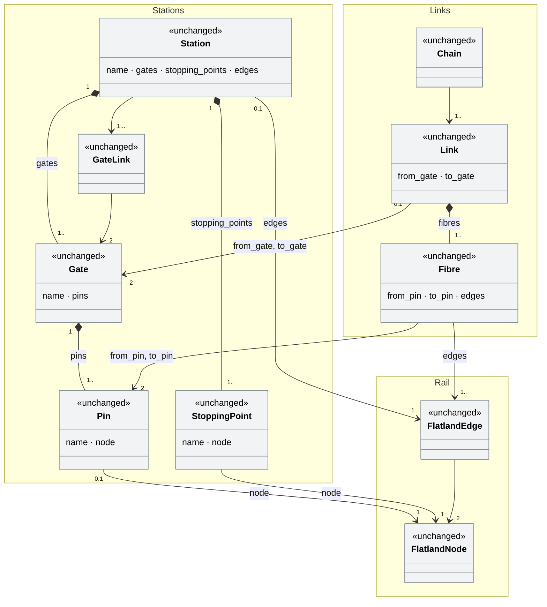
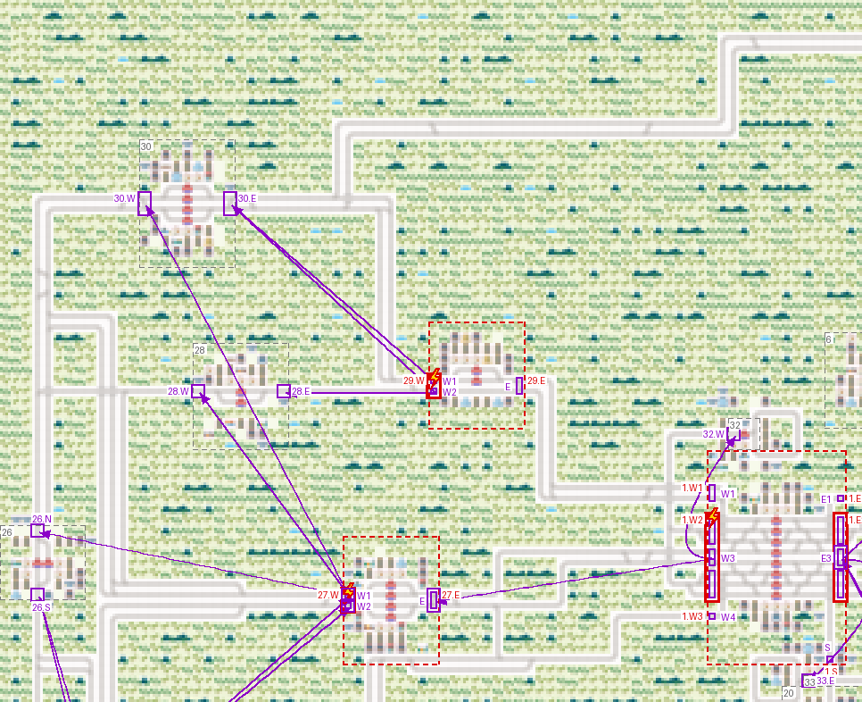
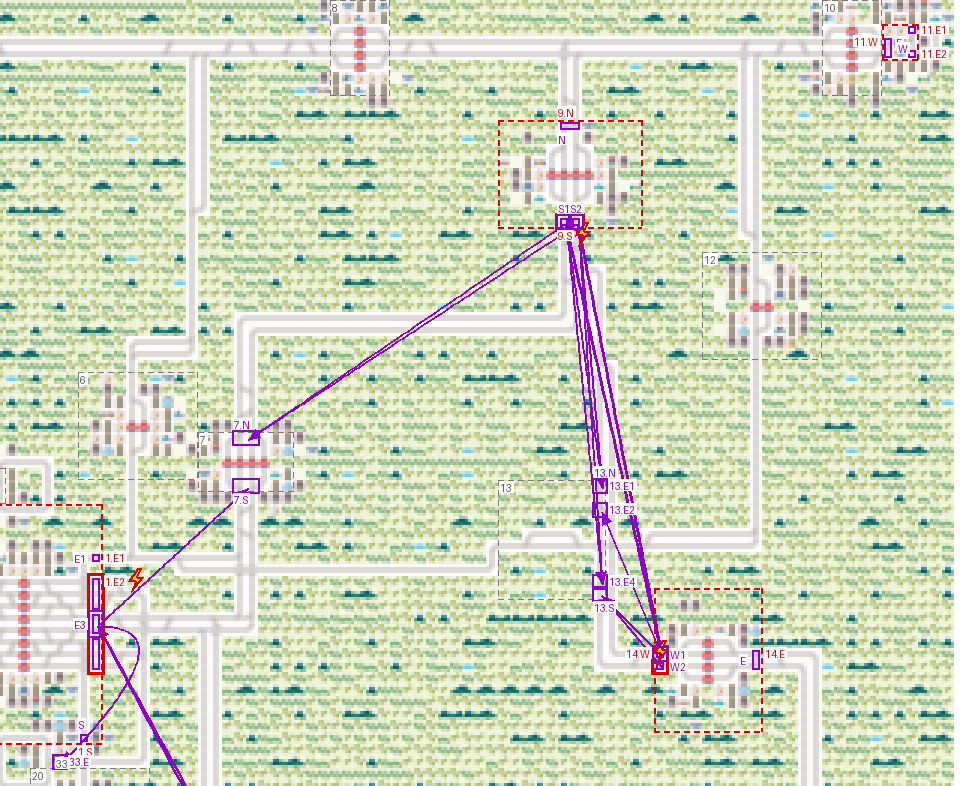
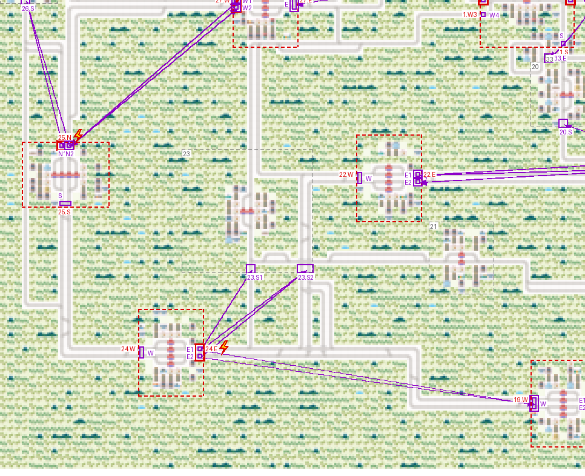
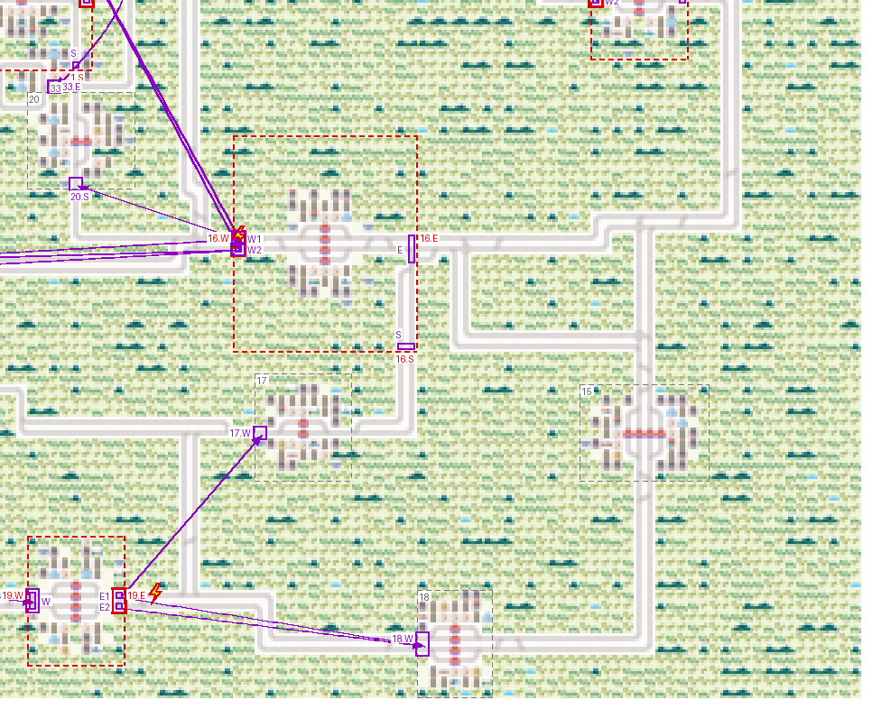
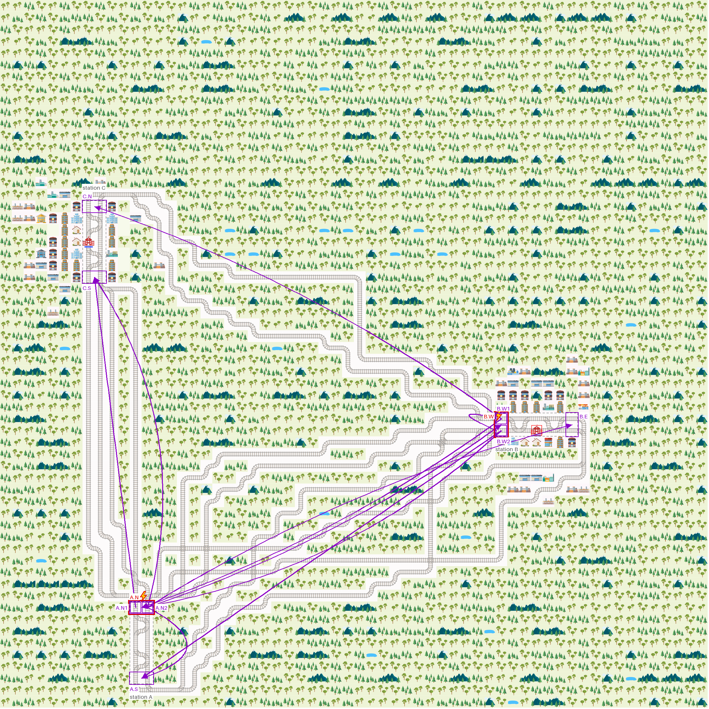
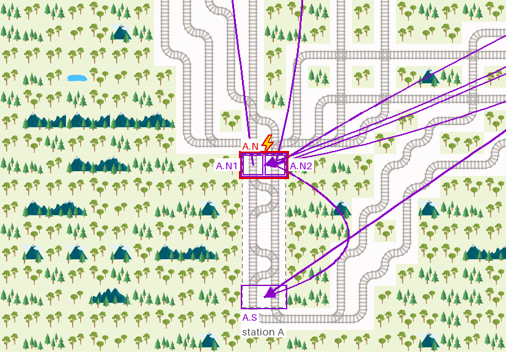
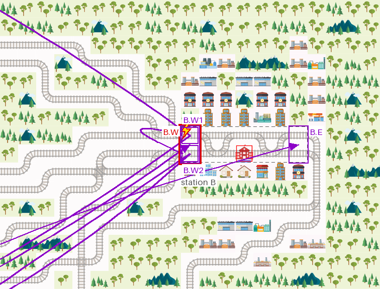
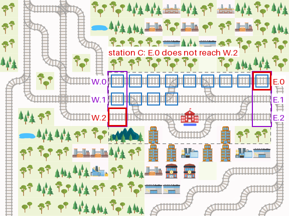

# The stations and links logical model: gates, one model for grid and graph, schema and versions

> **Status:** plan of 2026-11-12, revised 2026-11-13, draft. Based on `main` `bda4a79` and PR [#44](https://github.com/flatland-association/flatland-book/pull/44) (`docs/stations-links-model`, `c4b2865`),
> which adds "Deriving information from the structure", Limitations and "Open points and possible extensions" to
> `environment/environment/stations_links.md`. This plan has no issue or PR yet. Open questions: §9.1.
>
> **Why:** the book names `Gate` but does not say what a gate is, and the two producers of `stations_links` form gates
> differently: `sparse_rail_generator` one per city side, the Flatland Environment Drawing Tool (flatland-scenarios
> [#39](https://github.com/flatland-association/flatland-scenarios/pull/39)) from a station area the user draws.
> Checks on sparse envs and on ECML2026 show that the obvious definitions disagree. This plan collects them, and the
> other open points found on the way; the definition is decided (Q-1, Q-18, definition box in §4), so the book can
> state it (S-2).
>
> The plan grew from the gate definition into the specification of the model's version 2.0.0, which the book's Logical
> Model section describes: one model for grid and graph (every field a resource, a generic placement and outline, the
> area replacing `edges`), what consumers draw (display name, kinds, §8.4's map of every scenario format), and the
> schema with its extension points and versioning rules (§8.3). Renamed from `stations-links-gate-definition` on
> 2026-11-13.

## 1. Introduction and goals

*What the change is for: the requirements, the qualities that matter, who has a stake, and what it leaves out.*

### 1.1 Requirements overview (functional requirements)

*The issue's text and the numbered requirements the rest of the plan refers to.*

> Add the gate definition discussion and anything else on possible extensions/open points from this session to a new
> plan in flatland-book. (the user, 2026-11-12)

Requirements:

- **REQ-1** The book defines `Gate` (and with it `Pin`): what a gate groups, and which rule a producer's gates must satisfy
  (Q-1–Q-3).
- **REQ-2** The book says how a gate relates to the station area and to `Link`s (Q-4, Q-5).
- **REQ-3** The book's "Open points and possible extensions" and Limitations list what this plan leaves open, with the facts
  found (§4.4).
- **REQ-4** Every open point of the page's "Open points and possible extensions" (PR
  [#44](https://github.com/flatland-association/flatland-book/pull/44)) is addressed: decided here, or a question here
  with options and a proposal (§4.5). Added 2026-11-12.
- **REQ-5** A station's pins are complete: every transition from its area to outside starts at a pin of one of its
  gates. The book states it with the pin definition; where a station has an area (Q-4 b)), producers and readers can
  check it (§1.4). Added 2026-11-13.
- **REQ-6** The model has a schema, one per binding (grid; graph; graph with geographic coordinates; Q-13), owned by
  flatland-rl; every document a producer writes validates against it, and it names the extension points (NFR-4).
  Added 2026-11-13.
- **REQ-7** The model is versioned: every document carries the format's `version`, `MAJOR.MINOR.PATCH`; optional
  additions are minor, removals and renames major, and a removed name is never reused; a reader reads its major,
  converts older ones it supports and refuses others with a message naming the version (§8.3). Added 2026-11-13.

### 1.2 Quality goals (non-functional requirements)

*The few qualities the design must reach, each with a concrete scenario.*

| ID | Priority | Quality goal | Scenario |
|---|---|---|---|
| NFR-1 | 1 | Checkable | A reader can test a producer's gates against the definition with the data and the grid alone, as done in §4.3. |
| NFR-2 | 2 | Producer-neutral | The definition holds for `sparse_rail_generator` and the drawing tool alike, or the book says which one breaks it and where. |
| NFR-3 | 3 | Grounded in the domain | The definition maps to the railway terms of the book's terminology table (Kopf, Einfahrweiche). |
| NFR-4 | 4 | Extensible by producers | The model defines its extension points: where a producer or consumer may add its own data (e.g. the drawing tool a station colour, flatland-ui-hub a display field, a future fibre priority, Q-10) without a change in flatland-rl, without conflicting with core fields or with other owners, and without breaking readers that do not know it. Added 2026-11-13. |
| NFR-5 | 5 | Backwards compatible | Files written before a change still load: old `.pkl`s (cells, without the new fields) and documents of an older `version` (REQ-7), converted on load; new fields are optional (DP-10). Added 2026-11-13. |
| NFR-6 | 6 | Human-readable, machine-diffable | A person reads a document without tools, and changing one station, link or train changes only that element's lines in a `git diff` (deterministic output). So that snapshots can later be stored as increments against a base, e.g. per step in evaluation trajectories. Added 2026-11-13. |
| NFR-7 | 7 | Fast and small | (De)serializing is fast and small enough for today's uses of `.pkl` (loading envs for evaluation, storing trajectories); benchmarked against `.pkl`, budgets set when it is implemented. Added 2026-11-13. |

### 1.3 Stakeholders

*Who asks for the change, decides on it, reviews it or works with the result, and what they expect.*

| Role | Name | Expectations |
|---|---|---|
| Asks, decides | flatland-association maintainers | One definition of `Gate` that both producers follow. |
| Producer | `sparse_rail_generator` (flatland-rl) | Splits its gates where they break R-5 (Q-2 a)). |
| Producer | Drawing tool (flatland-scenarios PR #39) | Knows how to form gates from a drawn area, and what to check when the user saves one. |
| Reader | flatland-ui-hub, flatland-hmi (C-7), flatland-rl's planned exchange format (`docs/plans/flatland-scenario-exchange-format.md`) | Can rely on what a gate means when following links and chains; flatland-ui-hub draws stations from general fields (Q-15) and keeps its own data as extension data (§8.4). |

### 1.4 Follow-ups (not in this PR)

*What this PR leaves out, why, and where it goes later.*

| Follow-up | Why not in this PR | From | Findings | Issue |
|---|---|---|---|---|
| Drawing tool: split gates by R-5 on export (Q-2 a)), or check it when an area is saved (next to `stationAreaError`) | Code in flatland-scenarios. Starts from one gate per side, flatland-scenarios PR #39 plan's S-19 (its Q-2 revisited, decided 2026-11-13) | Q-1, Q-4 | - | draft: [`flatland-scenarios-drawing-tool-gates`](stations-links-logical-model/issue-flatland-scenarios-drawing-tool-gates.md) |
| `sparse_rail_generator`: split gates where they break R-5 (Q-2 a)) | Code in flatland-rl | Q-1, §4.3 | - | draft: [`flatland-rl-sparse-gates-and-links`](stations-links-logical-model/issue-flatland-rl-sparse-gates-and-links.md) |
| `Link`s from the grid: one fibre per connected pin pair, `edges` all routes, one link per gate pair | Code in flatland-rl (`sparse_rail_generator`) and flatland-scenarios (the tool exports no links yet) | Q-5 | - | draft: [`flatland-rl-sparse-gates-and-links`](stations-links-logical-model/issue-flatland-rl-sparse-gates-and-links.md) |
| A priority on `Fibre` (links and gate links), a future extension: an optional field, absent meaning normal; until then in the fibre's extension data | No producer needs one yet; the form (ordinal, levels, cost) is decided when it is added (Q-10) | Q-7, Q-10 | - | draft: [`flatland-rl-fibre-priority`](stations-links-logical-model/issue-flatland-rl-fibre-priority.md) |
| A `Track` element (number, extent, platform) referenced by stopping points, filled by both producers, in a later schema version (Q-16) | Code in flatland-rl and both producers; its exchange form in the exchange-format plan (its Q-9 follows Q-11) | Q-11, Q-16 | - | draft: [`flatland-rl-track`](stations-links-logical-model/issue-flatland-rl-track.md) |
| An optional area on `Station` (its rail resources, replacing `edges`) and an optional `Placement.outline`, filled by both producers | Code in flatland-rl; its exchange form in the exchange-format plan | Q-4, Q-8, Q-14 | - | draft: [`flatland-rl-station-area`](stations-links-logical-model/issue-flatland-rl-station-area.md) |
| `GateLink` like `Link` (fibres through the station between two of its gates), stored in `StationsLinks`, and `Chain` in `stations_links.py` (Q-6) | Code in flatland-rl; the exchange-format plan's Q-13 follows Q-6 | Q-6 | - | draft: [`flatland-rl-gate-links-and-chains`](stations-links-logical-model/issue-flatland-rl-gate-links-and-chains.md) |
| A check of unique gate and pin names in `StationsLinks` | Code in flatland-rl; the book now states it as an assumption | §2.2 | - | draft: [`flatland-rl-stations-links-checks`](stations-links-logical-model/issue-flatland-rl-stations-links-checks.md) |
| A check that a station's pins are complete (REQ-5) where it has an area: every transition from the area to outside starts at a listed pin, in `StationsLinks` next to the name check | Code in flatland-rl; needs the area (Q-4 b)) | REQ-5 | - | draft: [`flatland-rl-stations-links-checks`](stations-links-logical-model/issue-flatland-rl-stations-links-checks.md) |
| Drawing tool: the same check when an area is saved, next to `stationAreaError` | Code in flatland-scenarios | REQ-5 | - | draft: [`flatland-scenarios-drawing-tool-gates`](stations-links-logical-model/issue-flatland-scenarios-drawing-tool-gates.md) |
| A check that a natively built graph has every move's reverse at the same resource (double-vertex assumption) | Code in flatland-rl (`GraphRailEnv.from_graph`); flatland-scenarios PR #36 verifies it already | §2.2, Q-17 | - | draft: [`flatland-rl-stations-links-checks`](stations-links-logical-model/issue-flatland-rl-stations-links-checks.md) |
| Drawing tool: check station names on import and in the stations text area | flatland-scenarios PR #39 plan, F-19 (S-21) | §2.2 | - | - |
| The extensions of §4.4 (tracks, producer data, exchange, graph, directions, visualization) | Each needs its own decision and code in flatland-rl | §4.4 | - | - |
| `stations_links` typed by the env's resource type, generic for `RailEnv` and `GraphRailEnv`, old pickles staying readable (§8.2) | Code in flatland-rl, planned in the exchange-format plan's S-4; an issue is drafted there (`issue-generic-stations-links.md`), not created yet | Q-14 | - | - |
| One generated JSON schema per binding, with a root `binding` | Code in flatland-rl: the exchange-format plan's S-2 | Q-13 | - | - |
| Loops of the open line back to the own station as `Link`s, made by both producers | Code in flatland-rl (with Q-5's derived links) and flatland-scenarios | Q-19 | - | draft: [`flatland-rl-sparse-gates-and-links`](stations-links-logical-model/issue-flatland-rl-sparse-gates-and-links.md) |
| The page's diagram replaced by the planned model of §5.1 | Only once flatland-rl implements it; until then the page shows the code | §5.1 | - | - |

## 2. Constraints

*What limits the design from outside: platform, organisation and conventions.*

| ID | Constraint | Kind | Explanation |
|---|---|---|---|
| C-1 | The model is flatland-rl's | organisational | `flatland/envs/stations_links.py` (4.3.0) holds the classes; the book documents them. A definition the code does not check is an assumption on producers. |
| C-2 | Station areas are not in the model | technical | `Station` has `edges` (cells), no area; the drawing tool keeps its rectangle only in its own export (`area`). |
| C-3 | Two producers | organisational | `sparse_rail_generator` (flatland-rl) and the drawing tool (flatland-scenarios, PR #39, not merged). |
| C-4 | General terms for grid and graph | conventions | The data model uses the terms of flatland-book PR [#42](https://github.com/flatland-association/flatland-book/pull/42) (takes over [#39](https://github.com/flatland-association/flatland-book/pull/39)), "Flatland Data and Simulation Model": **entry point** (grid: a cell and the direction it was entered, `((r, c), d)`; graph: a node), **transition** (a pair of entry points; grid: from a cell into the next, graph: an edge; as PR #42's data model and flatland-rl's `TransitionMap`; "configuration", the entry point's name up to 4.3.0, is not used, Q-17), **resource** (what an agent holds on an entry point, from the resource map; grid: the cell, or the cell and the axis at level-free crossings; graph: the mapped resource), transition map, resource map. Cells, rectangles and sides are the grid binding only (the grid's `CoordinateT`, Q-12), never the general model (§3.1). |
| C-5 | Page conventions | conventions | The page uses the book's terminology tables and Mermaid diagrams; plans are not built as pages (`_config.yml` `exclude_patterns`). |
| C-6 | This plan stands alone | organisational | The decisions on the model are taken here and do not depend on flatland-rl's exchange-format plan (`docs/plans/flatland-scenario-exchange-format.md`), which builds on this plan and must stay compatible with it. References to it only say where a decision is implemented. |
| C-7 | Consumers: flatland-ui-hub, flatland-hmi | organisational | flatland-ui-hub reads `env.stations_links` from its experiment scenarios' `.pkl`s into its station geography (`_stations_links_geography`: `name`, `stopping_points`) and has its own station formats (§8.4); flatland-hmi reads `name` and `stopping_points`. Neither reads `edges`, gates or links today. The model serves them with general fields (`display_name`, `kind`, places without tracks, Q-15), never with a field for one consumer; what only one consumer needs is its extension data (§8.3). Their adapters live in their repos (the exchange-format plan's §4.7). |

### 2.1 Limitations

*What the built code gets wrong or ignores, each with the TODO or issue that tracks it.*

This plan changes documentation only; the model's limitations are in the page's Limitations section. What the
documented definition leaves unchecked:
- No code checks the gate definition (R-5); the checks of §4.3 are scripts run for this plan, on grid producers only
  (sparse, ECML2026). Graph producers are not checked. Follow-ups: §1.4.
- Loops of the open line back to the own station are not recorded by any producer yet (Q-19 decides them as
  `Link`s; §1.4).
- `Link`s are the lines as built until producers derive them from the transition map (Q-5, §1.4); the page keeps
  this limitation.

### 2.2 Assumptions

*What must hold for the design to be correct, but is not checked in code.*

Not checked in code; they hold by construction of the producers.

- Gate and pin names are unique across all stations (the page's Logical Model assumption; both producers qualify
  names with a unique station name).
- Stations are disjoint (`Station` "covers a certain (disjoint) set of the infrastructure").
- The double-vertex assumption (box below).
- Trains are points: a train occupies one resource at a time. A stopping point is then one resource, the same for
  both directions (Q-17). In the real world it is not: a train stops with its head at a stop board, at a different
  place in each direction and for each train length.
- Every track enters a station at a pin: now REQ-5, part of the definition, checked where a station has an area
  (§1.4). The walk along the line (Q-18) relies on it; where a producer breaks it, the walk goes on through that
  station (§4.3). Both producers meet it on the data checked (§4.3: stopping at the first station resource and at the
  first pin give the same reach).
- ECML2026's station areas are the drawing tool's rectangles as reconstructed for this plan (§4.2); the numbers of
  §4.3 hold for them.

> [!WARNING]
> **Double-vertex assumption.** Every move has its reverse at the same resource (Montigel's double-vertex graph): at
> the same, otherwise undefined, place there is always a node (graph) or an incoming and outgoing direction (cell)
> for the opposite direction.
> - A fact of the railway domain: there are no one-way tracks. A track can be driven in both directions; running one
>   way only is an operational choice (timetable, signalling), not topology.
> - What relies on it:
>   - the model holding only resources (Q-14 revisited, Q-17): a pin's inward and outward entry points, a stopping
>     point valid in both directions, and a fibre's routes all follow from resources and the transition map;
>   - the symmetric "links to" and R-5;
>   - undirected links and gate links (Q-5, Q-6), and following a chain in both directions (Q-9).
> - Where it holds: on grid (checked 2026-11-13: none of 6,560 ECML2026 and 700,736 sparse moves lacks its reverse),
>   for graphs converted from a grid, and for flatland-scenarios PR
>   [#36](https://github.com/flatland-association/flatland-scenarios/pull/36)'s OSM import by construction (one
>   resource per track node, edge duality verified, OSM `oneway` not used for travel).
> - A producer that breaks it builds a wrong topology. A check for natively built graphs is a follow-up (§1.4).

## 3. Context and scope (checked 2026-11-12 on PR #44 `c4b2865`, flatland-rl `v4.3.0`, flatland-scenarios `150782e`)

*The code on the base branch that the change works in, as it is before the change, and where the change stops.*

- **The page** `environment/environment/stations_links.md`: Logical Model ("`Station`s have `Gate` consisting of
  `Pin`s where `Link`s / `Fibre`s can start and end"), the diagram (`Gate --> "1..*" Pin`, `GateLink --> "2" Gate`,
  note "Fibres must not go through other stations"), the terminology tables (Gate = the side of a Kopf towards the
  line, Pin = a track crossing the station boundary), "Deriving information from the structure" (a gate's side, at
  most one gate per side in sparse), Limitations and Open points (gate links).
- **`sparse_rail_generator`** (`flatland/envs/rail_generators.py`): `_generate_city_connection_points` gives each
  city connection points on exactly two opposite sides with the same number of out rails; `_extract_stations_links`
  makes one gate per side with pins (`if len(connection_area) > 0`); `_build_inner_cities` joins each pin `X.k` to
  pin `Y.k` of the opposite side by one straight track; `_connect_cities` draws inter-city lines into existing track
  (`forbidden_cells=city_cells`), and each drawn line becomes a `Fibre`.
- **Drawing tool** (`scenario_generator/flatland_environment_drawing_tool.html` at `150782e`): the user drags a
  station area (`stationAreas[id]`, checked by `stationAreaError`: holds all of the station's platform cells and no
  other station's, no overlap); `stationTracks` collects the cells joined to the platforms by track inside the area;
  `stationGates` makes a pin of every cell where such a track leaves the area and a gate of every run of adjacent pins
  on one side (`N`, or `E1`, `E2`, … when a side has several). No `links` are exported.

Scope: the page only. Code changes in flatland-rl and flatland-scenarios are follow-ups (§1.4).

### 3.1 General terms and their grid and graph binding

*The words the data model uses, so that it holds for `RailEnv` and `GraphRailEnv` alike.*

From flatland-book PR [#42](https://github.com/flatland-association/flatland-book/pull/42) (takes over [#39](https://github.com/flatland-association/flatland-book/pull/39)) (`key-concepts/simulation_model.md` on `docs/flatland-rl-5`, `0dd2d37`): grid and graph share
one `step()` that only sees entry points; `AbstractRailEnv[TransitionMapT, ResourceMapT, EntryPointT]`. Its rail
glossary already defines the model's elements in these terms: "Stopping Point: entry points where agents can stop",
"Pin: a single entry point attached to a gate", "Fibre: a sequence of transitions linking two pins of a link".

| General term | Grid (`RailEnv`) | Graph (`GraphRailEnv`) |
|---|---|---|
| Entry point (up to 4.3.0 called configuration) | `((r, c), d)`: cell and the direction it was entered | a node (`str`) |
| Transition (Q-17 b); not "configuration") | a pair of entry points: from a cell into the next one | a directed edge between two nodes |
| Resource | the cell; at a level-free crossing the cell and the axis | the resource `GraphResourceMap` maps a node to |
| Station area (`Station.area`, Q-4 b), Q-8, Q-14) | the station's rail resources: the rail cells inside the drawn rectangle or city square (replaces `Station.edges`, the station's extent) | the station's resources (track nodes) |
| Station outline (`Placement.outline`, Q-12, Q-14) | the drawn rectangle's corner cells, `(r, c)` | a polygon of `CoordinateT`: `(r, c)` when converted from a grid, `(lat, lon)` for a geographic graph; none without coordinates |
| Side of a station, gate key `N`/`E`/`S`/`W` | the outline's side, the heading of a leaving train | none; a gate key is an opaque string |

The model is generic, `StationsLinks[ResourceT, CoordinateT]`, as flatland-rl types its envs and maps
(`AbstractRailEnv[TransitionMapT, ResourceMapT, EntryPointT]`, `ResourceMap[EntryPointT, ResourceT]`). Its type
parameters and what they are bound to (checked 2026-11-13 on flatland-rl `main`: `RailEnv` is
`AbstractRailEnv[GridTransitionMap, GridResourceMap, Tuple[Tuple[int, int], int]]`, `GraphRailEnv` is
`AbstractRailEnv[GraphTransitionMap, GraphResourceMap, str]`):

| Type parameter | What it is | Grid (`RailEnv`) | Graph (`GraphRailEnv`) | Model fields (Q-14 b)) |
|---|---|---|---|---|
| `EntryPointT` | where a train is, with the direction it came from | `Tuple[Tuple[int, int], int]`: `((r, c), d)`, the cell and the direction it was entered | `str`: a node, `"(r, c, d)"` when converted from a grid | - (the model keeps none since Q-17; entry points follow from the transition map) |
| `TransitionT` | a move from one entry point to the next | `Tuple[EntryPointT, EntryPointT]`: from a cell into the next one | `Tuple[str, str]`: a directed edge | - (the model keeps none since Q-14 revisited; routes and pins are defined with them) |
| `ResourceT` | what a train occupies, at most one train at a time | `(r, c)`, the cell; `((r, c), d % 2)`, the cell and the axis, at a level-free crossing (`GridResourceMap.get_resource`) | `str`: what `GraphResourceMap` maps a node to; converted from a grid (`GraphRailEnv._grid_resource_map`): `"(r, c)"`, the cell; `"(r, c, d % 2)"`, the cell and the axis, at a level-free crossing (e.g. `"(3, 4, 1)"`; flat, unlike the grid's nested `((r, c), d % 2)`) | every field (Q-14 revisited): `Station.area` (Q-8), `Station.edges`, `Fibre.edges`, `Pin.node`, `StoppingPoint.node`, `Track.extent`, `Track.platform` (Q-17) |
| `CoordinateT` (Q-12 d)) | where a station is drawn; a parameter of the env too, so the env fixes it | `Tuple[int, int]`: `(r, c)` | converted from a grid: `(r, c)`, as the grid; built natively, e.g. from OSM: `(lat, lon)` | `Station.placement.position` (Q-12) |

`TransitionT` is an alias, not a parameter of its own: a transition is a pair of entry points (box below). The model holds
only resources (Q-14 revisited, Q-17), so its rail fields need `ResourceT` alone; with the placement (Q-12) it is `StationsLinks[ResourceT, CoordinateT]`; entry points
and transitions follow from the resources through the env's transition map and resource map, under the
double-vertex assumption (§2.2).

> [!NOTE]
> **`TransitionT` (this plan) is not `TransitionsT` (flatland-rl).**
>
> | | `TransitionT` | `TransitionsT` |
> |---|---|---|
> | What it is | **one** transition: a move from one entry point to the next | a transition map's **encoding of all** transitions at a cell |
> | Defined | here, `TransitionT = Tuple[EntryPointT, EntryPointT]` (Q-17 b)) | flatland-rl, `TransitionMap(Generic[EntryPointT, TransitionsT, TransitionsValidityT, ActionsT])` |
> | Grid | `(((r, c), d), ((r', c'), d'))`: from a cell into the neighbouring one | `Grid4Transitions`, which encodes the cell's 16-bit field: 4 entry directions × 4 exit directions |
> | Graph | `(str, str)`: a directed edge | `GridEdge = Tuple[str]` in `GraphTransitionMap` |
> | Used by | the definitions (route, pin, links to); not stored in the model (Q-14 revisited) | `set_transitions(entry_point, new_transitions)`, `get_full_transitions(row, column)`; `get_transitions(entry_point)` returns the validity flags (`TransitionsValidityT`) of one entry point's exits |
>
> - One `TransitionT` corresponds to one set flag in a `TransitionsT`: a valid exit of one entry point, together with
>   the entry point it leads to.
> - Not "configuration": up to flatland-rl 4.3.0 that named an entry point, flatland-book PR #39 (and PR #42's note
>   in `railway_features.md`) use it for the agent's current pair, and flatland-rl #129 for what builds an env.
>   flatland-rl [#549](https://github.com/flatland-association/flatland-rl/issues/549) drops it and keeps the agent state
>   flat: `current_entry_point` and `next_entry_point` as fields of their own, no pair object; its leftovers are
>   reworded to "agent state" or "`current/next_entry_point`". Q-17 b) uses none of these meanings: the two entry
>   points span a transition, but the agent state does not store one.

The checks of §4.3 run on grid producers, so they speak of cells; the decisions of §9 are stated in the general
terms, with the grid form named where it differs.

### 3.2 Logical model: current

*The page's class diagram as it is on PR #44, with the code's field names.*

Source: the Logical Model diagram of `environment/environment/stations_links.md` (PR
[#44](https://github.com/flatland-association/flatland-book/pull/44), unchanged since 4.3.0) and
`flatland/envs/stations_links.py` (flatland-rl `v4.3.0`).



Notation: [UML class diagram in Mermaid](https://mermaid.js.org/syntax/classDiagram.html). In the code (4.3.0) every
`node` and every element of `edges` is a cell (`IntVector2D`), not a node or a pair of nodes; `GateLink` and `Chain`
are not implemented.

## 4. Solution strategy

*The fundamental choices and why, the rules the design follows, how it is verified, and the design of each part.*

| Quality goal | Scenario | Solution approach | Details |
|---|---|---|---|
| Checkable | test gates with data and grid | A definition stated as a reachability rule over pins, with the check described | §4.3, Q-1 |
| Producer-neutral | both producers | Results per producer recorded; a split rule where they fail | §4.3, Q-2 |
| Grounded in the domain | Kopf, Einfahrweiche | Keep the terminology rows; add the rule to the Gate row | Q-1 |
| Evolvable (NFR-4, NFR-5) | `Track` added after the first schema | Semver versions, a closed core with extensions, extension data promoted into the core | §8.3 |

> [!IMPORTANT]
> **Definition: Gate** (decided: Q-1 d), Q-2 a), Q-3 b), Q-4 b), Q-8, Q-9 d), Q-18 b); checks in §4.3)
>
> - A **route** is a sequence of transitions the transition map allows, each starting at the entry point where the
>   previous one ends (§3.1).
>   - A path a train can drive. Route, pin and "links to" are terms of the transition map (the topology), not of the
>     model's classes.
> - A **pin** of a station is a resource of its area with a transition to a resource outside the area. The
>   station's boundary is part of the station, so its pins are too.
>   - The model stores the resource (`Pin.node: ResourceT`, Q-17). Its entry points, inward and outward, follow from
>     the transition map: the transitions to the outside and, by the double-vertex assumption (§2.2), their
>     reverses.
>   - Where a track leaves the station: the pin is the last resource inside, the next one on the route is outside.
> - A station's pins are **all** of them: every transition from its area to outside starts at a pin of one of its
>   gates (REQ-5).
>   - A boundary resource without such a transition (e.g. a platform's end) is no pin. Without an area the pins
>     are the boundary, so the statement holds by definition and cannot be checked.
> - A pin `p` **links to** a pin `q` when some route leaving the station at `p` meets `q` as the first pin after `p`
>   (Q-18 b)). A pin links to a gate when it links to one of the gate's pins.
>   - `q` may be in any station, also in `p`'s own (a loop of the line back to the station, Q-19).
>   - The verb is not one of the classes: a `Link`'s fibre from `p` to `q` exists when `p` links to `q`, whether the
>     two pins are in different stations or in the same one (Q-19; once links are derived from the transition map,
>     Q-5); a `GateLink` bundles
>     fibres through a station, from one of its gates to another (Q-6), which "links to" never covers.
> - A **gate** is a set of pins on one side of one station (grid: a side of the area; graph: a group the producer
>   gives). The gates are the **coarsest** grouping of each side's pins in which all pins of a gate link to the same
>   set of gates (R-5, the corridor rule).
>   - Each pin links to *some* pin of every one of these gates, not necessarily every pin: two parallel tracks between
>     `A` and `B` count once.
>   - The pins of a gate need not be adjacent: other pins or no track may lie between them (Q-3 b)).
>   - On a graph there are no sides: the producer's grouping takes their place.
>   - Finding them: start from the sides (or the producer's grouping), split each gate by the gates its pins link to,
>     and repeat until nothing changes. The result is unique and does not depend on the order of the splits.
> - **Not part of the definition:** which pin links to which pin, inside the station and on the line.
>   - On the line, between gates of two stations: whether the routes run as parallel tracks, are joined by crossovers
>     (Spurwechsel), or fork and join on the way, does not matter; only which gates a pin links to does. Which pins
>     connect is recorded by the fibres of the `Link` between the two gates (Q-5).
>   - Inside a station, between two of its gates: the same; which pins connect through the station is recorded by the
>     fibres of the `GateLink` between the two gates (Q-6), with no rule or assumption on them (Q-9 d)).

### 4.1 Design principles

*The rules the design follows, each with its decision, the concepts it reuses instead of building new ones, and what
is not new on purpose.*

- **DP-1 A gate is defined by what its pins reach along the line, up to the first pin (Q-18), not by how a producer draws it.**
  The station's inner topology (crossovers, parallel tracks, which pin reaches which inside) does not matter for
  gates; it is the concern of `GateLink` (Q-6). Sides and drawn areas are how producers form gates today; the
  definition says what must hold for any producer. (Q-1)
- **DP-2 Same structure, different type.** Every element of the model is typed generically, as `AbstractRailEnv` is:
  every field holds resources of the env's resource type; entry points and transitions follow from them and the
  transition map (Q-14 revisited, Q-17). Grid and graph producers fill the same structure; a grid-only encoding (a side) is derived from it, never in its
  place; the drawn shape is the generic `Placement.outline` of `CoordinateT`, not a grid-only rectangle. (Q-8, Q-14)
- **DP-3 General terms for the model, grid terms only for the grid binding.** The data model is stated with entry points,
  transitions and resources (flatland-book PR [#42](https://github.com/flatland-association/flatland-book/pull/42) (takes over [#39](https://github.com/flatland-association/flatland-book/pull/39))); cells, rectangles and sides appear only in the grid binding (§3.1).
- **DP-4 Facts before rules.** Each candidate rule is checked on sparse envs and on ECML2026 before it is proposed (§4.3).
- **DP-5 The page states what is decided; open points stay in "Open points and possible extensions".** (REQ-3)
- **DP-6 Derived relations are stored, not derived on demand.** Links and gate links are derived from the transition
  map by the producer and stored in `StationsLinks`, so readers need no topology code. (Q-5, Q-6)
- **DP-7 The topology is complete; bad routes are not left out.** A priority to mark them is a future extension,
  added as an optional field (Q-7, Q-10).
- **DP-10 Extensible without breaking readers (NFR-4).** New fields are optional with a default that means "as before";
  producer- or consumer-specific data goes into extension data until it proves general; the schema `version`
  marks what moves into the core. (Q-10, Q-13)
- **DP-8 The station's boundary is data, not a convention.** (Q-4, Q-8)
- **DP-9 The schema is the contract, one schema per binding.** Tools choose their own (de)serialization code. (Q-13)

Reused concepts:

| Need | Reused concept | Instead of |
|---|---|---|
| Where a train goes from a pin | `Fibre`: wayside in a `Link`, in-station in a `GateLink` (Q-6) | A new route concept |
| Gates of one station that a train passes through | `GateLink` (diagram, not implemented) | A new in-station relation |
| Where the station ends | The pins at the boundary of the optional area (Q-4 b), Q-8): the station's rail resources, grid: the rail cells inside the tool's drawn rectangle; the drawn shape as the placement's outline (Q-14) | A convention on where the boundary lies (Q-4 a), not taken) |
| Gates and areas a user draws | The drawing tool's `stationGates` and `stationAreas` (flatland-scenarios PR #39) | A new editor model |
| What a train occupies | `ResourceT` of `GridResourceMap` and `GraphResourceMap` | A station-specific cell or resource type |
| Generic types in the exchange | pydantic v2 generic models and JSON Schema (Q-13) | A hand-written schema per binding |

Not new on purpose: the classes of `stations_links.py`; the names (`<station>.<gate>`, `<station>.<gate>.<index>`).

### 4.2 Verification

*How each requirement and quality goal is shown to work: tests, CI checks, before and after screenshots.*

Screenshots: ECML2026 `level_0_scenario_1` (flatland-scenarios `competitions/competition_2026`) drawn on the
starter kit's `docs/competition_map.png` (4 px per cell, no offset; 97 % of the platform cells fall on its station
dots). Sparse: the example envs of §4.3 rendered with `RenderTool` (`PILSVG`, 36 px per cell, flatland-rl v4.3.0).

| ID | Requirement | Test or check | Result | Screenshots |
|---|---|---|---|---|
| REQ-1 | Gate definition | The candidate rules of §4.3 checked on sparse (30 seeds × 3/5/8 cities × 1-3 rail pairs × 1-3 rails between cities, 60×60, v4.3.0) and ECML2026 | §4.3 | [`ecml2026-gate-links.png`](stations-links-logical-model/ecml2026-gate-links.png), quarters [`q1`](stations-links-logical-model/ecml2026-gate-links-q1.png), [`q2`](stations-links-logical-model/ecml2026-gate-links-q2.png), [`q3`](stations-links-logical-model/ecml2026-gate-links-q3.png), [`q4`](stations-links-logical-model/ecml2026-gate-links-q4.png); sparse [`sparse-r5-gate-links.png`](stations-links-logical-model/sparse-r5-gate-links.png) (details [`a`](stations-links-logical-model/sparse-r5-gate-links-a.png), [`b`](stations-links-logical-model/sparse-r5-gate-links-b.png)), [`sparse-r3-in-station.png`](stations-links-logical-model/sparse-r3-in-station.png) |
| REQ-2 | Area and links | The page's Gate and Pin rows and the diagram read against Q-4, Q-5 | open | - |
| REQ-3 | Open points | The page's list compared with §4.4 | open | - |
| REQ-4 | The page's open points addressed | Each open point of the page has a row in §4.5: decided, or a question with options and a proposal | §4.5 | - |
| REQ-5 | Complete pins | the checks of §4.3 (stopping at the first station resource and at the first pin give the same reach on sparse and ECML2026); a check in flatland-rl and the drawing tool (§1.4) | §4.3 | - |
| REQ-6 | Schema | the example files validate against their binding's schema; one with an owner's extension too | open | - |
| REQ-7 | Versioned | a document of the current, an older, a newer minor and an unknown `version`; §8.3's `Track` steps as cases (a 2.1.0 document with tracks read by a 2.0 reader, a 2.0.0 document with flatland-ui-hub's track extension promoted on read) | open | - |
| NFR-1 | Checkable | The checks of §4.3 run on the data and the grid alone (sparse, ECML2026) | §4.3 | - |
| NFR-2 | Producer-neutral | Both producers checked against each rule; where they break it, §4.3 and the Limitations say so | §4.3 | - |
| NFR-3 | Grounded in the domain | The page's Gate row states the rule in Kopf terms (S-2) | open | - |
| NFR-4 | Extensible by producers | The schema names the extension points (§8.3); a document with an owner's extension data validates, a reader that ignores it reads the same core, and a round trip keeps it; the example files carry one (`extensions` on `C`, §5.1) | open (needs the schema, flatland-rl) | - |
| NFR-5 | Backwards compatible | an old `.pkl` and a document of an older `version` load (implemented in flatland-rl) | open | - |
| NFR-6 | Human-readable, machine-diffable | the example files (§5.1) read without tools; writing the same model twice gives identical bytes; renaming one station changes only its lines and the references to it | open | - |
| NFR-7 | Fast and small | a benchmark against `.pkl` on the ECML2026 scenarios (implemented in flatland-rl) | open | - |
| - | Build | `jupyter-book build` without new warnings | open | - |

### 4.3 Candidate gate rules and what the producers do (REQ-1; Q-1, Q-2)

*The rules a gate could satisfy, checked on both producers.*

A pin *reaches* a gate **through the station** when a train entering at the pin can leave the station through one of
the gate's pins, moving only over the station's cells. A pin *links to* a gate **along the line** when it links
to one of the gate's pins: some route leaving the station at the pin meets that pin first (definition box, Q-18 b);
a `Link`'s fibre when the two pins are in different stations). "Same gates" compares sets of gates, not single pins.

R-5 is a corridor rule: a link connects two gates `A` and `B`, and every pin of `A` links to *some* pin of `B` along
the line, not every pin of `B`. Two parallel tracks between `A` and `B` (`A.0` to `B.0`, `A.1` to `B.1`, no crossover
on the line) satisfy it, and so do tracks that join or fork on the way, as long as every pin of `A` links to the same
gates (with a fork to `C`, every pin of `A` must link to some pin of `B` and some pin of `C`). Which pin of `B` a train arrives at is the pin-level detail of the fibres, not part of the
gate rule.

| Rule | `sparse_rail_generator` | ECML2026, gates as the drawing tool forms them |
|---|---|---|
| R-1 By side: all pins of one side form one gate | Holds by construction (two gates per city, opposite sides). | Not a rule there: the tool numbers runs of pins (`E1`, `E2`); PR #39 plan Q-2 b) decided one gate per side (S-19, not built). |
| R-2 Adjacent run: a gate is a run of adjacent pins on one side | Holds (the out rails of a side are adjacent). | The tool's rule today (`stationGates`). |
| R-3 All-to-all through the station: every pin of one gate reaches every pin of the other (exchange-format plan Q-13, the proposed `GateLink` rule) | Fails with 3 rails between cities: 6 of 15 cases; e.g. seed 0, 5 cities, 2 rail pairs, city `C`: `C.E.0` reaches `C.W.0`, `C.W.1`, not `C.W.2` (patch `flatland-rl-sparse-gates-connect-all-pins.patch` in the exchange-format plan). Holds with 1-2 rails. | Not checked separately; stricter than R-4. |
| R-4 Same gates through the station: all pins of a gate reach the same set of other gates | Holds for all 8,640 gates. Argued from the construction: two gates per station, so the rule reduces to "every pin reaches the opposite gate", which the straight track `X.k`-`Y.k` gives; the weak step is that the transition repair (`fix_inner_nodes`, `_fix_transitions`) keeps that straight, argued by cases, not proven. | Depends on the area: no failure with the platforms' bounding box + 0-4 cells; at + 6 station 1 (W2, E2: rows 48-51 and 52-55 reach different gates, two 4-track bundles joined only in the middle), at + 8 also stations 16 (E) and 23 (N, E1), where the area takes in junctions of the line. |
| R-5 Same gates along the line (corridor): all pins of a gate link to the same set of gates; each pin reaches some pin of each, not every pin | Fails for 1,075 of 8,640 gates (1,045 ignoring links back to the own gate; 1,101 using the generator's `Link`s); 3,862 gates have a pin linking to more than one gate. Example: seed 0, 3 cities, 1 rail pair, 2 rails between: `A.N.0` links only to `C.S`, `A.N.1` to `A.S`, `B.E`, `B.W`, `C.S`. Inter-city lines join and fork outside the cities. | Fails for 10 of 71 gates (stations 1, 9, 14, 16, 19, 24, 25, 27, 29), areas: + 6 for station 1, + 8 for 16 and 23, else the largest margin up to 4 holding no other station. |
| R-6 By destination: a gate's pins lead to the same neighbouring stations (PR #39 plan Q-2 c), exchange-format plan Q-13 "Destination") | Like R-5 at station level. | ECML2026 station 25 (area around the station throat): `(73,8)` leads only to 26, `(73,9)` only to 27, adjacent on the north side. |

**Splitting to satisfy R-5** (Q-2 a), Q-3 b)): group the pins of each side by their linked gates, adjacent or not, and
repeat until nothing changes, since a split renames gates that others link to. Starting from whole sides, ECML2026
gets 81 gates instead of the tool's 71, none breaking R-5. At station 1 the rows
48-50 and 53-55 of each side link to the same gate (33.E, 32.W) and form one gate, with the pair of rows 51-52, which
leaves on its own line, between them (the images draw such a gate as one frame per run of adjacent pins, with one
label); splitting into runs of adjacent pins only (Q-3 a), not taken) gives 83 gates and keeps them apart. On sparse the same split would turn many two-pin gates into one-pin gates. The purple boxes and arrows
in [`ecml2026-gate-links.png`](stations-links-logical-model/ecml2026-gate-links.png) show it: red frames with a
lightning bolt are the tool's gates that fail, purple the split gates with an arrow to each gate they link to.
The detail of the south-west quarter shows two cases: station 25's `N` splits into `N1` (links only to 26.S) and
`N2` (also to 27.W); station 24's `E` splits into `E1` (links to 19.W, 23.S1 and 23.S2) and `E2` (no 23.S1).
Station 22 is split only because 16.W, the gate its `E` links to, is. Station 11 goes the other way: the tool's
`E1` (row 2) and `E2` (row 4), apart because the row between them has no pin, both link only to each other along the
turning loop east of the station, so they form one gate `11.E` (north-east quarter, red dashed area without a bolt).

The four quarters of the map, enlarged (red: the tool's gates failing R-5, with a lightning bolt; purple: the split
gates of Q-3 b), with an arrow to each gate they link to, and a box at each gate an arrow ends at):

| North-west | North-east |
|---|---|
|  |  |
| **South-west** | **South-east** |
|  |  |

**On sparse**, the R-5 example of the table (seed 0, 3 cities, `max_rail_pairs_in_city=1`,
`max_rails_between_cities=2`, 60×60) has two failing gates, drawn the same way (grey dashed: the city square; red
with a lightning bolt: the generator's gate; purple: the split, with an arrow to each gate a part links to):

- `A.N` splits into `A.N1` (pin 0, links only to `C.S`) and `A.N2` (pin 1, links to `A.S`, `B.E`, `B.W` and `C.S`).
  The lines leave the city on two adjacent rails and part outside it: one rail runs north to `C` only, the other
  joins the network that leads to `B` and loops back to `A`'s south side.
- `B.W` splits into `B.W1` (pin 0, links to `A.N`, `C.N`) and `B.W2` (pin 1, links to `A.N`, `A.S` and back to
  `B.W` itself, the loop drawn west of the gate).

Both edge cases of Q-7's note show here: `A.N2` reaches another gate of its own station (`A.S`), `B.W2` its own gate.

| Whole map | `A.N` (detail a) | `B.W` (detail b) |
|---|---|---|
|  |  |  |

The R-3 example of the table (seed 0, 5 cities, `max_rail_pairs_in_city=2`, `max_rails_between_cities=3`, city `C`):
the blue squares are the cells a train entering at `C.E.0` can reach inside the city. It reaches `C.W.0` and
`C.W.1`, but `C.W.2` (red) lies on a track of its own. R-4 holds (every pin reaches the opposite gate), R-3 does not;
under Q-9 d) the gate link `C.E`-`C.W` records the pin pairs that connect.



**The split does not depend on the order** in which gates are split. It only splits, never merges, so it ends after
at most as many splits as there are pins. Every split it makes is forced: two pins of one gate that link to different
gates are in different gates in every grouping that satisfies R-5. So whatever the order, the result contains exactly
the forced splits: the unique coarsest grouping in which every gate satisfies R-5, the relational coarsest partition
(solved by Paige-Tarjan; the same principle as minimizing a state machine). It needs gates to be compared by
identity, not by name: names (`N1`, `N2`) are given at the end, in order along the side. The input decides the result:
another area gives other pins and another, again unique, grouping. Checked 2026-11-12 on ECML2026: splitting one gate at a
time in 20 random orders from whole sides, with the links recomputed after each split, gave the same 81 gates as
splitting all gates at once every time, each after 14 single-gate splits. So producers may split in any order (Q-2 a)).

**Where the walk along the line stops** (Q-18, decided b); checked 2026-11-12, split from the sides to a fixpoint,
Q-3 b)): the walk outward from a pin stops at a) the first station resource it meets ("over no station's
resources"), b) the first pin it meets, whatever it crosses before ("over no pin").

| Variant | Producer | Producer's gates | Producer's gates breaking R-5 | Gates after the split |
|---|---|---|---|---|
| a) stops at the first station resource | Sparse (810 envs, 11,982 pins) | 8,640 | 1,075 | 9,903 |
| a) stops at the first station resource | ECML2026 (62 sides) | 71 | 10 | 81 |
| b) stops at the first pin | both | the same as a): every pin links to the same pins | | |

Producer's gates breaking R-5: gates as `sparse_rail_generator` or the drawing tool make them, before any split, whose
pins do not all link to the same set of gates (e.g. sparse `A.N` above: `A.N.0` links only to `C.S`, `A.N.1` also to
`A.S`, `B.E`, `B.W`). After the split no gate breaks R-5.

No example differs: on both producers the walk never reaches a station's resources other than through a pin, and
it never meets a pin it would leave a station by. That is the pin definition (Q-4, Q-8): a pin is where a track
crosses the station's boundary, so the first station resource on the line is a pin. a) and b) differ only where a
producer breaks it (a track entering a station between pins): a) then stops on that track and reaches nothing, b)
walks on through the station. b) needs only the pins, not the station's resources. Both give one result in any order
(20 random orders on ECML2026): the argument above needs only a fixed relation "pin reaches pin".

The split starts from whole sides. Started from the drawing tool's gates instead, it gives 82 on ECML2026: station
11's `E1` and `E2` stay apart, because in the first pass the gates they reach are still named by the tool.

**Splitting to satisfy R-4** (in-station) on ECML2026: station 1 at + 6 goes from 6 to 8 gates, 16 at + 8 from 3 to 4,
23 at + 8 from 5 to 7.

### 4.4 Other open points and possible extensions (REQ-3)

*Found while checking the model; each would go to the page's "Open points and possible extensions" or Limitations.*

Already on the page (PR [#44](https://github.com/flatland-association/flatland-book/pull/44)): tracks, producer data, exchange, graph, gate links,
visualization; Limitations: gates linked to several stations, R-3 failing, R-5 failing, `Link`s versus the grid, no
directions, level-free crossings. New from this plan:

- **Station area** (Q-4 b), form Q-8, decided: a set of resources of the env's resource type): an optional area on `Station` (the station's rail resources; grid: the rail cells inside the drawing tool's rectangle or sparse's city square), since gates depend on where
  the station ends; it replaces `edges`, and the drawn shape goes to `Placement.outline` (Q-14).
- **`Link`s from the grid:** for 3,627 of 11,982 sparse pins the gates reached on the grid differ from the gates
  their fibres end at, because a line drawn into existing track joins it. Either `Link`s describe reachability (derived
  from the grid) or the page says they are the lines as built (Q-5).
- **Unique names checked:** `StationsLinks` could reject duplicate gate and pin names instead of relying on the
  assumption.
  - **`agents_hints` from `stations_links`:** `train_stations`, the city count and the axis of `city_orientations` are
    derivable; `city_positions` and the heading are not. A producer could derive the hints, or the hints could carry
    only what is not derivable.
- **Platforms** (Q-11 d), Q-16): the model has a stopping point per track but no platform extent; the drawing tool marks platform
  cells (one stopping point per cell today, one per track planned in flatland-scenarios PR #39, its plan's S-18).
- **`GateLink`** (decided Q-6: like a `Link` within one station, stored like links): `0..` per station, no direction,
  no rule of its own (Q-6, Q-9 d)); §4.5 lists the page's sub-points.

### 4.5 The page's open points (REQ-4)

*Each open point of the page's "Open points and possible extensions", with the question or decision that addresses it.*

The decisions on the model are taken here (C-6); flatland-rl's `docs/plans/flatland-scenario-exchange-format.md` builds the format and the code on them (§4.3-§4.8 there).

| Open point (page) | Sub-point | Addressed by | Status |
|---|---|---|---|
| Tracks | explicit track number on `StoppingPoint` | Q-11 (decided: a `Track` element), Q-16 (decided: a future version, its form then) | decided |
| Producer data | producer's own station key; grid placement (position, orientation, bounding box) | Q-12 d): `Station.id` and a generic `Station.placement` (position, bearing, optional `outline`, Q-14); a bounding box is derived from the outline or the area | decided |
| Exchange | JSON form and schema | Q-13 (decided: flatland-rl owns the schema, one generated schema per binding, extensions by owner with `extensions_used`, semver `version`, §8.3) | decided |
| Graph | stations and links in `GraphRailEnv`, cells as resources | Q-14 revisited, Q-17: every field a resource (§3.1); `edges` dropped, the area holds the station's rail resources (Q-14 b)) | decided |
| | directions of stopping points | Q-17: a stopping point is a resource, valid in both directions (trains are points, §2.2) | decided |
| | the resource of a level-free crossing cell | §3.1: `ResourceT` is `((r, c), d % 2)` there | decided |
| Gate links | `0..` or `1..` per station | Q-6: gate links follow from the fibres through a station, so a station without such fibres (a terminus with one gate, a station without area) has none: `0..` | decided |
| | every pin of one gate to every pin of the other, or only some | Q-1 (the inside does not shape gates), Q-9 (only some: gate links record which) | decided |
| | symmetric or directed like a `Link` | Q-5: one link per unordered gate pair, a link's direction has no meaning; the same for gate links (Q-6) | decided |
| | a gate's pins all lead to the same neighbouring stations | Q-1 d) (R-5, the corridor rule, at gate level) | decided |
| Visualization | display name next to the short `name` | Q-15 | decided: `Station.display_name` |
| | kinds of stations (stop without platforms, portal) | Q-15 | decided: `Station.kind` |
| | places without tracks along a line | Q-15 | decided: stations without stopping points |
| | line layout (corridor or network) derived or stated | Q-15 | decided: derived from the links |

## 5. Building block view

*The components the change adds or changes: an overview, why the system is split this way, what each is responsible
for, the important interfaces, and the planned data model.*

### 5.1 The stations and links page

*One white box: its building blocks, why it is split this way, and the interfaces between them.*

Documentation only; the page's Logical Model diagram changes as below.

**Logical model: planned.** The same classes in the general terms (§3.1, Q-14), with the decisions of §9 and the open
questions marked:

```mermaid
classDiagram
    namespace stations_links {
        class StationsLinks~ResourceT, CoordinateT~ {
            <<modified>>
            stations · links
            +gate_links : List~GateLink~
            +version : str
            +extensions : dict
        }
    }
    namespace Links {
        class Link {
            <<modified>>
            from_gate · to_gate · fibres
        }
        class Fibre {
            <<modified>>
            from_pin · to_pin
            edges : List~ResourceT~
        }
        class Chain {
            <<modified>>
        }
        class GateLink {
            <<modified>>
            +from_gate · +to_gate · +fibres
        }
    }
    namespace Stations {
        class Station {
            <<modified>>
            name · gates · stopping_points
            -edges (removed, Q-14)
            +area : Set~ResourceT~
            +tracks : List~Track~ (future)
            +id : int
            +placement : Placement~CoordinateT~
            +display_name : str
            +kind : str
        }
        class Gate {
            <<modified>>
            name · pins
        }
        class Pin {
            <<modified>>
            name
            node : ResourceT
        }
        class StoppingPoint {
            <<modified>>
            name
            node : ResourceT
            +track : Track (future)
        }
        class Track {
            <<future>>
            +name : str
            +number : str
            +extent : List~ResourceT~
            +platform : List~ResourceT~
        }
        class Placement~CoordinateT~ {
            <<added>>
            +position : CoordinateT
            +orientation : float
            +outline : List~CoordinateT~
        }
    }
    StationsLinks *-- "0.." Station : stations
    StationsLinks *-- "0.." Link : links
    StationsLinks *-- "0.." GateLink : +gate_links
    Station "1" *-- "0.." Gate : gates
    Gate "1" *-- "1.." Pin : pins
    Station "1" *-- "0.." StoppingPoint : stopping_points
    Station "1" --> "0.." GateLink
    Station "1" *-- "0.." Track : +tracks
    StoppingPoint --> "1" Track : +track (future)
    Station --> "0,1" Placement : +placement
    Link --> "2" Gate : from_gate, to_gate
    Link *-- "1.." Fibre : fibres
    GateLink --> "2" Gate : +from_gate, +to_gate
    GateLink *-- "1.." Fibre : +fibres
    Fibre --> "2" Pin : from_pin, to_pin
    Chain --> "1.." Link
    Chain --> "0.." GateLink : +gate links between its links
    note for Gate "Q-1–Q-3, Q-18 decided: the coarsest grouping of a side's pins that link to the same gates (R-5), not necessarily adjacent"
    note for GateLink "Q-6 decided: in-station, like the wayside Link within one station, stored, with fibres. Q-9 decided: no rule, its fibres record which pins connect"
    note for Fibre "Q-5, Q-7 decided: one per connected pin pair, all routes, all connections. Q-10 decided: priority a future extension. Q-17 decided: resources"
    note for Track "Q-11 decided: a Track of its own. Q-16 decided: a future version, not in the first schema"
    note for Placement "Q-12 decided: generic placement, CoordinateT bound by the env. orientation: bearing in degrees. Q-14 decided: optional outline, a polygon"
    note for Station "Q-8, Q-14 decided: area the rail resources, edges removed. Q-12 decided: id, placement. Q-15 decided: display_name, kind, 0.. gates and stopping points"
    note for StationsLinks "Q-13 decided: schema owned by flatland-rl. Q-13 decided: extensions by owner, semver version (§8.3). Q-17 decided: the term transition"
    note for StationsLinks "Type parameters bound by the env: ResourceT, CoordinateT. Entry points and transitions follow from the env's maps"
    note for Pin "Q-17 decided: ResourceT, entry points from the transition map"
    style StationsLinks fill:#fff3bf,stroke:#e67700,stroke-width:2px,stroke-dasharray:4 2,color:#000
    style Link fill:#fff3bf,stroke:#e67700,stroke-width:2px,stroke-dasharray:4 2,color:#000
    style Fibre fill:#fff3bf,stroke:#e67700,stroke-width:2px,stroke-dasharray:4 2,color:#000
    style Chain fill:#fff3bf,stroke:#e67700,stroke-width:2px,stroke-dasharray:4 2,color:#000
    style GateLink fill:#fff3bf,stroke:#e67700,stroke-width:2px,stroke-dasharray:4 2,color:#000
    style Station fill:#fff3bf,stroke:#e67700,stroke-width:2px,stroke-dasharray:4 2,color:#000
    style Gate fill:#fff3bf,stroke:#e67700,stroke-width:2px,stroke-dasharray:4 2,color:#000
    style Pin fill:#fff3bf,stroke:#e67700,stroke-width:2px,stroke-dasharray:4 2,color:#000
    style StoppingPoint fill:#fff3bf,stroke:#e67700,stroke-width:2px,stroke-dasharray:4 2,color:#000
    style Track fill:#e7f5ff,stroke:#1971c2,stroke-width:2px,stroke-dasharray:6 3,color:#000
    style Placement fill:#d3f9d8,stroke:#2b8a3e,stroke-width:2px,color:#000
```



Notation: [UML class diagram in Mermaid](https://mermaid.js.org/syntax/classDiagram.html). Legend: green «added», yellow
dashed «modified» (new fields and relations with a leading `+`, removed fields with a leading `-`), grey «unchanged», blue dashed «future»: in the model, defined by a later version of the schema (Q-16), marked
`(future)` on the fields and relations that use it; the notes name the decisions and open questions per class. `StationsLinks`, the
root holding all others, sits in its own namespace named after its module (`stations_links`), next to `Links` and
`Stations`: Mermaid cannot nest namespaces, so it cannot enclose them. `Links` holds the connections both on the
line (wayside) and inside a station: `Link` is wayside, between gates of two stations; `GateLink` is in-station,
between two gates of one station; `Fibre` and `Chain` serve both (a fibre belongs to a link or a gate link, a chain
alternates them). So `GateLink` moves from `Stations`, where the page has it, to `Links` (Q-6). The rail is not a class of the model but its
type parameters, as flatland-rl types its env and maps
(`AbstractRailEnv[TransitionMapT, ResourceMapT, EntryPointT]`, `ResourceMap[EntryPointT, ResourceT]`, PR #42):
`StationsLinks[ResourceT, CoordinateT]`: every rail field holds resources, the placement a coordinate (Q-12); entry points and transitions follow from the env's maps.
The placeholders `FlatlandNode` and `FlatlandEdge` of §3.2 are gone; which field takes which type parameter is Q-14
(revisited: all resources, table in §3.1).

Compared with §3.2:

| Element | Change | Decided by | Open |
|---|---|---|---|
| `Rail`: `FlatlandNode`, `FlatlandEdge` | removed: placeholders, replaced by flatland-rl's type parameter `ResourceT` | §3.1, Q-14 revisited (both to `ResourceT`) | - |
| `StationsLinks` | generic in `ResourceT` and `CoordinateT`; `gate_links`, `version`, `extensions` | Q-6, Q-8, Q-13 | - |
| `Station` | `area` (the station's rail resources); `edges` removed (Q-14 b)); `tracks`; `GateLink` multiplicity `1...` to `0..`; `id`, `placement`; `display_name`, `kind`; `Gate` and `StoppingPoint` multiplicity `1..` to `0..` (a place without tracks) | Q-4, Q-8, Q-11, Q-6, Q-12, Q-14, Q-15 | - |
| `Gate` | defined by the corridor rule, pins not necessarily adjacent | Q-1–Q-3 | - |
| `Pin`, `StoppingPoint` | `node` a resource (was a cell); `StoppingPoint.track` | Q-11, Q-17 | Q-16 |
| `Track` | future: number, extent, platform; not in the first schema version | Q-11, Q-16 | - |
| `Fibre` | one per connected pin pair, all routes, wayside (in a link) or through a station (in a gate link) | Q-5, Q-6, Q-7 | - |
| `Link` | one per unordered gate pair | Q-5 | - |
| `GateLink` | moved from `Stations` to `Links`; like `Link` within one station (in-station, `Link` wayside), stored, with fibres; no rule through the station | Q-6, Q-9 | - |
| `Chain` | alternates links (wayside) and gate links (in-station) | Q-6 | - |
| `Placement` | added: where a station is drawn, `position: CoordinateT`, `orientation` (a bearing) and an optional `outline` (a polygon); `Station.id` the producer's key | Q-12, Q-14 | - |


**Motivation:** the definition goes where the terms are introduced (Logical Model) and into the terminology rows;
the checks into "Deriving information from the structure"; what stays open into Open points.

**Contained building blocks:**

| Component | Responsibility | Change |
|---|---|---|
| Logical Model (page section) | Defines the model's elements and the assumptions producers must meet. Not for producer specifics. | 🟨 modified: readers learn what a gate is. |
| Terminology mapping to the railway domain (page section) | Maps model elements to railway terms. Not a definition of the model. | 🟨 modified: the Gate row states the rule in Kopf terms. |
| Deriving information from the structure (page section) | What a reader derives from data and grid, per producer. Not the rules producers must follow. | 🟨 modified: how to check a producer's gates. |
| Limitations, Open points and possible extensions (page sections) | What the model gets wrong today and what may change. | 🟨 modified: the items of §4.4. |

**Example.** The planned model as JSON, for one layout in three bindings (Q-13: one schema per binding, the root
`binding` fixed to it): [`example-grid.json`](stations-links-logical-model/example-grid.json) (grid),
[`example-graph.json`](stations-links-logical-model/example-graph.json) (graph converted from the grid) and
[`example-graph-geo.json`](stations-links-logical-model/example-graph-geo.json) (a graph built natively, with
geographic coordinates). Generated from one model, so the three agree. Four stations on a 9 × 20 grid:

```text
      col 0   1-4      5-7    8-11    12  13  14  15  16   17-19
row 3     ┌── A ══1══ ─────── B ══1══ ──────────┐
row 4     │   (area                (area         │
row 5     └── A ══2══ ─────── B ══2══ ──────────╳────────── C
row 6         rows 2-6)            rows 2-6)     │
row 7-8                                          D  (area rows 7-8, cols 13-15)
```

- **A**, a through station with a reversing loop on its west side: the loop is the link `A.W`–`A.W`, one gate to
  itself (Q-19); the gate link `A.W`–`A.E` has two parallel fibres.
- **B**, a through station whose east side is split by the corridor rule (Q-1 d), Q-2 a), Q-3 b)): `B.E1` (row 3)
  links to `D.N`, `B.E2` (row 5) to `C.W`; its gate links `B.W`–`B.E1` and `B.W`–`B.E2` are partial, one fibre each
  (Q-9 d)).
- The two lines from `B` cross level-free at `(5, 14)` (Q-14): grid `[[5, 14], 0]` (north-south) and
  `[[5, 14], 1]` (east-west); converted graph `"(5, 14, 0)"`, `"(5, 14, 1)"`; the geographic graph has two track
  nodes there (`"200514"`, `"100514"`), a bridge and the track below it.
- **C** and **D**, termini; `D` lies north-south (`orientation` `0.0`).
- Every rail field is a resource (Q-14 revisited, Q-17). A fibre's `edges` are the resources between its two pins,
  the pins excluded (they belong to the stations).
- `placement` (Q-12 d)): grid and converted graph `(r, c)`, the geographic graph `(lat, lon)`; `orientation` a
  bearing in degrees. `area` holds the station's rail resources in every binding (no `edges`, Q-14 b)); the drawn
  rectangle is `placement.outline`, its corners clockwise from the north-west one: cells on grid and converted graph,
  `(lat, lon)` in the geographic graph.
- [`example-ui-hub.json`](stations-links-logical-model/example-ui-hub.json): the same layout as flatland-ui-hub
  draws it (Q-15, §8.4): every station has a `display_name`; `C` is a `stop` (one track, no switches), `D` a
  `portal` (its `display_name` the destination, its `via` and the stopping points' track numbers flatland-ui-hub's
  extension data); `E` ("Eschen", position `(4, 6)` on the line `A`–`B`) is a place without tracks: no area, no gates,
  no stopping points, so the link `A.E`–`B.W` stays one link. `C` keeps the drawing tool's extension: a consumer
  keeps what it does not read. One example per flatland-ui-hub format, from its real fixtures, is in §8.4.
- Illustrative, not real data: the geographic file's node ids and coordinates. `extensions` on `C` shows an extension
  with `extensions_used` (§8.3). No `tracks`: `Track` is a future version
  (Q-16), whose form is shown there.

## 8. Crosscutting concepts

*What the change introduces that other code will follow, and what it changes for existing callers.*

### 8.1 New patterns

*What is new compared with the base branch.*

Compared with `main` `bda4a79`. What is reused, and what is not new on purpose, is in §4.1.

| ID | New | Defined in |
|---|---|---|
| PAT-1 | A definition of `Gate` by what its pins reach along the line, up to the first pin (R-5, corridor) | §4.3, Q-1, Q-18 |
| PAT-2 | Gates formed by splitting each side to a fixpoint (the coarsest partition), the same result in any order | §4.3, Q-2, Q-3 |
| PAT-3 | The model generic in the env's types (`StationsLinks[ResourceT, CoordinateT]`) | §3.1, Q-8, Q-12, Q-14 |
| PAT-4 | One generated schema per binding, with a root `binding` | Q-13 |
| PAT-8 | A closed core with `extensions` objects keyed by owner, owners declared in `extensions_used` with their schema | §8.3, Q-13 |
| PAT-9 | Semver for the format: optional additions minor, removals major, names never reused; promotion of extensions into the core | §8.3, REQ-7 |
| PAT-5 | A complete topology instead of leaving bad connections out; a priority added later as an optional field | Q-7, Q-10 |
| PAT-6 | Links and gate links derived from the transition map and stored | Q-5, Q-6 |
| PAT-7 | Grid encodings (side) derived from the general structure, never in its place; the drawn shape a generic outline of `CoordinateT` | DP-2, Q-8, Q-12, Q-14 |

### 8.2 Breaking changes

*What breaks for whom, and the migration path.*

None for readers of the book: the page gains a definition and open points; its diagram moves `GateLink` to the
`Links` namespace and drops two notes (S-3).

For the model, once flatland-rl implements the decisions (follow-ups, §1.4), each with its migration:
- Q-2 a): R-5 splits some of today's gates (sparse 1,075 of 8,640, ECML2026 10 of 71), so gate names change
  (`A.N` becomes `A.N1`, `A.N2`). Code that addresses gates by name sees new names; no compatibility kept, since the
  old gates break the definition.
- Q-5: one link per gate pair instead of one per direction, fibres per connected pin pair instead of per drawn line;
  code that counts links or follows a fibre's `edges` as a single route sees different data.
- Q-6: fibres inside stations (gate links) are new data; readers that assume every fibre joins two stations must
  check the class.
- Q-14 b): `Station.edges` is removed; `area` holds the station's rail resources. Only flatland-scenarios' tests
  read `edges` (no code in flatland-rl, flatland-baselines or flatland-ui-hub); old `.pkl`s convert on load
  (`edges` → `area`, in the 1.x → 2.0.0 conversion, §8.3). The drawing tool's area then also takes a through track
  inside its rectangle, which gets pins (REQ-5).
- Q-14 revisited, Q-17: every field changes type from cells to resources, the same on grid except at level-free
  crossings (`((r, c), d % 2)`);
  pickled envs hold cells. Migration: old files stay readable; on grid the cells are the resources, except at
  level-free crossings, where the axis follows from the transition map. How a reader does it is implementation
  (planned in the exchange-format plan, its S-4).
- Q-13: the exchange schema gets a root `binding`; files without it are not valid against the new schema.
- Q-4 and Q-11 add optional fields, which break no reader.

### 8.3 Extension points and versioning

*How producers and consumers add their own data, and how the format changes over time (Q-13, NFR-4, NFR-5, REQ-7).*

**Decided 2026-11-13 (Q-13):** a closed core with one `extensions` object per element, keyed by owner, the owners a
document uses declared at the top in `extensions_used` with their schema, and a semver `version`:

```json
{
  "version": "2.0.0",
  "binding": "grid",
  "extensions_used": {
    "drawing-tool":    "https://…/drawing-tool/stations-links-extension/v1.json",
    "flatland-ui-hub": null
  },
  "stations": {
    "C": { "name": "C", "...": "...",
           "extensions": { "drawing-tool":    { "color": "#1c7ed6" },
                           "flatland-ui-hub": { "sbb_code": "ZB" } } }
  }
}
```

- **Extension points:** an `extensions` object on the top level and on every element (`Station`, `Gate`, `Pin`,
  `StoppingPoint`, `Track`, `Link`, `GateLink`, `Fibre`, `Placement`). Everything else is core: the schema closes it
  (`additionalProperties: false`), so a misspelled core field is invalid.
- **Owners:** the keys of `extensions`, a stable name (the repo or tool, e.g. `drawing-tool`, `flatland-ui-hub`). Each
  owner used anywhere in a document is declared in `extensions_used`, mapped to the URL of its extension schema, or to
  `null` while it has none (its data is then not checked). An undeclared owner is invalid, so a misspelled owner is
  caught. A validator checks each `extensions.<owner>` against the declared schema.
- **Readers:** ignore owners they do not know; a round trip keeps their data unchanged.
- **Versioning (REQ-7):** `version` is `MAJOR.MINOR.PATCH`. Adding an optional field or an extension point is minor;
  removing, renaming or retyping a field is major; a field name is never reused once removed. A reader reads its own
  major version (older minors: missing fields take their defaults; newer minors: validated against the document's
  own version's schema, core fields it does not know ignored) and refuses another major with a message naming it;
  flatland-rl converts older majors it supports on load (NFR-5). Worked through with `Track` below.
- **Promotion:** an extension that proves general moves into the core in a minor version (`extensions.<owner>.f`
  becomes `f`); readers accept the old extension key until the next major version.
- **Where the version lives:** `StationsLinks.version` in code and at the top of every JSON document. A schema per
  binding and per version, its `$id` naming both (e.g. `…/stations-links/2.1.0/grid.json`); a document's `version`
  picks the schema it is validated against.
- **What a writer does:** writes its own version. A reader of an older minor that writes the document back writes
  its own, older `version`, without the fields it did not know, so the file says truthfully what it holds; a tool
  that must keep them reads with the newer flatland-rl.

**Worked example, `Track`:** decided (Q-11 d)) but not in the first schema (Q-16), while flatland-ui-hub has track
numbers today (§8.4). `Track` through the versions (field forms as proposed in Q-16 a); decided when the version is made):

| Version | Change | Kind | A reader of the older version | A reader of the newer version | `Track` |
|---|---|---|---|---|---|
| 1.x | flatland-rl `v4.3.0`'s `stations_links` (#441): cells, no `version` field | - | - | read as 1.0.0, converted on load (cells to resources, `Station.edges` to `area`, Q-14) | none; stopping points per track by index |
| 2.0.0 | the planned model (§5.1): resources, `area` (replacing `Station.edges`), `gate_links`, `id`, `placement` with `outline`, `display_name`, `kind`, `extensions`, `version` | major: retyped `node`/`edges` (cells to resources), `Station.edges` removed | refuses 2.0.0 | converts 1.x | none in the core; flatland-ui-hub carries its numbers as `extensions.flatland-ui-hub.track` on stopping points ([`example-ui-hub.json`](stations-links-logical-model/example-ui-hub.json)) |
| 2.1.0 | `Station.tracks: List[Track]` (`name`, `number`, `extent`, `platform`) and `StoppingPoint.track`, optional | minor: optional fields added | reads it, ignores `tracks` and `track`; written back as 2.0.0 without them | reads 2.0.0 with no tracks (`tracks` empty, `track` absent) | in the core; flatland-ui-hub's adapter moves its `track` extension into a `Track` and `StoppingPoint.track` (promotion); 2.x readers still accept the extension key |
| 3.0.0 (only if needed) | e.g. Q-16 b): stopping points nested in their track, `Station.stopping_points` removed | major: a field removed | refuses 3.0.0 | converts 2.x (stopping points into their track; a stopping point without a track into a track of its own) | the extension key `extensions.flatland-ui-hub.track` no longer read; the name `Station.stopping_points` never reused |

The same path holds for every later addition: the fibre priority (Q-10, an extension until it is general, then an
optional core field, absent meaning normal), a new `kind` value (Q-15, a minor version; a producer's own value
`<owner>:<value>` until then).

**Best practices and which option follows them:**

| Practice | Where it is used | What it means here | Option(s) |
|---|---|---|---|
| Closed core, designated extension slots | JSON Schema `additionalProperties: false` / `unevaluatedProperties: false` ([docs](https://json-schema.org/understanding-json-schema/reference/object#unevaluatedproperties)); Kubernetes `metadata.annotations`, the free slot on otherwise strict objects ([docs](https://kubernetes.io/docs/concepts/overview/working-with-objects/annotations/)); protobuf extension ranges, the core declaring which messages are extensible ([docs](https://protobuf.dev/programming-guides/proto2/#extensions)) | Core typos are invalid; extension data has one known place | a), a'), b3); partly b1), b2) (core closed by a key pattern, no slot of its own) |
| Namespaced owners | Kubernetes annotation keys with a DNS prefix; STAC field prefixes (`eo:`, `proj:`); XML namespaces in railML; protobuf extensions by package name | Owners cannot clash | a) (object key), a') (type URL), b2) (`owner:`), b3) (`owner/`); b1) by convention only |
| Declared extensions, each with its own schema | STAC `stac_extensions`, schema URIs validated per extension ([docs](https://github.com/radiantearth/stac-spec/blob/master/extensions/README.md)); protobuf `Any`, a type URL per payload ([docs](https://protobuf.dev/programming-guides/proto3/#any)) | A reader sees which extensions are used; each is validated by its owner's schema | b2) natively, a') per entry; a), b3) with `extensions_used`; not b1), c) |
| Prefixed keys mixed into the core | OpenAPI `x-` specification extensions ([spec](https://spec.openapis.org/oas/v3.1.0#specification-extensions)) | Works; core and extension keys share one object | b1), b2) |
| Open objects, foreign members | GeoJSON foreign members ([RFC 7946 §6.1](https://datatracker.ietf.org/doc/html/rfc7946#section-6.1)), free-form `properties` | Maximally tolerant; core fields unchecked | c) |
| Tolerant reader, unknown data kept on a round trip | [Tolerant Reader](https://martinfowler.com/bliki/TolerantReader.html); protobuf unknown fields ([docs](https://protobuf.dev/programming-guides/proto3/#unknowns)) | Readers ignore unknown extensions, a round trip keeps them | all (reader behaviour) |
| Additive evolution, a versioning rule, no reuse of names | Avro and protobuf (new fields with defaults, `reserved` names and numbers); [SchemaVer](https://snowplow.io/blog/introducing-schemaver-for-semantic-versioning-of-schemas), semver for schemas | Optional fields minor, removals major; readers accept their major | all (the `version` rule) |
| Promotion path | STAC extensions moving into the core; OpenAPI vendor extensions becoming fields | Extension field into the core with a version bump; the old key stays readable for one major | all; simplest in a), b2) |

**The options, on station `C` with a drawing tool colour and a flatland-ui-hub code:**

- **a) Nested by owner, plus `extensions_used`** (taken): `"extensions": {"drawing-tool": {"color": "#1c7ed6"}}`.
  - Advantages: core and extension data apart; owners cannot clash by structure; one object per owner, validated by
    `$ref` to its schema; extension points explicit (NFR-4); full owner names cost nothing; promotion by moving a key
    up.
  - Disadvantages: one more nesting level (`station["extensions"]["drawing-tool"]["color"]`); more lines; a station
    copied into another document needs the top-level declaration too.
- **a') Self-describing entries, protobuf `Any` style:** `"extensions": [{"@type": "https://…/drawing-tool/station/v1",
  "color": "#1c7ed6"}]`.
  - Advantages: each entry names owner, schema and version, so a copied element stays valid; two versions of one
    owner's extension can coexist.
  - Disadvantages: the type URL repeats on every extended element (size, diff noise); access means searching a list;
    validation picks the schema by URL (`if`/`then` or a discriminator).
- **b1) Prefixed keys inline, OpenAPI style:** `"x-drawing-tool-color": "#1c7ed6"`.
  - Advantages: flat; known from OpenAPI; core typos still caught (`patternProperties: {"^x-": {}}`).
  - Disadvantages: the owner cannot be parsed from the key (`drawing-tool` or `drawing`?); core and extension keys
    mixed; no validation per owner.
- **b2) Declared prefixes inline, STAC style:** `"extensions_used": {"dt": "https://…"}`, `"dt:color": "#1c7ed6"`.
  - Advantages: flat and compact; short access paths (`station["dt:color"]`); tabular tools get a column directly;
    promotion keeps the level (`dt:color` becomes `color`); the STAC precedent.
  - Disadvantages: core and extension keys mixed (core fields must never contain `:`); each owner's schema applies to
    the whole object (`allOf`), the core schema allows `^[a-z-]+:` keys in general; short prefixes need a registry.
- **b3) One slot with prefixed keys, Kubernetes annotations style:** `"annotations": {"drawing-tool/color": "#1c7ed6"}`.
  - Advantages: core and extension data apart; flat inside the slot; owner parseable.
  - Disadvantages: validation per owner by `patternProperties` per prefix; Kubernetes allows strings only (we need
    not copy that); a key mixes owner and field.
- **c) Free additional properties:** `"color": "#1c7ed6"`.
  - Advantages: simplest to write.
  - Disadvantages: core typos unnoticed; a later core field (`display_name`, Q-15) clashes with data already in files; no
    extension points (NFR-4 not checkable).

| | a) nested + declared | a') `@type` entries | b1) `x-` inline | b2) `owner:` inline | b3) slot, `owner/field` | c) free |
|---|---|---|---|---|---|---|
| Core typos caught | yes | yes | yes | yes | yes | no |
| Owners cannot clash | by structure | by type URL | by convention | by declared prefix | by prefix | no |
| Core and extensions apart | yes | yes | no | no | yes | no |
| Validation per owner | `$ref` per owner object | schema chosen by URL | hard | `allOf` per prefix | `patternProperties` per prefix | none |
| Extension points defined (NFR-4) | yes | yes | partly | yes | yes | no |
| Size, nesting | one level per owner | URL per entry | flat | flat | one level | flat |
| Copied element stays valid | with the declaration | yes | yes | with the declaration | yes | yes |

**Encodings:** protobuf (or another binary format) itself would serve NFR-7 (fast and small) but not NFR-6
(readable, diffable); it is a candidate for a second, compact encoding of large data such as trajectories, next to
the readable JSON, not instead of it.

### 8.4 The scenario formats and how they map to the model

*Every format a producer writes or a consumer reads stations from, by generation, and where its station data goes in
the model.*

Checked 2026-11-13 on flatland-scenarios `main` `88c5c3c`, PR #39 `150782e`, PR #36 `7d2bcd4`, PR #40 `7d9727a`,
flatland-ui-hub `main` `fd0c70c` and flatland-rl `v4.3.0`. Per format, its station data goes one of three ways:

- **In the model:** an attribute of the format maps to a model field (`source` → `field`), possibly by a rule
  (grouping, a unit), or is derived from the model (layout, single track, track count).
- **Extension data:** the format's own data the model has no field for, kept under the format's owner (§8.3), so a
  round trip loses nothing (the exchange-format plan's NFR-1). It needs only the extension points the model already
  has (`Station`, `StoppingPoint`, top level); none needs a new one.
- **Rest of the scenario:** not station data, but part of the larger structure the stations sit in (rail, lines,
  timetables, trains, malfunctions, a tool's own presentation). It belongs to the exchange-format plan's
  whole-scenario document, or stays the tool's own file; the model does not carry it, as core or as extension.

| Format (owner, where) | Stations as | In the model | Extension data | Rest of the scenario | Example |
|---|---|---|---|---|---|
| Drawing tool export, generation 1: flat cells (flatland-scenarios `main`; `examples/*/…_initial.json`) | `stations: [{id, r, c}]`, one entry per cell | `id` → `Station.id`, its string → `name`; each `(r, c)` → a stopping point's `node`; no area, gates or placement | - | `grid`, `lines`, `timetables`, `trainCategories`, `flatlandLine`, `flatlandTimetable` | - |
| Drawing tool export, generation 2: grouped per city (PR #39 `05c51b0`) | `{id, city_position, city_orientation, station_cells: [[cell, index]]}` | `id` → `id`; `city_position` → `placement.position`; `city_orientation` × 90 → `placement.orientation`; `station_cells` in `index` order → stopping points | - | as generation 1 | - |
| Drawing tool export, generation 3: `stations_links` vocabulary (PR #39 `700c49e`, `a462df3`) | `{id, name, city_position, city_orientation, stopping_points, edges, gates, area: [r0, c0, r1, c1]}` | `id`, `name`, `stopping_points`, `gates` one to one, gates split by the corridor rule (Q-2 a)); `area` `[r0, c0, r1, c1]` → `placement.outline` (its corners); the rail cells inside it → `area` (today's `edges`, plus a through track the tool leaves out, REQ-5); `city_position`, `city_orientation` as generation 2 | the colour (owner `drawing-tool`) | as generation 1 | [`example-grid.json`](stations-links-logical-model/example-grid.json) |
| Scenario `config.json` (PR #39) | none: `malfunctions.scheduled` (`train`, `step`, `duration`), `seed` | - | - | all of it | - |
| `.pkl` with `env.stations_links` (flatland-rl #441, `v4.3.0`; PR #40 stores scheduled malfunctions in it) | `Station(name, gates, stopping_points, edges)`, cells | cells → resources (they differ only at level-free crossings, Q-14); `edges` → `area`; `id`, `placement` absent | - | the env, malfunctions | - |
| `sparse_rail_generator` (flatland-rl) | `stations_links` and `agents_hints` (`city_positions`, `city_orientations`, `train_stations`) | the `.pkl` row; city index → `id`; `city_positions[i]` → `placement.position`, `city_orientations[i]` × 90 → `placement.orientation`; the city square's corners → `placement.outline`, its rail cells (today's `edges`, equal on all 4,320 stations checked) → `area` | - | `agents_hints` (the line generator's input) | - |
| ECML2026 `stations.pkl` (flatland-rl `checks.yml`) | `train_stations`: per station a list of `((r, c), direction)` | `(r, c)` → a stopping point's `node`; the direction dropped (a stopping point is valid both ways, Q-17) | - | - | - |
| OSM import (flatland-scenarios PR #36) | none exported yet; the notebook reads OSM `railway=station` features | OSM `railway:ref` or `short_name` → `name`, `name` → `display_name`, `railway=halt` → `kind` `stop`; node coordinates → `placement.position` `(lat, lon)` | other OSM tags (owner `osm`) | the track graph | [`example-graph-geo.json`](stations-links-logical-model/example-graph-geo.json) |
| flatland-ui-hub network sidecar (`fixtures/olten/olten.geography.json`) | one row per platform `{code, name, track, cell, kind, via, basis}`; `layout`, `locations`, `single_track`, `_comment` | rows grouped by `code`: `code` → `name`, `name` → `display_name`; `kind` `platform` → `station` (absent), `stop` → `stop`, `portal` → `portal`; `cell` → a stopping point's `node`, in row order; `locations` → stations without stopping points; `layout`, `single_track` derived from the links (Q-15) | owner `flatland-ui-hub`: `track` and `basis` on the stopping point (`track` moves into `Track` in 2.1.0, §8.3), `via` on the portal station, `_comment` at the top | the rail (`olten.pkl`), from which the links and so `layout` and `single_track` follow | [`example-ui-hub-olten.json`](stations-links-logical-model/example-ui-hub-olten.json) |
| flatland-ui-hub builder scene (`fixtures/pf_ch/*.scene.json`) | `stations: [{id, name, x, y, metadata: {station, code, track}}]`, one per platform; `metadata.locationOrder`, `locationColumns`, `singleTrackSection`, `tracksPerStation` | grouped by `metadata.code`: code → `name`, `STATION_NAMES[code]` (else `metadata.station`) → `display_name`; `(y, x)` → a stopping point's `node`, ordered by `track`; a code of `locationOrder` without platforms → a station without stopping points, `locationColumns[code]` → `placement.position` column; the platforms' middle row → `placement.position` row; `tracksPerStation` derived (the number of stopping points; later of tracks); `singleTrackSection` derived from the links; the per-platform `id` and `name` derived (`st_<code>_<track>`, `<code> <track>`) | owner `flatland-ui-hub`: `track` on the stopping point | `cells`, `graph` (the rail, from which the links follow), `agents`, `grid`, `validation`, the rest of `metadata` (`source`, `note`) | [`example-ui-hub-pf-ch.json`](stations-links-logical-model/example-ui-hub-pf-ch.json) (Weesen to Walenstadt) |
| flatland-ui-hub train plan (`fixtures/pf_ch/*.plan.json`) | none: each train's route and timing | - | - | all of it (timetable) | - |
| flatland-ui-hub topology (`fixtures/gotthard/gotthard.topology.json`) | `operatingPoints: [{id, name, kind, lat, lon, kmBG, kmGBT, route, basis}]`, no rail yet | `id` → `name`, `name` → `display_name`; `kind` `station` → `station`, `junction` → `junction`, `crossover` → `crossover`, `loop` → `flatland-ui-hub:loop` (an owner's value, read as `station`, Q-15); `(lat, lon)` → `placement.position`; the bearing between the neighbouring operating points of its `route` → `placement.orientation`; no stopping points, area or gates until a graph is built | owner `flatland-ui-hub`: `kmBG`, `kmGBT`, `route`, `basis` on the station | `sections` (`from`, `to`, `km`, `tracks`: the links and the number of their fibres once there is rail), `routes`, `crossovers.tubeChange`, `portals`, `scope`, `speedAssumptions`, `generated`; `gotthard.traffic.json` | [`example-ui-hub-gotthard.json`](stations-links-logical-model/example-ui-hub-gotthard.json) (excerpt) |
| flatland-ui-hub experiment folder (`fixtures/plan-b/<id>/`, flatland-ui-hub #164) | `draw.json`, `generator.json` (drawing tool generation 3), `scenario.pkl` (`.pkl` row), `config.json` (row above) | as the drawing tool generation 3; the link and gate links worked out from the grid (a passing loop on the line `A`–`B`) | - | the intro card `scenario.json` (`id`, `title`, `description`, `image`, `source`, `seconds_per_step`, `locked`; `scenario.schema.json`) stays flatland-ui-hub's file; `generator.json`'s `malfunctions` and the drawing tool's rest as generation 1 | [`example-ui-hub-plan-b.json`](stations-links-logical-model/example-ui-hub-plan-b.json) (`tutorial`) |
| flatland-ui-hub ECML2026 fixture (`fixtures/ecml2026/`) | `ecml2026_scene1_level0.pkl` and `stations.pkl` | as the `.pkl` and ECML2026 `stations.pkl` rows | - | the env | - (pickles not opened here) |
| flatland-ui-hub derived geography (`_stations_links_geography`, `app/core/experiment_scenarios.py:139`) | built from the `.pkl`: `{code, name, track, cell, kind}` per stopping point, `code` = `name` = `Station.name`, `track` = index + 1, `kind` `platform`, `layout` `corridor` | the reverse direction: the exchange-format plan's adapter replaces it and maps `name` → `code`, `display_name` → `name`, `kind` → `kind` | - | - | `example-ui-hub-plan-b.json` read back as rows `{code: "A", name: "A", track: 1, cell: [2, 3], kind: "platform"}` |

[`example-ui-hub.json`](stations-links-logical-model/example-ui-hub.json) shows all of flatland-ui-hub's cases on the
synthetic map of §5.1: a stop, a portal with `via`, a place without tracks, track numbers, and another owner's
extension kept. The four `example-ui-hub-*.json` are generated from the fixtures at `fd0c70c`.

Readers of the older generations: flatland-scenarios PR #39's `flatland_generators.py` reads all three drawing tool
generations (it converts generation 1 into 2, `:68`, and names generation 2's stations, `:24`).

## 9. Decisions

*The decisions behind the plan: the questions still open, the decisions taken, and how each review finding was settled.*

### 9.1 Open questions

*Choices not made yet, each with its options and a proposal.*

~~💡 **(Q-1) Which rule defines a gate?**~~ ✅ **Decided 2026-11-12:** d) R-5, the corridor rule along the line; the
inner-station topology does not matter for gates. The options as they were:
- a) R-1 by side: simple, sparse holds; hides tracks that lead to different places (ECML2026 station 1, 25).
- b) R-2 adjacent run: what the drawing tool does; says nothing about reachability.
- c) R-4 same gates through the station: sparse holds (argued from construction); the tool holds with tight areas;
  fits `GateLink` (which pins can pass through the station to which gate).
- d) R-5 same gates along the line: fits `Link` as a corridor (a gate's pins leave towards the same gates, each
  reaching some pin there, e.g. parallel tracks without crossovers); sparse fails for 12 %
  of its gates, ECML2026 for 10 of 71; satisfying it needs the repeated split (§4.3).
- e) R-3 all-to-all: strictest; sparse fails with 3 rails between cities.

c) and d) differ in where they look. c) follows a train from a pin *into* the station and asks which other gates of
the same station it can leave by: it depends on the crossovers inside, and two pins whose tracks only meet in the
middle of the station (ECML2026 station 1 at + 6) are split, even if they lead to the same places outside. d) follows
the rail from a pin *out of* the station and asks at which gates of other stations it arrives: it ignores the inside,
and splits pins whose lines go to different places (ECML2026 station 25: `N1` only to 26, `N2` also to 27), even if
the station joins them inside. A gate is where links start and end, so d) groups pins by the link they belong to;
what a train can do inside the station between two gates is recorded by gate links (c) is not taken for them either, Q-9 d)).

~~💡 **(Q-2) What does a producer do where its gates break the rule?**~~ ✅ **Decided 2026-11-12:** a), split (grouped
by Q-3 b)). The options as they were:
- a) Split the gate into runs of adjacent pins until the rule holds (§4.3).
- b) Report it (the drawing tool when an area is saved; a check in flatland-rl) and leave the gate.
- c) Allow it and document the producer's deviation.

Consequence: both producers split; for `sparse_rail_generator` (1,075 of 8,640 gates fail R-5) this is a follow-up in
flatland-rl (§1.4), until then the page lists it under Limitations.

~~💡 **(Q-3) Must a gate's pins be adjacent?**~~ ✅ **Decided 2026-11-12:** b), only closeness: a gate's pins lie on
the same side of the station, but there may be space (other pins or no track) between them. The options as they were:
- a) Yes: a gate is one place on the station's boundary (a Kopf side); pins with the same targets but apart stay two
  gates (ECML2026 station 1, `E2` and `E4`).
- b) No: group by rule only, a gate may hold pins that are not adjacent.

Consequence: on ECML2026 the split gives 81 gates instead of 83: station 1's `E2` and `E4` (both to 33.E) become
one gate with rows 48-50 and 53-55, the pair of rows 51-52 between them the other; the same on its west side (§4.3).

~~💡 **(Q-4) How does a gate depend on the station area?**~~ ✅ **Decided 2026-11-12:** b), the model gets an optional
area field, and gates are checked against it. Gates are formed of pins, and pins lie on the station
boundary by definition: a pin is where a track crosses it. So the gates follow from where the boundary is drawn. Under
R-5 (Q-1) a junction of the line outside the boundary splits a gate when its branches lead to different gates; moved
inside the boundary, the same junction is part of the station, its branches leave through different pins, and the
pins of each branch are grouped by where they lead. So the same network can get different gates from different
boundaries. The question is whether the book constrains where the boundary lies:
- a) The definition holds for any area the producer chooses; the book only requires the area to contain the
  station's platform tracks up to its entry switches (Einfahrweiche), so that line junctions stay outside.
- b) The model gets an optional area field (§4.4), and the rule is checked against it.

Consequence: the boundary is data, not a convention: a reader checks R-5 against the station's area and sees where
the producer drew it. Producers that have an area fill it (grid: the cells of the drawing tool's rectangle); `sparse_rail_generator` can
give the cells of its city's square. Needs a field in flatland-rl's `Station` (§1.4) and its place in the exchange format
(flatland-rl's `docs/plans/flatland-scenario-exchange-format.md`, producer data).

~~💡 **(Q-5) What do `Link`s and `Fibre`s stand for?**~~ ✅ **Decided 2026-11-12:** a `Link` bundles the fibres between
two gates, a `Fibre` runs from a pin to a pin; fibres b), `edges` b), links a). The points as they were:
- **Which fibres exist:** a) the lines as the producer built them (sparse today; a train on a fibre may reach other
  pins than its `to_pin`, for 3,627 of 11,982 sparse pins the gates differ); b) one fibre per pin pair connected
  along the line, derived from the grid, so that `Link`s and gates (R-5) agree.
- **A fibre's `edges` when the line forks and joins:** with b), two pins can be connected by several routes. a) the
  cells of one route (e.g. the shortest); b) the cells of all routes between the two pins.
- **One link per gate pair or per direction:** sparse makes a link for each city that built lines, so `A.E`-`B.W`
  can appear as two links, `A.E → B.W` and `B.W → A.E`; the page says a link's direction has no meaning. a) one link
  per unordered gate pair; b) keep one per producer's line direction.

Consequence: one fibre per pin pair connected along the line, derived from the transition map; its `edges` are the
resources of all routes between the two pins (Q-14 revisited); one link per unordered gate pair. `Link`s and gates (R-5) then agree. Until the
producers change (flatland-rl for sparse, the drawing tool exports no links yet), the page keeps the limitation that
`Link`s are the lines as built. Then the page drops "Fibres can fork and join" (the diagram's note for `Fibre` and
the Limitations bullet quoting it): with a fibre per connected pin pair, its `edges` hold all routes between the two
pins, and forks and joins are no longer a property of fibres to point out (S-3).

~~💡 **(Q-6) `GateLink` rule, multiplicity and direction?**~~ ✅ **Decided 2026-11-12:** two gates connected by a fibre
are gate-linked; a `GateLink` corresponds to a `Link` within one station and is stored like links (below). First
decided as virtual (not stored), revisited the same day. The question as it was: carried over from the
exchange-format plan's Q-13 (flatland-rl `docs/plans/flatland-scenario-exchange-format.md`): multiplicity `0..`; R-3 or R-4
as its rule; symmetric or directed.

Consequence: multiplicity and a rule need no decision of their own, since gate links follow from the fibres; R-3 and
R-4 are not required of producers. The exchange-format plan's Q-13 (`GateLink` as a class, its rule) follows this
decision. Found before the decision: the page defines fibres between pins of two stations ("`Fibre`s cover wayside infrastructure between
two connection pins of two stations"; diagram note "Fibres must not go through other stations"; the `Chain` note
leaves passing through a station to `GateLink`), and no producer makes anything else: of 8,684 sparse links (30 seeds
× 3/5/8 cities × 1-3 rail pairs and rails between cities) none connects two gates of one station and no fibre passes
over a station's cells between its end pins; the drawing tool exports no links. So two gates of one station are never
connected by a fibre today. The options were:
- a) fibres also run through a station, from a pin of one gate to a pin of another gate of the same station, with the
  station's cells as `edges` (a model change: the Logical Model's fibre sentence and the diagram note); or
- b) the virtual gate link is derived from the station's own track topology (two gates are gate-linked when some pin
  of one reaches some pin of the other over the station's cells), and fibres stay on the open line.

**Settled 2026-11-12:** a `GateLink` corresponds to a `Link`, but within one station: it bundles the fibres that run
from a pin of one gate through the station to a pin of another gate of the same station, as a `Link` bundles the
fibres on the line between two gates of two stations. This is a) in the form of a), with Q-5's rules carried over:
one fibre per pin pair connected over the station's resources (derived from the transition map, inside the area of
Q-8), its `edges` the resources of all routes between the two pins, one gate link per unordered pair of gates. The Logical
Model's fibre sentence ("between two connection pins of two stations") and the diagram note then cover fibres inside a
station too. A `Chain` alternates: link, gate link, link, …

**Decided 2026-11-12:** gate links are stored in `StationsLinks` next to the links, like links, so that a reader
needs no search of the transition map and the exchange format carries both. Not taken: derived on demand from the
transition map and the area.

~~💡 **(Q-7) Do the fibres cover all pin-to-pin connections of the topology, or may they be a subset?**~~ ✅ **Decided
2026-11-12:** c) all fibres, with a priority. The domain reason for b) holds: some connections are possible but bad
(e.g. a crossover against the main direction, a route across all tracks of a station). But a priority on the fibre
expresses that better than leaving the fibre out: the topology stays complete, and a reader or planner can still use
the bad route when nothing else is free. The options as they were:
- a) All: every pin pair connected along the line (and, with Q-6, through a station) has a fibre, as Q-5 decided. A
  reader can rely on the fibres as the topology; `Link`s, gates (R-5) and gate links agree, and all are derivable from
  the grid.
- b) A subset: a producer may leave connections out, e.g. routes not meant for service; the diagram's note for
  `Fibre` says a fibre "May define subset of Cartesian product of from and to pins". Then fibres say what the producer
  intends, not what the grid allows: R-5 is checked on the grid, so `Link`s may disagree with gates, and a virtual
  gate link misses connections the grid has. Reopens Q-5's "one fibre per connected pin pair".

- c) All, with a priority: every connected pin pair has a fibre, as in a), and a fibre may carry a priority saying how
  much it should be used; a bad but possible fibre gets a low priority instead of being left out.

*Proposal (before the decision):* a), intended routes as a separate layer. Decided c).

Consequence: Q-5's "one fibre per connected pin pair" and the gate rules (R-5, Q-9) stay on the complete topology. The
priority is a future extension (Q-10). The diagram's note for `Fibre` "May define subset of Cartesian product of from and to
pins" no longer holds and is dropped from the page with "Fibres can fork and join" (S-3).

Note: "all" is bounded by the definition of a fibre: between pins of two stations (`Link`) or of two gates of one
station (`GateLink`, Q-6). The grid also has loops
of the open line back to the own station: in the R-5 check on sparse, `A.N.1` reaches `A.S` along the line (seed 0, 3
cities, `max_rail_pairs_in_city=1`, `max_rails_between_cities=2`; drawn in §4.3, where `B.W.1` also reaches its own
gate). Such a loop is no fibre under the page's
definition, sparse makes no link for it, and nothing in the model records it. Whether a fibre may start and end at the
same station (another gate, or the same gate) is decided by Q-19 (yes, a `Link`); R-5 counted such a loop as a linked gate (the
1,075 failing sparse gates are 1,045 when links back to the own gate are ignored).

~~💡 **(Q-8) What form does the station area take (Q-4 b))?**~~ ✅ **Decided 2026-11-12, revisited the same day, and
again 2026-11-13 with Q-14 b):** the area holds the station's **rail** resources in every binding (grid: the rail
cells inside the drawn rectangle or city square, no empty cells), so it replaces `Station.edges`; the drawn shape is
`Placement.outline` (Q-12). Pins, gates and the REQ-5 check are the same either way, since an empty cell has no
transition. The 2026-11-12 form, kept below: the area
has the same structure for grid and graph, only its type differs, like `AbstractRailEnv[TransitionMapT, ResourceMapT,
EntryPointT]`: `Station.area` is a set of resources of the env's resource type (`ResourceT`; grid: cells, `(r, c)`, or
cell and axis at level-free crossings; graph: the resources of `GraphResourceMap`). It contains the station's extent
(`edges`, of the same type), and its pins lie at its boundary: a pin is a resource of the area with a transition to a
resource outside it. A grid producer's rectangle (the drawing tool's, sparse's city square) is the set of its cells;
a bounding box is derived from the area when a reader needs one, not stored (Q-12). First decided as a rectangle, which a graph cannot have. The options as they were:
- **Shape:** a) a rectangle `[r0, c0, r1, c1]`, inclusive, as the drawing tool keeps it (`stationAreas[id]`); b) a
  set of cells, which also allows stations that are not rectangles.
- **Relation to `edges` and pins:** a) all of `edges` lie inside the area, and every pin lies on its border, where its
  track leaves the area (the drawing tool guarantees both: `stationTracks` stays inside the area, `stationGates` takes
  pins on the border); b) no constraint, the area is informative only.
- **What `sparse_rail_generator` fills in:** a) the city square, `city_position` ± `city_radius`, whose border holds
  the outer connection points (`_generate_city_connection_points` places them at `city_position ± city_radius`);
  b) the bounding box of the station's `edges`; c) nothing.
- **Where else it goes:** `RailEnvPersister` (saved with the env, as `stations_links` is), the exchange format
  (flatland-rl's `docs/plans/flatland-scenario-exchange-format.md`, producer data), and the book's terminology row
  "station area", which says "no area field".

Checked 2026-11-12 on sparse (v4.3.0, 60×60, seeds 0-29 × 3/5/8 cities × 1-3 rail pairs × 1-3 rails between
cities, 4,320 stations; square = `city_position` ± `city_radius`, `city_radius` = rail pairs + 2): a station's `edges`
cover only its track cells, not the square: 89,690 edge cells of 361,440 square cells (25 %). All `edges` lie inside
the square, all pins lie on its border, and `edges` are exactly the track cells inside the square, so no other track
crosses a city square. In the drawing tool `edges` lie inside the area too, but the area may hold track that is not in
`edges` (a through track without a switch to the platforms, `stationTracks`).

*Proposal (first decided, then revisited):* a rectangle; the area contains all of `edges` (which hold only track
cells) and its border runs through the pins; sparse fills in the city square, which meets both; the field is persisted and exchanged with
`stations_links`, and the terminology row is updated once it exists.

~~💡 **(Q-9) Does the corridor rule (R-5) extend to gate links, or does the book assume the station connects its pins or
gates all-to-all?**~~ ✅ **Decided 2026-11-12:** d), neither a rule nor an assumption; gate links record which pins
connect through the station. Gates are defined by R-5 on the line (Q-1); a gate link bundles the fibres through the station
(Q-6). Checked 2026-11-12 on ECML2026 with the gates split by R-5 (Q-3 b), 81 gates in 28 stations, areas as in §4.3),
following a train through the station in its direction of travel:
- a) Extend R-5 to gate links: all pins of a gate reach the same set of gates through the station (R-4). Sparse holds
  (§4.3); on ECML2026 10 of the 81 gates fail, so gates would be split by the inside of the station as well. Revisits
  Q-1, which keeps the inner-station topology out of the gate definition.
- b) Assume all-to-all between pins: every pin reaches every pin of every gate on another side (R-3). Sparse breaks it
  with 3 rails between cities (6 of 15 cases, §4.3); an assumption producers don't meet.
- c) Assume all-to-all between gates: every pin reaches some pin of every gate on another side. Sparse holds (two
  gates per city, each pin reaches the opposite one, §4.3). ECML2026 breaks it in 8 of 28 stations (26 of 81 gates:
  stations 1, 9, 11, 13, 16, 23, 25, 32), all with more than two gates: a branch joins the station's tracks facing
  one direction, so a train from it can go only one way (station 1: from `S` only to `W2`-`W4`; `W1` and the upper
  rows of `W2` only to the `E` gates). A train cannot turn inside a station, so real layouts break it.
- d) Neither a rule nor an assumption: gate links record which pins connect to which through the station (with Q-7 c),
  all of them); R-5 stays a rule of the line only. A reader who follows a chain (link, gate link, link) checks the
  fibres pin by pin, not the gates.

*Proposal (decided):* d): it keeps Q-1 (the inside does not shape gates), needs no assumption that producers break (b,
c), and the stored gate links (Q-6) carry what the station allows. Consequence: a `Chain` of gates says that some
train can pass, not that every train arriving at the first gate can; the page says so (S-3). A reader follows a chain
by pins: the `to_pin` of the arriving link's fibre is the `from_pin` of one of the gate link's fibres.

What it means for the examples (checked 2026-11-12):
- `sparse_rail_generator`: one gate link per city (its two gates), never partial at gate level, since every pin
  reaches the opposite gate (all 8,640 gates, §4.3); with 1-2 rails between cities a fibre for every pin pair, with 3
  some pin pairs without one (city `C`: no `C.E.0`-`C.W.2`, 6 of 15 cases, §4.3). No gate changes because of Q-9.
- ECML2026 (28 stations, 81 gates of the R-5 split): of 81 gate pairs on different sides of a station, 61 are gate
  links and 20 have none (branches facing one way: at station 1, from `S` only to the west gates); 17 gate links are
  partial, e.g. station 1 `E2`-`W1`, where 3 of `E2`'s 6 pins have a fibre to `W1` and both of `W1`'s pins one to
  `E2`. No gate changes because of Q-9; under a), 10 gates would be split again.

~~💡 **(Q-10) What form does a fibre's priority take (Q-7 c))?**~~ ✅ **Decided 2026-11-13:** a future extension; the
model gets no priority now, so all fibres are equal until one is added. The form is decided when it is added; the
model must take it then without breaking readers:
- It is added as an optional field whose absence means normal, so old files and readers stay valid.
- Until then, a producer that needs a priority puts it in the fibre's extension data (§8.3); one that proves general moves into the core with a new schema `version`.
- The options below stay recorded for that decision. The question as it was:
- **Scale:** a) an ordinal number, lower is preferred (`0` = normal); b) a few named levels (`preferred`, `normal`,
  `avoid`); c) a cost (e.g. extra time or a penalty per use) that a planner adds up.
- **Default and who sets it:** a) optional, default normal, so producers without an opinion (sparse) set nothing;
  b) required.
- **Scope:** fibres of links and of gate links alike (Q-6); relative within a link or gate link, or comparable across
  the network.

*Proposal (before the decision):* an optional ordinal number, default `0`, lower preferred, on every `Fibre` (in links and gate links),
compared within the same link or gate link; a cost is a later extension when planners need one. The drawing tool lets
the user lower the priority of a pin pair; sparse sets none.

~~💡 **(Q-11) Tracks: an explicit track number on `StoppingPoint`?**~~ ✅ **Decided 2026-11-12:** d), a `Track` element of
its own. Today the model has no track: one stopping point per track, its index the track number from 0 (a convention
of the producers, "Deriving information from the structure"). The options as they were:
- a) Keep the convention: the index is the track number. Breaks for real numbering (the PF-CH scenes in
  flatland-ui-hub carry real track numbers per platform cell, `metadata.track`).
- b) An optional `StoppingPoint.track`, the index as fallback.
- c) A required `StoppingPoint.track`.
- d) A `Track` of its own: its number, its extent (resources, Q-17) and the platform (which resources a train may stop at, Q-17, how long
  the platform is, a Haltekante in the terminology table), with stopping points referencing their track.

Consequence: the model gets the track the page says it lacks ("The model has no track of its own"); several stopping
points can share a track (front and rear sections of a long platform); the platform extent, missing today, is in the
model. Both producers fill it, and the diagram changes. Its form: Q-16.

~~💡 **(Q-16) What form does a `Track` take (Q-11 d))?**~~ ✅ **Decided 2026-11-13:** a future version. `Track` stays
in the logical model (§5.1), marked «future»; the first version of the schema does not define it, and
`StoppingPoint` has no `track` there. A later minor version (§8.3) adds `Station.tracks` and `StoppingPoint.track`
as optional fields and decides their form then; until then a producer may carry tracks in its extension data. The
options, recorded for that decision, on station `B` of `example-grid.json` (tracks along rows 3 and 5, cells 8–11,
platform cells 9–10):

- **Number:**
  - a) `str`: `"number": "1"`, `"number": "7A"`. Real designations (`7A`, `12B`) fit as they are.
  - b) `int`: `"number": 1`. Sorting and arithmetic easy; `7A` does not fit.
- **Name:**
  - a) Fully qualified, `<station>.<number>`: `"name": "B.1"`. Unique across all stations like gate, pin and
    stopping point names, so a reference names one track.
  - b) The number only, unique within the station: `"name": "1"`. A reference then needs the station too
    (`"track": ["B", "1"]`).
- **Extent:**
  - a) Its resources, the straight run inside the area (Q-14 b)): `"extent": [[3, 8], [3, 9], [3, 10], [3, 11]]`. What
    "Deriving information from the structure" derives today; checkable.
  - b) Any resources the producer chooses: `"extent": [[3, 9], [3, 10]]`. Free; producers may differ, readers cannot
    rely on it.
- **Platform:**
  - a) The track's resources where a train may stop, a contiguous part (Q-17): `"platform": [[3, 9], [3, 10]]`. Shows
    where the platform (Haltekante) is; stopping points lie on it.
  - b) A length only: `"platform_length": 2`. Compact; where the platform lies is lost.
- **Where tracks live, how stopping points refer to them:**
  - a) `Station.tracks`; `StoppingPoint.track` refers to its track (a reference in code, the track's name in JSON):

    ```json
    "B": { "name": "B", "...": "...",
      "tracks": [
        { "name": "B.1", "number": "1", "extent": [[3, 8], [3, 9], [3, 10], [3, 11]], "platform": [[3, 9], [3, 10]] },
        { "name": "B.2", "number": "2", "extent": [[5, 8], [5, 9], [5, 10], [5, 11]], "platform": [[5, 9], [5, 10]] } ],
      "stopping_points": [ { "name": "B.1.0", "node": [3, 10], "track": "B.1" },
                           { "name": "B.2.0", "node": [5, 10], "track": "B.2" } ] }
    ```

    `stopping_points` stays where it is, so readers that do not know tracks (flatland-ui-hub, flatland-hmi) keep
    working (NFR-5); additive, a minor version.
  - b) Stopping points nested in their track:

    ```json
    "B": { "name": "B", "...": "...",
      "tracks": [
        { "name": "B.1", "number": "1", "extent": [...], "platform": [[3, 9], [3, 10]],
          "stopping_points": [ { "name": "B.1.0", "node": [3, 10] } ] },
        { "name": "B.2", "number": "2", "extent": [...], "platform": [[5, 9], [5, 10]],
          "stopping_points": [ { "name": "B.2.0", "node": [5, 10] } ] } ] }
    ```

    No reference needed, a stopping point cannot name a wrong track; but `Station.stopping_points` disappears, which
    breaks its readers and `agents_hints`' `train_stations`: a major version.
- **A real case** (a) throughout): platform `7A` with two sections, two stopping points on one track:

  ```json
  "tracks": [ { "name": "Olten.7A", "number": "7A", "extent": [...], "platform": [[12, 30], [12, 31], [12, 32], [12, 33]] } ],
  "stopping_points": [ { "name": "Olten.7A.0", "node": [12, 31], "track": "Olten.7A" },
                       { "name": "Olten.7A.1", "node": [12, 33], "track": "Olten.7A" } ]
  ```
- **What producers would fill:** `sparse_rail_generator`: one track per parallel city track, number the index as a
  string, platform its stop cell (it has no longer platforms); the drawing tool: one track per run of platform cells,
  number given by the user or the index, platform the marked platform cells (PR #39 plan S-18 groups them already).

*Proposal for the future version:* a) throughout; additive, so a minor version.

~~💡 **(Q-12) Producer data: a producer's own station key and the grid placement as optional fields?**~~ ✅ **Decided
2026-11-13:** d), with `CoordinateT` a type parameter of the env as well (flatland-rl typing issue), so the env fixes
it as it fixes `ResourceT`:
- `Station.id: Optional[int]`, the producer's key (the drawing tool's station id, sparse's city index), not the name.
- `Station.placement: Optional[Placement[CoordinateT]]` with `position: CoordinateT` and `orientation: float`, a
  bearing in degrees clockwise from north for every binding (grid: `0`, `90`, `180`, `270` for `N`, `E`, `S`, `W`;
  `b` and `b + 180` are the same axis). Grid and graph converted from a grid: `(r, c)`; a geographic graph:
  `(lat, lon)`.
- `StationsLinks[ResourceT, CoordinateT]`; `AbstractRailEnv` gets `CoordinateT`: `RailEnv` binds `(r, c)`,
  `GraphRailEnv` is generic in it (`from_rail_env` gives `(r, c)`, an OSM import `(lat, lon)`). DP-2 holds: every type
  follows from the env.
- No bounding box: it is derived from the outline or the area. Added 2026-11-13 with Q-14 b): an optional
  `Placement.outline: Optional[List[CoordinateT]]`, the drawn shape as a polygon (vertices in order, clockwise, the
  first not repeated; grid: the rectangle's corner cells; geographic graph: `(lat, lon)`, e.g. an OSM station area;
  absent on a graph without coordinates). A producer may derive `area` from it (the rail resources inside) where its
  resources have coordinates; `area` stays what the definitions use. `GridStation` (a)) is not built; sparse fills `position` from
  `city_positions[i]` and `orientation` from `city_orientations[i] * 90`.
- Each schema binding (Q-13) names its coordinate system too (grid; graph with grid coordinates; graph with
  geographic coordinates).

The options as they were:
- a) `Station.id` (the producer's key, not the name) and an optional `Station.grid: GridStation` with `position`,
  `orientation` and `bounding_box`; `bounding_box` is a compact grid encoding derived
  from the station area (Q-8), not the area itself.
- b) Grid fields directly on `Station`.
- c) None: producers keep their own data next to `stations_links`.
- d) A generic placement: a second type parameter `CoordinateT`, `StationsLinks[ResourceT, CoordinateT]`,
  and an optional `Station.placement: Placement[CoordinateT]` (position, orientation); grid: `(r, c)` and a side
  `N`/`E`/`S`/`W`, graph: e.g. `(lat, lon)` and a bearing. One structure for grid and graph, as for the area (Q-8).
  Consequences in flatland-rl (checked 2026-11-13 on `main`, `v4.3.0-261`):
  - `flatland/envs/stations_links.py`: the frozen dataclasses (typed `IntVector2D` today) become generic; a new
    optional field at the end breaks no caller (the only constructor call, `sparse_rail_generator`'s
    `_extract_stations_links`, uses keywords).
  - `sparse_rail_generator` can fill it from what it computes already: `city_positions` and `city_orientations`.
  - Persistence pickles `stations_links` as objects (`persistence.py`): an old pickle lacks the new attribute, so
    reading it needs a default (`__setstate__`). The same holds for every new field (`area`, `tracks`, `gate_links`).
  - `GraphRailEnv` has no `stations_links` yet; binding it is new work either way (exchange-format plan).
  - Rendering: `graph/graph_rendering.py:get_positions` derives positions from grid cells; geographic coordinates
    need their own drawing path (Q-15). flatland-baselines does not use `stations_links`.
  - Typing: unlike `ResourceT`, `CoordinateT` is not fixed by the env type: a `GraphRailEnv`
    converted from a grid has `(r, c)`, a geographic one `(lat, lon)`. The env can only type its attribute
    `StationsLinks[ResourceT, Any]`; the producer binds `CoordinateT`. This loosens DP-2. Resolved by the decision: the env carries
    `CoordinateT`.
  - Exchange (Q-13): each binding's schema binds `CoordinateT` too, so a binding names all its types (e.g. grid;
    graph with grid coordinates; graph with geographic coordinates).

  Not taken (2026-11-13): deriving the placement from the resources' coordinates, since resources need not have
  coordinates (they can be virtual, or have them only in an extension).

*Proposal (before the decision):* a): the core model stays usable without a grid (`GraphRailEnv`), and an editor's export (the drawing
tool keeps a station id and a rectangle) maps to it one to one. d) is the generic alternative if one structure for grid and graph
placement is wanted in the core; it costs a type parameter the env does not fix.

~~💡 **(Q-13) Exchange: a JSON form and schema for `StationsLinks`?**~~ ✅ **Decided 2026-11-12, the remainder 2026-11-13:** only the
schema is owned by flatland-rl; extensions are allowed, as long as they do not conflict with it. The schema defines
the core (the model's elements in the general terms of §3.1, a `version`); a producer or consumer may add its own
data without a change in flatland-rl, but never redefines or reuses a core field. How a tool reads and writes the
JSON (flatland-rl's own `to_dict`/`from_dict` or the tool's code) is not prescribed; the schema is the contract.
How extensions are marked and versioned (decided 2026-11-13): a closed core, one `extensions` object per element
keyed by owner, the owners declared in `extensions_used` with their schema, and a semver `version`; the rules, the
best practices behind them and the options with their advantages and disadvantages are in §8.3. The options as they
were:
- a) Owned by flatland-rl: `to_dict`/`from_dict` (tuples as lists, pin keys as strings, `None` left out) and a JSON
  schema next to the module, with a `version` field (the exchange-format plan's §4.4 and its Q-6); the drawing tool's
  export uses it (its §4.5 and Q-5).
- b) Each tool keeps its own converter.

*Proposal (before the decision):* a). The core carries what this plan adds: stored gate links (Q-6), the fibre
priority (Q-7, Q-10) and the area (Q-4, Q-8).

How extensions are marked: §8.3.

How the generic structure goes into the schema. **Decided 2026-11-13:** b) with the discriminator of c). Grid and
graph documents have the same structure, with the type parameters bound once per document; a document must not mix
them (a grid entry point in one place, a graph one in another). The options as they were:
- a) One generic schema with `$dynamicRef`/`$dynamicAnchor` (JSON Schema 2020-12, its mechanism for generic schemas):
  the base schema leaves `entryPoint`, `resource` (and `coordinate`, Q-12 d)) as dynamic references, a small binding
  schema per binding sets them once. Single source, consistent by construction; but tool support is uneven: most
  code generators (e.g. `json-schema-to-typescript`) ignore `$dynamicRef` (to be checked before relying on it).
- b) One concrete schema per binding, generated from one generic definition: the model as generic classes in
  flatland-rl (e.g. pydantic v2 `Generic[ResourceT, CoordinateT]`), and `StationsLinks[Cell, GridCoordinate]`'s
  schema emitted next to the graph one. Plain schemas every validator and code generator reads; consistent by
  construction; the generic relation lives in the source, not in the published schemas.
- c) One schema with a root discriminator `"binding": "grid" | "graph"` and `oneOf` (or `if`/`then`) at the root,
  each branch with its own definitions. One file, the binding visible in the data, but every definition twice. A
  `oneOf` per value instead would allow mixed documents.
- d) Opaque values (entry points, resources untyped) and a binding header checked in code. No consistency from the
  schema.

Consequence: flatland-rl publishes one schema per binding, generated from its generic classes (Q-14); each fixes a
root field `binding` to its value (`const`), so a document says which binding it uses and is validated against that
schema. flatland-ui-hub generates its TypeScript types from the same schemas. A 2020-12 generic schema (a) may be
added later as a reference, once the tools that consume it support `$dynamicRef`.

~~💡 **(Q-14) Which type parameter of `StationsLinks` does each field take, i.e. what do `FlatlandNode` and
`FlatlandEdge`, the diagram's `Rail` placeholders, become?**~~ ✅ **Decided 2026-11-13:** a), every field is a
resource (revisited from b) by Q-17): `Pin.node`, `StoppingPoint.node`, `Fibre.edges`, `Station.area`,
`Track.extent`, `Track.platform`. Entry points and transitions follow from the resources and the transition map under
the double-vertex assumption (§2.2); a fibre's routes are the routes from its one pin to the other over its
resources. The rail fields need `ResourceT` alone (the placement adds `CoordinateT`, Q-12).

**The remainder, decided 2026-11-13: b) `Station.edges` is dropped.** `area` holds the station's rail resources
(Q-8 revisited again), and the drawn shape is the optional `Placement.outline` (Q-12). Facts behind it:
- On sparse, `edges` equals the rail cells of the city square on all 4,320 stations (810 envs, 30 seeds × 3/5/8
  cities × 1–3 rail pairs × 1–3 rails between cities, `city_radius` from `rail_generators.py:294`).
- In the drawing tool, `edges` equals the rail inside the rectangle on the stations that have an area (flatland-ui-hub's
  `tutorial`), but `stationTracks` (`flatland_environment_drawing_tool.html:2357-2386`) leaves out a through track
  without a switch to the platforms. Such a track leaves the area, so its border cells are pins by REQ-5: the tool's
  exception breaks the definition, and the area takes the track.
- Without an area, `edges` repeats the stopping points' nodes (`test_flatland_generators.py:86`).
- No code reads `edges`: flatland-rl writes and pickles it, flatland-baselines and flatland-ui-hub ignore it
  (flatland-ui-hub's geography reads `stopping_points`, `experiment_scenarios.py:149-156`); only three flatland-scenarios
  tests assert on it (`test_flatland_generators.py:86,127`, `model/test_scenario.py:63`).

Not taken: a) keep `edges` beside `area`; c) keep it until `Track` (2.1.0) makes it derivable; a bounding box in place
of the area (it cannot hold a polygon, and a shape alone does not tell which resources belong to a station on a
graph without coordinates). Which tracks are the station's own, as against a through track, becomes `Track`'s job
(Q-16). Implemented by flatland-rl's exchange-format plan, step S-4, and its typing issue draft; no flatland-rl
issue exists yet.

~~**Decided 2026-11-13, with an open remainder:** b): `FlatlandNode` becomes `EntryPointT`, `FlatlandEdge` becomes
`TransitionT`.~~ Revisited the same day (above). The question as it was:
The diagram ties the model to the rail at four places: `Pin --> "1" FlatlandNode`, `StoppingPoint --> "1"
FlatlandNode`, `Station "0,1" --> "1.." FlatlandEdge`, `Fibre --> "1.." FlatlandEdge`, with `FlatlandEdge --> "2"
FlatlandNode`. The code (`stations_links.py`, 4.3.0) fills all four with cells: `Pin.node`, `StoppingPoint.node`:
`IntVector2D`; `Station.edges`, `Fibre.edges`: `List[IntVector2D]`, so a code "edge" is one cell, not two nodes, and
the diagram and the code disagree already. On a graph (`GraphRailEnv`) cells do not exist, so `stations_links` is
always `None` there. In the general terms of §3.1:
- a) **Both are resources** (all fields `ResourceT`): a node and an edge are the same thing, a resource (grid: a cell, as the
  code has it); `FlatlandEdge --> "2" FlatlandNode` is dropped. The station area (Q-8) is of this type already.
- b) **Node = entry point, edge = transition** (`EntryPointT`, `TransitionT`), as the diagram draws it
  (`FlatlandEdge --> "2" FlatlandNode`) and as PR #42 defines pins ("a single entry point") and fibres ("a sequence
  of transitions"). The code changes from cells to entry points and transitions.
- c) **Mixed:** pins and stopping points resources, station extent and fibres transitions (or the other way round).

Follows from the choice:
- **Directions:** under a) a pin or stopping point has no direction and stands for all entry points on its resource;
  under b) it has one (a pin: inward or outward; a stopping point: the direction a train stops in), and the gate key's
  direction (grid: `N`/`E`/`S`/`W`) becomes derivable from the pin.
- **Level-free crossings** (grid: one cell, two resources, one per axis): under a) the model holds the resource along
  its track's axis; under b) the entry points and transitions already tell the axis apart.
- **Other decisions:** Q-8 (area: resources) holds under a), and under b) as the resources of the station's entry
  points; Q-16 (track extent: transitions, platform: resources, Q-17) and Q-17 (pin, stopping point, fibre as in PR #42)
  read naturally under b).
- **Persistence** of a `GraphRailEnv` with `stations_links` (exchange-format plan Q-4) is not part of the diagram;
  it follows once the type is fixed: saved with the env, as for `RailEnv`.

*Proposal (before the decision):* c): transitions for fibres and the station's extent, resources for pins and
stopping points. Decided b) instead: the diagram's nodes and edges map one to one to entry points and transitions.

~~💡 **(Q-15) Visualization: what the model holds for drawing stations?**~~ ✅ **Decided 2026-11-13** (the
exchange-format plan's §4.8 and its Q-8, Q-10–Q-12 follow it):
- **Display name:** a) `Station.display_name: Optional[str]` next to `name`, which stays the short key used in the
  qualified names (`B.E.0`). Absent, a reader shows `name`. Not taken: b) the display name as `name` (long names with
  spaces in every gate, pin and stopping point name); renaming `name` to the display name with a new `short_name` as
  the key (the GTFS and NeTEx convention, below) breaks every reader of `name` and every qualified name (a major
  version).
- **Kinds of stations:** a) `Station.kind: Optional[str]`, absent meaning `station`. The values follow railML's
  operational types and OSM's `railway=*`: `station` (has switches or several tracks), `stop` (railML
  `stoppingPoint`, OSM `halt`: no switches), `junction`, `crossover` (no passenger stop; Gotthard's `Abzw`, `Spw`),
  `portal` (where trains enter and leave the modelled network, its `display_name` the destination; Olten's `P-*`).
  A new value is a minor version (§8.3); a producer's own value is written `<owner>:<value>` with the owner declared
  in `extensions_used`, as railML 3's `other:` values; a reader treats an unknown value as `station`. Not taken: b)
  portals as gates at the grid's border without a station (a gate cannot carry a name or a stopping point where
  trains start and end).
- **Places without tracks along a line:** a) a station without stopping points, and without area and gates, so it
  does not split the link it lies on; only `placement` puts it on the line. The diagram's `Station` gets `0..` gates
  and `0..` stopping points. Not taken: b) a separate `Location`.
- **Line layout:** a) derived: a chain of links is a corridor, a single-track section a link with one fibre. No field.
- **Everything else** a consumer draws stays its extension data (§8.3): flatland-ui-hub's track numbers until
  `Track` (Q-16), a portal's `via`, a source's `basis`.

Field names, compared with the open rail formats (§8.4 maps each producer's format to the model):

| | Key | Display name | Short code | Kind |
|---|---|---|---|---|
| This model | `name` | `display_name` | `name` | `kind` |
| [GTFS](https://gtfs.org/documentation/schedule/reference/#stopstxt) `stops.txt` | `stop_id` | `stop_name` | `stop_code`, `platform_code` | `location_type` |
| [NeTEx](https://netex-cen.eu/) `StopPlace` | `@id` | `Name` | `ShortName`, `PublicCode` | `StopPlaceType` |
| railML 2/3 `ocp` ([IS:ocp](https://wiki2.railml.org/wiki/IS:ocp)) | `@id` | `name` | `designator` (external codes) | `propOperational@operationalType` ([railML 2](https://wiki.railml.org/wiki/IS:propOperational), [railML 3](https://wiki3.railml.org/wiki/IS:opOperation)) |
| [HRDF](https://tp-info.ch/sites/default/files/2024-12/HRDF_2_0_7_e.pdf) `BAHNHOF` | stop number | name | abbreviation (§6.1; syntax not checked) | - |
| OSM | node id | `name` | `short_name`, `railway:ref` | `railway=station`/`halt`/`junction`/`crossover` |
| flatland-ui-hub | `code` | `name` | `code` | `kind` (`platform`, `stop`, `portal`) |

The formats agree on a key, a display `name` and a short code. Here `name` is key and short code at once, so the
display name gets the new field; the adapters map it (flatland-ui-hub's `code` ↔ `name`, its `name` ↔
`display_name`).

~~💡 **(Q-17) How do the model's elements read in PR #42's general terms?**~~ ✅ **Decided 2026-11-13 for pin, stopping point
and fibre:** a), all are resources (`ResourceT`), as every field of the model (Q-14 revisited). A fibre holds the
resources of all routes between its two pins; its routes follow from them and the transition map. A pin's entry points, inward and outward, follow from the transition map
(its transitions to the outside and their reverses, double-vertex assumption, §2.2), not from the gate key, which a
graph lacks. A stopping point stands for all entry points of its resource, so it is valid in both directions. Comment:
this rests on trains being points (§2.2); in the real world a stopping point is not at the same place in the two
directions (the head stops at a stop board, which depends on the direction and the train length). Decided 2026-11-13 for the
term: b), "transition" for a pair of entry points, as flatland-rl's `TransitionMap` and PR #42's data model
(`transitions: Set[Tuple[EntryPoint, EntryPoint]]`); "configuration" is not used: up to 4.3.0 it named an entry
point, and PR #42's note in `railway_features.md` uses it for the agent's pair, following PR #39; flatland-rl issue
[#549](https://github.com/flatland-association/flatland-rl/issues/549) drops it in the code and keeps the agent state
flat (`current_entry_point`, `next_entry_point`, no pair). The alias `ConfigurationT` becomes
`TransitionT`. PR #42 is asked to say transition throughout (review comments on [`simulation_model.md`](https://github.com/flatland-association/flatland-book/pull/42#discussion_r4566316661) and [`railway_features.md`](https://github.com/flatland-association/flatland-book/pull/42#discussion_r4566316960)). The question as it was: flatland-book PR [#42](https://github.com/flatland-association/flatland-book/pull/42)'s rail glossary defines them
with entry points and transitions; four of its definitions differ from the model or from decisions here:
- **Fibre** ("a sequence of transitions linking two pins of a link"): Q-5 makes a fibre hold all routes between its
  two pins, which fork and join, so its transitions are not one sequence. a) "the transitions of all routes linking
  two pins"; b) keep "a sequence" and make each route its own fibre (reopens Q-5).
- **Pin** ("a single entry point attached to a gate"): `Pin.node` is direction-free today (grid: a cell), and a train
  passes a pin in two directions, entering and leaving the station. a) a pin is a resource with its two entry points,
  inward and outward, derived from the gate key (grid: the gate key is the heading of a leaving train); b) a pin is
  the outward entry point only, and the inward one is derived.
- **Stopping point** ("'Bahnhofsmitte' entry points where agents can stop", plural): `StoppingPoint.node` is one
  direction-free node. a) a stopping point is a resource and stands for all its entry points (Q-14 directions a)); b)
  it lists its entry points.

- **Configuration:** PR #42 calls a pair of entry points a transition and uses configuration only as the old name of
  an entry point (up to 4.3.0). This plan uses configuration in its new meaning, the pair (grid: from a cell into the
  next, graph: an edge). a) PR #42 adopts it (configuration = pair, transition kept for the transition map's moves);
  b) this plan says transition.

*Proposal (before the decision):* fibre a), pin a), stopping point a), configuration a): the model keeps resources where it has nodes today, and the entry
points follow from them and the gate keys; PR #42's glossary wording is aligned in S-3 (or in PR #42 if it is not
merged first).

(Q-17) revisited 2026-11-13, superseded by the decision above: Q-14 b) makes `Pin.node` and `StoppingPoint.node` entry points, which removes the premise
of pin a) and stopping point a) ("the model keeps resources where it has nodes today"). New proposal: pin b) (the pin
is one entry point, as PR #42 says; which one, inward or outward, is to decide; the other is derived from the gate
key) unless Q-14's remainder keeps pins resources; stopping point b) (it lists its entry points, one per direction a
train stops in); fibre a) and the term a) unchanged.

~~💡 **(Q-18) Where does the walk along the line stop?**~~ ✅ **Decided 2026-11-12:** b), at the first pin it meets. The
options as they were (§4.3, "Where the walk along the line stops"):
- a) At the first station resource ("over no station's resources"): needs the station's resources (`edges` or the
  area, Q-8) to tell where the line ends.
- b) At the first pin, whatever it crosses before ("over no pin"): needs only the pins.
- c) Not at all ("over any resources"): a pin then reaches most of the network (ECML2026: 39.5 of 62 sides on
  average; sparse: 75 % of pins reach every gate), and gates no longer group pins by corridor. Dropped.
- An earlier b), "over no other station's resources" (crossing the own station), split or merged gates where a line
  loops back into its own station (ECML2026 station 11; 32 sparse gates). Replaced by the b) above.

Checked 2026-11-12: a) and b) give the same reach for every pin on sparse (810 envs) and ECML2026, so the same gates
(9,903 and 81). Consequence: the definition needs only pins and the transition map, the same for grid and graph; the
station's resources only say where the pins are (Q-4, Q-8). Where a producer breaks the pin definition (a track
entering a station between pins), the walk goes on through that station.

~~💡 **(Q-19) Is a loop of the open line back to the own station recorded?**~~ ✅ **Decided 2026-11-13:** b), as soon
as a route leaves the station it is wayside, so a loop back to the own station is a `Link` like any other. The page's
fibre sentence becomes "`Fibre`s cover wayside infrastructure between two connection pins of two stations
(potentially the same)" (S-3). The question as it was: Under Q-18 b) a pin may link to a pin of
its own station: sparse `A.N.1` links to `A.S` (seed 0, §4.3), `B.W.1` to its own gate; ECML2026 station 11's `E1`
and `E2` link only to each other. R-5 counts such a loop as a linked gate (the 1,075 failing sparse gates are 1,045
without links back to the own gate). The page defines fibres between pins of two stations or two gates of one
station through it, so such a loop is neither; no producer records it.
- a) Not recorded: no fibre, R-5 still counts it.
- b) A `Link` whose two gates are in the same station (or one gate to itself): wayside, as a link is.
- c) Not recorded, and R-5 ignores it.

*Proposal (taken):* b): the loop is wayside infrastructure, and Q-7 c) keeps the topology complete; a priority (Q-10)
can mark it as bad.

### 9.2 Decision log

*Every decision by date, with why it was taken and what follows from it.*

| Date | Decision | Why | Consequences |
|---|---|---|---|
| 2026-11-12 | ✅ Q-1 d): a gate is defined by R-5, the corridor rule along the line (§4.3); the inner-station topology does not matter for gates. | A gate is where links start and end, so it groups pins by where their lines lead; what happens inside the station is the gate link's concern. Not taken: R-4 (depends on crossovers inside the station), R-1/R-2 (no reachability), R-3 (stricter than needed, pin to pin). | `sparse_rail_generator` fails R-5 for 1,075 of 8,640 gates and the drawing tool for 10 of 71 ECML2026 gates: Q-2 decides what producers do. R-4 is not taken for gate links either (Q-9 d)). Conflicts with PR #39 plan Q-2 b) (one gate per side, S-19) where a side's lines lead to different gates (§1.4). Resolved 2026-11-13 in the PR #39 plan (its Q-2 revisited): one gate per side is the split's starting point. Q-5 b) becomes the target. |
| 2026-11-12 | ✅ Q-2 a): where a producer's gates break R-5, it splits them. | Gates must mean the same for every producer; reporting or allowing deviations leaves readers to check. Not taken: report only (b), document deviations (c). | The drawing tool splits on export; sparse needs a change in flatland-rl (§1.4), listed as a limitation until then. |
| 2026-11-12 | ✅ Q-3 b): a gate's pins lie on the same side, not necessarily adjacent. | Pins leading to the same gates belong together even with another track between them (ECML2026 station 1). Not taken: adjacent runs only (a). | ECML2026 split: 81 gates instead of 83. Pin order stays along the side; pin indexes may skip positions. |
| 2026-11-12 | ✅ Q-4 b): `Station` gets an optional area, and gates are checked against it. | Pins lie on the boundary by definition, so gates depend on where it is drawn; as data, a reader sees it instead of relying on a convention. Not taken: a convention only (a), boundary at the entry switches. | A field in flatland-rl's `Station` and in the exchange format (§1.4); producers fill it. |
| 2026-11-12 | ✅ Q-5: fibres per connected pin pair from the grid, `edges` the resources of all routes (Q-14 revisited), one link per unordered gate pair. | `Link`s then agree with the gates (R-5), and a link's direction has no meaning. Not taken: the lines as built (sparse: 3,627 of 11,982 pins disagree), one route per fibre, one link per direction. | Producers derive links from the grid (§1.4); until then a limitation on the page. |
| 2026-11-12 | ~~💡 Q-6: `GateLink` stays virtual: not stored, any two gates connected by a fibre are gate-linked.~~ Revisited 2026-11-12 (next row). | The connection between gates is in the fibres already; a stored gate link would duplicate it and need its own rule (R-3/R-4) and multiplicity. Not taken: a `GateLink` class with R-3 or R-4. | No `GateLink` class; the diagram's `GateLink` becomes derived (S-3); two gates of one station are never connected by a fibre today: fibres through stations or gate links from the station's topology (Q-6 open remainder, proposal: from the topology); Q-7 asks whether fibres are complete. |
| 2026-11-12 | ✅ Q-6: a `GateLink` corresponds to a `Link` within one station: it bundles the fibres from a pin of one gate through the station to a pin of another gate of the same station; Q-5's rules apply (fibres per connected pin pair from the grid, `edges` all routes, one per unordered gate pair); stored in `StationsLinks` like links. | The same concept on the line and in the station; a `Chain` alternates links and gate links. Not taken: gate links from the station topology without fibres (Q-6 b)), R-3/R-4 as a rule, derived on demand instead of stored. | The page's fibre sentence and diagram note extend to fibres inside a station (S-3); `GateLink` in flatland-rl like `Link` (§1.4); the exchange-format plan's Q-13 follows. |
| 2026-11-12 | ✅ Q-7 c): fibres cover all pin-to-pin connections; a priority on a fibre marks possible but bad ones instead of leaving them out. | Domain: some connections should not be used normally; a priority keeps the topology complete and the bad route usable when needed. Not taken: all without priority (a), a subset (b). | A priority field on `Fibre` (Q-10, §1.4); the diagram's "subset of Cartesian product" note is dropped (S-3). |
| 2026-11-12 | ~~✅ Q-8: the station area is a rectangle `[r0, c0, r1, c1]` containing all of `edges`, its border running through the pins; sparse fills in the city square; persisted and exchanged with `stations_links`.~~ Revisited 2026-11-12 (next row) | The drawing tool keeps a rectangle already; sparse's city square meets both conditions on all 4,320 checked stations; a rectangle is enough for grid producers. Not taken: a set of cells, no constraint, the bounding box of `edges` or nothing for sparse. | The area field of the §1.4 follow-up takes this form (with Q-12, `GridStation.bounding_box`); the book's "station area" terminology row changes once it exists. |
| 2026-11-12 | ~~✅ Q-8 revisited: `Station.area` is a set of resources of the env's resource type, the same structure for grid and graph; it holds every resource of `edges`, its pins lie at its boundary (a transition leaves the area from them). A grid rectangle is the set of its cells.~~ Revisited 2026-11-13 (Q-14 row) | The model must hold for `RailEnv` and `GraphRailEnv` alike (§3.1, PR #42's general terms); a rectangle has no meaning on a graph. Not taken: the rectangle as the model's form (kept only as an optional grid encoding, Q-12). | The model is generic in its resource type (Q-14); sparse fills the cells of its city square, the drawing tool the cells of its rectangle; both checks of the earlier decision hold unchanged as statements about these cell sets. |
| 2026-11-12 | ✅ Q-11 d): the model gets a `Track` element of its own (number, extent, platform), stopping points reference their track. | Real track numbering (PF-CH), several stopping points per track and the platform extent cannot be expressed by the index convention or a number field alone. Not taken: the convention (a), an optional or required number on `StoppingPoint` (b, c). | Its form is Q-16; a follow-up in flatland-rl (§1.4); the page's "no track of its own" bullet and the Haltekante row change; the diagram gets `Track`. |
| 2026-11-12 | ✅ Q-13 (remainder decided 2026-11-13, below): only the schema is owned by flatland-rl; extensions are allowed without conflicting with it. Open: how extensions are marked. | One contract for all tools, while each tool can carry its own data without waiting for a flatland-rl release; (de)serialization code is the tools' choice. Not taken: flatland-rl owning the converters too (a), each tool its own converter without a shared schema (b). | The exchange-format plan follows (flatland-rl's `docs/plans/flatland-scenario-exchange-format.md`, §4.4 there: the schema, not the code, is the contract); extension marking: Q-13's remainder. |
| 2026-11-12 | ✅ Q-9 d): neither the corridor rule nor an all-to-all assumption for the inside of a station; gate links record which pins connect through it. | Keeps Q-1 (the inside does not shape gates); b) and c) are assumptions sparse (3 rails) and ECML2026 (8 of 28 stations) break; the stored gate links carry what the station allows. Not taken: R-4 for gate links (a), all-to-all between pins (b) or gates (c). | ECML2026: 61 gate links, 17 partial, 20 gate pairs without; sparse: one complete gate link per city. A chain is followed pin by pin; the page says that a chain of gates means some train can pass (S-3). |
| 2026-11-12 | ✅ Q-18 b): the walk along the line stops at the first pin it meets (§4.3). | Needs only pins and the transition map, so it reads the same on grid and graph; gives the same gates as stopping at the first station resource on both producers. Not taken: stopping at the first station resource (a), never stopping (c), crossing only the own station (the earlier b)). | The definition box and §4.3 say "up to the first pin"; ECML2026 numbers recomputed with the split from whole sides (81 gates, Q-3, Q-9). |
| 2026-11-12 | ✅ Unique gate and pin names are an assumption of the model, stated in the Logical Model. | `Link`s and `Fibre`s refer to gates and pins by name; `StationsLinks` does not check it; both producers meet it. | Done in PR [#44](https://github.com/flatland-association/flatland-book/pull/44); a check in flatland-rl is a follow-up (§1.4). |
| 2026-11-13 | ✅ Q-13, generic structure in the schema: one concrete schema per binding, generated from flatland-rl's generic classes, each with a root `binding` field fixed to its value. | Consistent types per document by construction, readable by every validator and code generator (flatland-ui-hub's TypeScript types). Not taken: one `$dynamicRef` schema (a; uneven tool support), a root `oneOf` over duplicated definitions alone (c), opaque values (d). | flatland-rl's classes become generic (Q-14) and emit the schemas; a 2020-12 generic schema may follow as a reference. The extension marking of Q-13 stays open. |
| 2026-11-13 | 💡 Q-12, d) not taken in its form from the resources: deriving the placement from the resources' coordinates. | Resources need not have coordinates (virtual, or only in an extension). | d) stays as a `CoordinateT`; decided the same day, bound by the env (next row). |
| 2026-11-13 | 💡 Q-17 revisited: pin and stopping point as entry points (b)), after Q-14 b). | Q-14 b) removes the premise of a) ("resources where the model has nodes"). | Open: which entry point a pin is, one or one per direction for a stopping point. |
| 2026-11-13 | ✅ Q-19 b): a loop of the line back to the own station is a `Link` (two gates of the station, or one gate to itself). | Once a route leaves the station it is wayside; Q-7 c) keeps the topology complete, and R-5 already counts the loop, so gates rest on data the model holds. Not taken: count but not record (a), ignore in R-5 (c). | The page's fibre sentence gets "(potentially the same)" (S-3); a `Link` no longer always joins two stations; producers derive such links with Q-5 (§1.4). |
| 2026-11-13 | ✅ REQ-5: a station's pins are complete (every transition from its area to outside starts at a listed pin), part of the definition, checked where a station has an area. | The walk along the line (Q-18) and the loops of Q-19 rely on it; an unlisted crossing makes the walk run through the station and hides a link. Not taken: pins on all boundary cells (a boundary cell without a track leaving is no pin), an unchecked assumption only. | Checks in flatland-rl and the drawing tool (§1.4); the §2.2 assumption becomes REQ-5. |
| 2026-11-13 | 💡 Q-17 a) for pin, stopping point and fibre: all are resources; Q-14 revisited to a): every field of the model is a resource, `StationsLinks[ResourceT]`. | Under the double-vertex assumption (§2.2) the resource fixes the entry points, so no inward/outward choice and no gate key (opaque on a graph) is needed; with trains as points a stopping point is the same in both directions. Fibres consistently with pins: their routes follow from the resources and the transition map. Not taken: the pin as one entry point (b), the stopping point listing its entry points (b), fibres as transitions (Q-14 b)). | §3.1, the diagram and Q-16 change to `ResourceT`; the model holds no entry points or transitions; on grid the 4.3.0 cells stay, except at level-free crossings. The exchange-format plan's S-4 and the issue draft follow. Real stopping points differ per direction: a limit of trains as points. Transition b) as the term (next row). is the extent still needed next to the area (Q-14). |
| 2026-11-13 | ✅ Q-17 b) for the term: "transition" for a pair of entry points; "configuration" is not used; the alias `ConfigurationT` becomes `TransitionT`. | Matches flatland-rl's `TransitionMap` and PR #42's data model (`transitions: Set[Tuple[EntryPoint, EntryPoint]]`); "configuration" named the entry point up to 4.3.0 and is used by PR #39 and PR #42's note for the agent's pair, while flatland-rl #549 rewords it away and keeps the agent's entry points flat, so it would read three ways. Not taken: configuration for the pair (a). | The plans say transition throughout; PR #42 is asked in review comments to drop configuration for transition (key concepts, `railway_features.md`). |
| 2026-11-13 | ~~💡 Q-14 b): `FlatlandNode` becomes `EntryPointT`, `FlatlandEdge` becomes `TransitionT`; open: pins and the station's extent may be resources.~~ Revisited 2026-11-13 (Q-17 row). | The diagram's nodes and edges map one to one to flatland-rl's entry points and transitions, the same for grid and graph; pins and stopping points get a direction, fibres stay distinguishable where routes fork and join. Not taken: all resources (a, as the 4.3.0 code), the mixed proposal (c). | flatland-rl's classes change from cells to entry points and transitions (exchange-format plan, S-4); the schemas of Q-13 carry these types. |
| 2026-11-13 | ✅ Q-10: the fibre priority is a future extension, no field now; the model stays extensible for it (optional field, absent meaning normal; extension data until then; schema `version`). | No producer sets one yet, and its form (ordinal, levels, cost) is better decided with a real use; adding it later must not break readers. Not taken: an ordinal field now (the earlier proposal). | The §5.1 diagram drops `priority`; DP-7 and the new DP-10; the issue draft becomes a future extension; Q-7 c) holds: all fibres, none marked yet. |
| 2026-11-13 | ✅ Q-12 d): `Station.id` and a generic `Station.placement: Placement[CoordinateT]` (position, bearing); `CoordinateT` becomes a type parameter of the env and of `StationsLinks[ResourceT, CoordinateT]`. | One placement for grid and graph, as for the area; with the env fixing `CoordinateT`, d)'s cost (an unbound parameter, `Any` on the env) is gone. Not taken: the grid-only `GridStation` (a), grid fields on `Station` (b), producer sidecars (c). | The typing issue adds `CoordinateT` to `AbstractRailEnv`; no stored bounding box; the exchange-format plan's `GridStation` (its §4.3) follows; examples updated. |
| 2026-11-13 | ✅ Q-13 remainder: a closed core, one `extensions` object per element keyed by owner, owners declared in `extensions_used` with their schema URL (or `null`), a semver `version` (§8.3). | Follows the common practice (closed core with designated slots, namespaced owners, declared extensions with their own schema, tolerant reader, additive evolution); the only option that keeps core and extension data apart and validates each owner's data by its schema. Not taken: self-describing `@type` entries (a'), `x-` keys (b1), declared prefixes inline (b2, flat), a prefixed slot (b3), free properties (c). | NFR-4 and REQ-7 checkable once flatland-rl has the schema; the example files carry `extensions_used` and a semver `version`; the exchange-format plan's Q-6 and REQ-12 follow. |
| 2026-11-13 | ✅ Q-16: `Track` stays in the logical model, marked «future»; a later schema version defines it (optional fields, a minor version), its form decided then; the options are recorded with examples. | The first version stays small; tracks need real data (PF-CH numbering, platform sections) to settle number, extent and platform. Not taken: deciding the form now (proposal a) throughout, kept for the future version). | The examples carry no tracks; the page shows `Track` as future (S-3); the issue draft and the exchange-format plan's Q-9 follow. |
| 2026-11-13 | ✅ Q-15: `Station.display_name` next to `name` (the key); `Station.kind` (`station` default, `stop`, `junction`, `crossover`, `portal`; `<owner>:<value>` for a producer's own); places without tracks are stations without stopping points, area and gates (`0..` gates and stopping points); the line layout is derived from the links; the rest of a consumer's drawing data is its extension data. | The open rail formats (GTFS, NeTEx, railML, HRDF, OSM) all keep a key apart from a display name; here `name` is the key and short code, so the display name gets the new field, an addition (minor version). Kinds follow railML and OSM. Not taken: the display name as `name`; `name` as display name with a new `short_name` key (GTFS/NeTEx naming, but a major version); portals as gates; a `Location` class; a stored layout. | The exchange-format plan's Q-8, Q-10–Q-12 follow; the typing issue draft gets the two fields; §8.4 maps every scenario format; `example-ui-hub.json`. |
| 2026-11-13 | ✅ Q-14 remainder b), with Q-8 revisited again and an addition to Q-12: `Station.edges` is dropped; `Station.area` holds the station's rail resources in every binding; an optional `Placement.outline: List[CoordinateT]` holds the drawn shape (grid: the rectangle's corners; geographic: a polygon). | `edges` carries nothing of its own: equal to the area's rail on all 4,320 sparse stations, differing in the drawing tool only where it breaks REQ-5, the stopping points again without an area, and read by no code. One meaning of `area` for grid and graph; the shape kept generically. Not taken: keep `edges` (a), keep it until `Track` (c), a bounding box instead of the area. | 2.0.0 removes `Station.edges` (a major version anyway); old `.pkl`s convert `edges` to `area`; the drawing tool's area takes through tracks, with pins (flatland-scenarios issue draft); flatland-scenarios' three test assertions change; `Track` (Q-16) tells own tracks from through tracks. |

### 9.3 Code Review Findings

*Findings from code reviews, PR comments and TODOs, with their status and the commits that fix them.*

None yet.

| Fixed | ID | Source | Category | Severity | Finding | Commit message |
|---|---|---|---|---|---|---|

## 10. Glossary

*The domain and technical words the plan uses, with their code symbols.*

- **Gate** (`Gate`): a set of pins on one side of one station; the gates are the coarsest grouping of each side's
  pins in which all pins of a gate link to the same set of gates (R-5, Q-18, definition box in §4), not necessarily
  adjacent (Q-3). Where links and gate links start and end; in the railway domain the
  side of a Kopf towards the line. Not a group of tracks inside the station (Gleisgruppe).
- **Entry point**, **transition**, **resource**: the general terms of §3.1 (flatland-book PR [#42](https://github.com/flatland-association/flatland-book/pull/42) (takes over [#39](https://github.com/flatland-association/flatland-book/pull/39))). Grid: `((r, c), d)`, a
  step from cell to cell, the cell. Graph: a node, an edge, the mapped resource.
- **Pin** (`Pin`): the resource of the area where one track crosses the station's boundary (definition box, Q-17);
  grid: its cell. Its entry points follow from the transition map (PR #42: "a single entry point attached to a gate",
  aligned in S-3). Not a stopping point.
- **Station area** (`Station.area`, Q-8, Q-14): the station's rail resources, of the env's resource type (grid: the rail
  cells inside the drawing tool's rectangle or sparse's city square), with the pins at its boundary. Today the model has
  only `Station.edges`, which the area replaces (Q-14 b)). Not the drawn shape, which is the outline.
- **Outline** (`Placement.outline`, Q-12, Q-14): the drawn shape of a station, a polygon of the env's `CoordinateT`
  (grid: the rectangle's corners; geographic: `(lat, lon)`). Not the area: it says where the station is drawn, the
  area which resources belong to it.
- **Fibre** (`Fibre`): the resources of all routes from one pin to another (Q-5, Q-17): wayside, between pins of two
  stations, as part of a `Link`; or in-station, between pins of two gates of one station, as part of a `GateLink` (Q-6).
- **Link** (`Link`): wayside: the fibres between the same two gates, of two stations or of one station whose line
  loops back to it (Q-19). Not routes through a station.
- **Gate link** (`GateLink`, Q-6): in-station: like a `Link`, but within one station: the fibres from a pin of one gate
  through the station to a pin of another gate of the same station. Not a `Link`, which runs on the line between two
  stations.
- **Route**: a sequence of transitions the transition map allows, each starting at the entry point where the
  previous one ends; a path a train can drive. A term of the topology, not a class. Not a `Fibre`, which records the
  resources of all routes between two pins.
- **Links to** (verb): a pin `p` links to a pin `q` when some route leaving the station at `p` meets `q` as the first
  pin after `p` (Q-18); a pin links to a gate when it links to one of the gate's pins. A relation of the topology, not
  the `Link` or `GateLink` class: a `Link`'s fibre from `p` to `q` exists when `p` links to `q` and the pins are in
  different stations (Q-5).
- **Reaches through the station**: see §4.3 (R-3, R-4).
- **Track** (`Track`, decided Q-11 d), a future version, Q-16): one track of a station with its number, its resources and its platform (resources where agents may stop, Q-17);
  stopping points refer to it. Not a Gleisgruppe (a group of tracks), not a fibre (open line).
- **Corridor**: the tracks of the open line between two gates `A` and `B`, as R-5 sees them: every pin of `A` reaches
  some pin of `B`, e.g. over parallel tracks. Not a guarantee that every pin of `A` reaches every pin of `B`.
- **R-1–R-6**: the candidate gate rules of §4.3.
- **Side** (gate key `N`/`E`/`S`/`W`): grid only, the side of the station's outline (its rectangle) a pin lies on, named by the
  heading of a leaving train. A graph has no sides; its producer groups the pins. Not a gate: a side may hold several.
- **Display name** (`Station.display_name`, Q-15): the name a viewer shows ("Ziegelbrücke"). Not the key `name`
  ("ZB"), which the qualified names of gates, pins and stopping points use.
- **Kind** (`Station.kind`, Q-15): what kind of place a station is: `station`, `stop`, `junction`, `crossover`,
  `portal`. A **portal** is where trains enter and leave the modelled network; a **place without tracks** is a station
  without stopping points, area and gates, placed along a line.
- **Binding**: the types a producer binds the model's type parameters to (grid, graph; §3.1), and the schema
  generated for them (Q-13). Not a producer.

## 11. Execution plan and status

*The commits that build the change, in order, and which of them are done: the source of the PR's status.*

### 11.1 Steps

*One row per commit: what it does, the findings it fixes, its message, and its SHAs once committed.*

| ID | Findings | Step | Category | Severity | Commit message | Commit(s) | Needs | Blocked by |
|---|---|---|---|---|---|---|---|---|
| 💡 S-1 | - | Exclude `docs/plans/` from the book build and add this plan. | docs | - | docs(plans): plan the stations and links logical model. |  | - | - |
| 💡 S-2 | - | Define `Gate` in the Logical Model and the Gate row of the terminology table (definition box in §4: route, pin, complete pins (REQ-5), links to, up to the first pin, Q-3, Q-18); describe how to check it, by the split to a fixpoint, in "Deriving information from the structure"; the assumptions (unique names, complete pins and the corridor rule). Resulting page: [`stations_links-after-S-2.md`](stations-links-logical-model/stations_links-after-S-2.md), the definition in cells. | docs | - | docs(stations-links): define a gate by what its pins reach along the line. |  | S-1 | - |
| 💡 S-3 | - | Align the page's and PR #42's definitions with the general terms (§3.1, Q-17): entry point, transition, resource; the diagram's `FlatlandNode`/`FlatlandEdge` become one `Resource` (grid: a cell, Q-14). Move `GateLink` in the diagram from `Stations` to `Links`, label `GateLink --> "2" Gate` with `from_gate, to_gate` as for `Link`, give it fibres and `0..` per station (Q-6); drop "Fibres can fork and join" (Q-5) and "May define subset of Cartesian product of from and to pins" (Q-7) from the note for `Fibre`, and the Limitations bullet's quote of the former; the `Chain` note: links and the gate links between them, passable pin by pin (Q-6, Q-9); the fibre sentence reads "between two connection pins of two stations (potentially the same)" (Q-19); `Track` «future» (Q-11, Q-16). Limitations: the producers' gates breaking the corridor rule, the drawing tool's through track (REQ-5, Q-14). "Open points and possible extensions" lists the decided, not yet implemented points (Q-2 a), Q-4 b), Q-5–Q-8, Q-10, Q-12–Q-17, Q-19), without the plan's IDs; the station area and link terminology rows (Q-8, Q-14, Q-19); the definition generalized from cells to resources and the assumption "every move can be reversed" (§2.2). Resulting page: [`stations_links-after-S-3.md`](stations-links-logical-model/stations_links-after-S-3.md). | docs | - | docs(stations-links): list station areas, links from the grid, gate links and fibre priority as open points. |  | S-2 | - |

## 12. Change inventory

*Every file the change adds, modifies, renames or removes, and what stays unchanged on purpose.*

### 12.1 New files

*The files the change adds, and what each adds.*

| File | Adds |
|---|---|
| `docs/plans/stations-links-logical-model.md` | This plan. |
| `docs/plans/stations-links-logical-model/ecml2026-gate-links.png` | ECML2026 map: the tool's gates failing R-5, the split, arrows to linked gates. |
| `docs/plans/stations-links-logical-model/ecml2026-gate-links-q1.png` … `-q4.png` | The map's four quarters, enlarged: north-west, north-east, south-west, south-east. |
| `docs/plans/stations-links-logical-model/sparse-r5-gate-links.png`, `-a.png`, `-b.png` | Sparse (seed 0, 3 cities): the gates `A.N` and `B.W` failing R-5, their split, arrows to linked gates; details of both. |
| `docs/plans/stations-links-logical-model/stations_links-after-S-2.md`, `stations_links-after-S-3.md` | The page `environment/environment/stations_links.md` as S-2 and as S-3 leave it, from PR #44's version; each step copies its version over the page. |
| `docs/plans/stations-links-logical-model/sparse-r3-in-station.png` | Sparse (seed 0, 5 cities), city `C`: the cells reachable from `C.E.0`, which miss `C.W.2` (R-3 fails, R-4 holds). |

### 12.2 Modified files

*The files the change modifies, and what changes in each.*

| File | Changes |
|---|---|
| `_config.yml` | `exclude_patterns` gets `docs/plans/**`, so plans are not built as pages. |
| `environment/environment/stations_links.md` | Gate definition, how to check it, assumptions (S-2); general terms, diagram changes, limitations and the decided open points (S-3). The results: [after S-2](stations-links-logical-model/stations_links-after-S-2.md), [after S-3](stations-links-logical-model/stations_links-after-S-3.md). |

Unchanged on purpose: `_toc.yml`; the page's diagram apart from S-3's changes (`Resource` for the rail placeholders,
`GateLink` in `Links` with `from_gate, to_gate` and fibres, the two `Fibre` notes dropped, `Track` «future»); the
§5.1 planned model's fields (`area`, `placement`, `display_name`, `kind`, …) go into the page's diagram once
flatland-rl implements them (§1.4): until then the page lists them as open points. If PR #42 merges first, S-3's alignment of its definitions edits `environment/environment/`
files of PR #42 too (Q-17).
