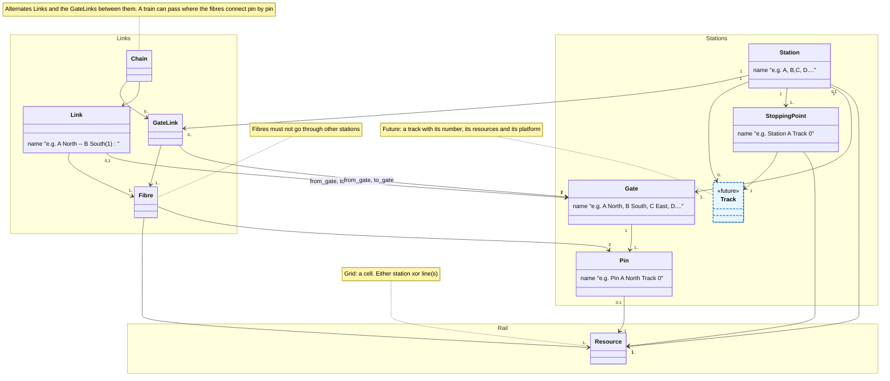

Stations and Links Data Model
=============================

> This feature was introduced in [4.3.0](https://github.com/flatland-association/flatland-rl/pull/441)

## Context and Goal

Before 4.3.0, `RailEnv` only had a notion of lines at the agent level, i.e. at Railway Undertaking (RU) = "service" level. More precisely,

* `RailEnv` did not expose stations (they came from some rail generators in the agent hints)
* `sparse_rail_generator` internally used outer connection points grouped by 4 directions (North, East, South, West outbound facing) where lines can start and
  end, but did not pass this
  information to `RailEnv`.

The goal is to extend the interfaces so rail generators (and rail env) CAN expose such information on stations and links between stations at agent-independent
level,
i.e. at Infrastructure Manager (IM) = infrastructure/topology level.

## Logical Model

The model uses the general terms of the [Flatland data and simulation model](../../key-concepts/simulation_model.md):
an **entry point** is where a train can be (grid: a cell and the direction it was entered, `((r, c), d)`), a
**transition** a move from one entry point to the next, and a **resource** what a train occupies (grid: the cell).
In 4.3.0 every place where the model touches the rail is a cell.

The logical model is as follows:

* `Station`s cover a certain (disjoint) set of the infrastructure. Currently: list of cells.
* `Station`s have `Gate` consisting of `Pin`s where `Link`s / `Fibre`s can start and end. Currently: outer connection points of the sparse rail generator.
* `Fibre`s cover wayside infrastructure between two connection pins of two stations (potentially the same). Currently: built from the inter-city lines of the sparse rail generator.
* `Link`s bundle fibres between the same `Gate`s.
* `GateLink`s bundle the fibres through one station, from a pin of one of its gates to a pin of another. Currently: not implemented.
* `Station`s have `StoppingPoint`s where trains can start and stop. Currently: list of cells.
* A sequence of `Link`s and the `GateLink`s between them forms a `Chain`. Currently: not implemented.

**Definition: gate and pin.**

* A **route** is a sequence of transitions the transition map allows, each starting at the entry point where the
  previous one ends: a path a train can drive.
* A **pin** of a station is a resource of the station with a transition to a resource outside it: where a track
  leaves the station. The pins are **all** of them: every transition from the station to outside starts at a pin of
  one of its gates. A boundary cell without such a transition (e.g. a platform's end) is no pin.
* A pin `p` **links to** a pin `q` when some route leaving the station at `p` meets `q` as the first pin after `p`.
  `q` may lie in any station, also in `p`'s own, when the line loops back. A pin links to a gate when it links to one
  of the gate's pins.
* A **gate** is a set of pins on one side of one station. The gates are the **coarsest** grouping of each side's pins
  in which all pins of a gate link to the same set of gates (the corridor rule).
  * Each pin links to *some* pin of every one of these gates, not necessarily every pin: two parallel tracks between
    `A` and `B` count once.
  * The pins of a gate need not be adjacent: other pins, or no track, may lie between them.
  * The gates are found by starting from the sides, splitting each gate by the gates its pins link to, and repeating
    until nothing changes. The result is unique and does not depend on the order of the splits.
* **Not part of the definition:** which pin links to which pin, on the line and inside the station. Whether the routes
  between two gates run as parallel tracks, are joined by crossovers, or fork and join on the way does not matter for
  the gates; the fibres of the `Link` between the two gates record which pins connect, and the fibres of a
  `GateLink` which pins connect through a station.

Notation: [UML class diagram in Mermaid](https://mermaid.js.org/syntax/classDiagram.html); `Track`, blue dashed, is
not in the model yet (see [Open points and possible extensions](#open-points-and-possible-extensions)).

Assumptions, not checked by `StationsLinks`; every producer must ensure them:

* **Unique names:** `Link.from_gate`/`to_gate` and `Fibre.from_pin`/`to_pin` refer to gates and pins by name, so a
  reader looks them up by name across all stations: every gate and every pin needs a name that is unique across all
  stations. `sparse_rail_generator` and the drawing tool (see the table under
  [Deriving information from the structure](#deriving-information-from-the-structure)) do this by qualifying names
  with the station's name, which is unique and contains no `.`: `<station>.<gate>` and `<station>.<gate>.<index>`
  (stopping points `<station>.<index>`).
* **Complete pins and the corridor rule:** a producer's gates follow the definition above. See
  [Limitations](#limitations) for where 4.3.0's producers do not yet.
* **Every move can be reversed:** every transition has its reverse at the same resource (a railway has no one-way
  track), so a pin's resource fixes where trains enter and leave there, and a stopping point is valid in both
  directions.

### Implementation

See [stations_links.py](https://github.com/flatland-association/flatland-rl/tree/main/flatland/envs/stations_links.py), which implements `Pin`, `Gate`,
`StoppingPoint`, `Station`, `Fibre`, `Link` and `StationsLinks` (`Chain` and `GateLink` are not implemented yet).

`sparse_rail_generator` returns a `StationsLinks` object in its optionals under the key `stations_links`. `RailEnv.reset()` exposes it as
`env.stations_links`, which is `None` if the rail generator does not provide it.

## Terminology mapping to `sparse_rail_gen`

| Ours            | sparse rail gen         |
|-----------------|-------------------------|
| `Station`       | city                    |
| `Link`          | inter_city_line         |
| `Gate` / `Pin`  | outer_connection_points |
| `StoppingPoint` | train_station           |
| `Station` cells | free_rail / inner city  |

## Terminology mapping to the railway domain

| Ours | Railway domain | Definition |
|---|---|---|
| `StoppingPoint` | Haltepunkt (stopping point) | "Definierter Halteort der Spitze eines Fahrzeuges/Zuges" ([IVT ETH glossary](https://archiv.ivt.ethz.ch/oev/glossar/)): a defined position where the head of a vehicle or train stops. In Flatland a train occupies one cell, so a stopping point is the cell where the train stops. |
| track of a stopping point (no class) | Haltekante (boarding platform, e.g. track or edge) | "Orte an welchen in ein Verkehrsmittel eingestiegen werden kann (z.B. Gleis, Kante)" ([Swiss service point master data](https://opentransportdata.swiss/de/cookbook/masterdata-cookbook/servicepoints/)); grouped into areas (Bereiche, e.g. a Perron). The model has no such element: one stopping point per track stands for it, and a platform's cells and length are not in the model (see [Deriving information from the structure](#deriving-information-from-the-structure)). |
| `Station` | Station: Bahnhof (Stationsanlage) or Haltestelle; Dienststelle (service point) | Station: "Oberbegriff für Bahnhof, Bahnhaltestelle, …"; Stationsanlage (Bahnhof): "Innerhalb der Einfahrsignale vorhandene Gleisanlage und daran angeschlossene übrige Gleise. Fehlen Einfahrsignale, so bilden die Einfahrweichen die Grenzen"; Haltestelle: "Die Anlage für den Publikumsverkehr, ohne Möglichkeit für die Regelung des Zugverkehrs; unmittelbare Umgebung eines Haltepunktes, inklusive Gleise, Bauten und weitere Einrichtungen" ([IVT ETH glossary](https://archiv.ivt.ethz.ch/oev/glossar/)). A Flatland station with switches is a Stationsanlage, bounded by its entry switches, where its gates and pins lie; one without switches is a Haltestelle. In the Swiss master data, a stop is a service point (Dienststelle) relevant for boarding and alighting, holding its Haltekanten. |
| station area (`Station.edges`; no area field yet) | Haltestellenbereich / Stationsanlage, opposite the freie Strecke | Einfahrsignal: "Das Signal, das die Grenze zwischen der Strecke und dem Bahnhof bildet (Hauptsignal zur Sicherung der Fahrt von der freien Strecke in den Haltestellenbereich)"; Ausfahrsignal: "… (Hauptsignal zur Sicherung der Fahrt vom Haltestellenbereich auf die freie Strecke)"; Stationsanlage: "Innerhalb der Einfahrsignale vorhandene Gleisanlage und daran angeschlossene übrige Gleise. Fehlen Einfahrsignale, so bilden die Einfahrweichen die Grenzen" ([IVT ETH glossary](https://archiv.ivt.ethz.ch/oev/glossar/)). Flatland has no signals: the area is the station's rail cells, today `edges` (in `sparse_rail_generator` the city's tracks and pins; an editor keeps the drawn rectangle itself), closest to the case without entry signals. Like a Stationsanlage, it includes every track inside the boundary, also a through track without a switch to the platforms: such a track leaves the area, so its boundary cells are pins (see [Logical Model](#logical-model)). The [Swiss service point master data](https://opentransportdata.swiss/de/cookbook/masterdata-cookbook/servicepoints/) have no area concept: service points and boarding places are points with coordinates. |
| `Link` / `Fibre` | freie Strecke (open line between stations) | The track between the Ausfahrsignal of one station and the Einfahrsignal of the next ([IVT ETH glossary](https://archiv.ivt.ethz.ch/oev/glossar/), see the station area row); a fibre is one track of it, a link the tracks between the same two gates. A line that leaves a station and returns to it is a link too; the connections through a station are gate links, not links. |
| `Gate` | the side of a Kopf (station throat) towards the line | Kopf: "In einem einfachen Bahnhof haben wir zwei Seiten mit Weichenzonen. Diese befinden sich beidseitig der Bahnsteige und sie scheinen einen Bahnhof abzuschliessen. […] den Bereich nennt man Kopf, der mit einer Richtungsangabe ergänzt wird. So gibt es zum Beispiel einen „Nordkopf“, oder einen „Kopf Seite Himmelreich“" ([lokifahrer.ch, Gleisanlage](https://www.lokifahrer.ch/Lukmanier/Infra/Bahnhof-Depot-Co/Gleisanlage.htm)). A Kopf is the whole switch zone; its switches belong to the Flatland station's `edges`, and the gate is only its outer boundary, where the tracks leave towards the line. The gate key (`N`, `E`, `S`, `W`) names the side, as "Nordkopf" does. A gate groups the pins of one side that lead along the line to the same gates (the corridor rule, see [Logical Model](#logical-model)); where a side's tracks lead to different places, the side has several gates (`N1`, `N2`, …). |
| `Pin` | a track crossing the station boundary towards the line | The boundary is the entry signal ("Einfahrsignal: Das Signal, das die Grenze zwischen der Strecke und dem Bahnhof bildet"), or without entry signals the entry switches ("Fehlen Einfahrsignale, so bilden die Einfahrweichen die Grenzen", [IVT ETH glossary](https://archiv.ivt.ethz.ch/oev/glossar/)); Einfahrweiche: "die erste Weiche eines Bahnhofes, die der einfahrende Zug von der Spitze her befährt" ([lokifahrer.ch, Gleisanlage](https://www.lokifahrer.ch/Lukmanier/Infra/Bahnhof-Depot-Co/Gleisanlage.htm)). A pin is the cell where one track leaves the station's area, outside its first switch. Every track leaving the area has one. |
| (no counterpart) | Gleisgruppe (track group) | "Die Gleisgruppe umfasst immer ein paar Geleise. Jedoch nicht die dazwischen liegenden Weichen, welche aber zum Gleisfeld gehören" ([lokifahrer.ch, Gleisanlage](https://www.lokifahrer.ch/Lukmanier/Infra/Bahnhof-Depot-Co/Gleisanlage.htm)); named by letter or number, e.g. track A1 of group A. In the Swiss master data the corresponding element is the Bereich, which groups Haltekanten (e.g. to a Perron). The model has no group of tracks; it is not a gate, which lies at the station boundary, not among its tracks. |

## Deriving information from the structure

Most of what a reader needs follows from the `StationsLinks` data and the rail grid; it does not depend on how a
producer names or orders things, given unique names (see the assumption in [Logical Model](#logical-model)) and:

* **Grid coordinates:** cells are `(row, column)` tuples and directions are Flatland's grid directions, N = 0, E = 1,
  S = 2, W = 3 (see [Transitions maps](transitions.ipynb)). A cell is the grid's resource; with the direction it was
  entered it is an entry point. `Pin.node` and `StoppingPoint.node` are cells, and `Station.edges` and `Fibre.edges`
  are lists of any length whose elements are cells: each element is one `(row, column)` tuple, not an edge `(u, v)`
  between two nodes (a station's list holds all its cells, a fibre's all cells from pin to pin). A cell carries no
  direction. Coordinates may be numpy integers (`np.int64`) rather than `int`.

Everything else can be derived:

| What | How to derive it | In `sparse_rail_generator` | In the drawing tool |
|---|---|---|---|
| A station's name | Its key in `StationsLinks.stations` (and `Station.name`). | `A`, `B`, …, `Z`, `AA`, `AB`, … by city index. | The name the user gives the station, else its id; names must be unique and contain no `.`. |
| A gate's side | The direction in which the tracks at its pins leave the station: a transition from the pin's cell into a cell that is not in the station's `edges`. The gate's key states the same side (`N`, `E`, `S`, `W`); a side split by the corridor rule has several gates (`N1`, `N2`, …). | Two gates per city, on the two sides along its orientation, each holding all outer connection points of that side. Named `<station>.<side>`, e.g. `A.E`. | The user draws a rectangle, the station area. A pin is a cell of the station's tracks where a track leaves the area; a gate is a run of adjacent pins on one side, keyed by the side, numbered along the border (`E1`, `E2`, …) when a side has several. Without an area, a station has no gates. |
| The order of a gate's pins | Sort the pins' cells along the side: by column on `N` and `S`, by row on `E` and `W`. | The pin's index is that order; named `<gate>.<index>`, e.g. `A.E.0`, `A.E.1`. | The same order: along the side, by column on `N` and `S`, by row on `E` and `W`; named `<gate>.<index>`. |
| A station's tracks | The rows (gates on `E`/`W`) or columns (gates on `N`/`S`) of the station's `edges` that hold straight track along that axis. | The city's parallel tracks between its two gates. | Not exported as such; `edges` are the cells connected to the station's platform cells by track inside the area (a through track without a switch to them is left out), or only the platform cells without an area. |
| The track of a stopping point, and its number | The track through its cell; numbered by position across the axis. | One stopping point per track, at the track's middle cell; its index is the track number; named `<station>.<index>`, e.g. `A.1` for track 1 of `A`. | One stopping point per platform cell the user marks, numbered in row-major order, so a platform longer than one cell has several stopping points on one track; named `<station>.<index>`. |
| Which stations a link connects, and where | `Link.from_gate`/`to_gate`; each fibre's `edges` run from its `from_pin`'s cell to its `to_pin`'s cell, both included. A link's direction has no meaning: the tracks can be used both ways. | One link per gate pair; `from` is the city that built the line, and two neighbouring cities usually each build lines to the other. | Not exported: `links` is empty. |
| `agents_hints.train_stations` | Per station, `(stopping point node, stopping point index)`. | The same, `(cell, track number)`. | The same, `(cell, stopping point index)`. |
| The axis of `agents_hints.city_orientations` | The axis of the station's gate keys. | The heading 0-3 to the closest neighbouring city (random in grid mode); the tracks run along that axis. | `1` (east) if the station's middle platform cell, in row-major order, is a horizontal straight, else `0` (north). |
Not derivable from the env: `agents_hints.city_positions` and which of the two headings along the axis
`city_orientations` gives. `agents_hints` is used only while the env is built (`reset()` passes it to the line and
timetable generators, the env does not keep it, and `RailEnvPersister` does not save it), and `Station` has no
position field. In `sparse_rail_generator`, `city_positions` is the generator's city centre, which is not always the
centre of the station's cells.

Not needed either: `agents_hints` duplicates what `stations_links` holds. Flatland's generators use only `train_stations`
(the stop cells per station, with their track index: `sparse_line_generator` starts trains on even and ends them on
odd indexes) and the number of cities (`len(city_positions)`, for picking cities and for `max_episode_steps`);
`city_orientations` only for its axis, both headings along it are tried. All three are derivable from the
stopping points, the stations and the gate keys above.

The third column is what `sparse_rail_generator` guarantees (4.3.0), so a reader may check it against the derivation.
The fourth column is what the [drawing tool](https://github.com/flatland-association/flatland-scenarios) in flatland-scenarios exports, converted by its
`stations_to_stations_links` (as of its pull request
[#39](https://github.com/flatland-association/flatland-scenarios/pull/39), not merged yet); where it differs from
the third column, a reader relying on the `sparse_rail_generator` column reads a drawn env wrongly. Its export also
carries `city_position`, the station's middle platform cell, which is not derivable from the env. Further:

* Names follow the structure (third column), so a reader need not parse them; the diagram's examples ("A North",
  "Pin A North Track 0") are descriptions, not these names.
* The model has no track of its own (no `Track` class or field): one stopping point per track holds by construction
  of `sparse_rail_generator`; another producer may put several stopping points on one track, which the derivation
  above shows. A track's cells are derivable as the straight run along the gate axis through its stopping point's
  cell, inside `edges`; which of them are platform cells, i.e. where a train may stop and how long the platform is,
  is not in the model (`sparse_rail_generator` has no platforms beyond the stop cell).
* A station's `edges` are the cells of its tracks inside the city plus its pins.

**Checking a producer's gates.** For every pin, follow the rail outward from it, over every route, up to the first
pin each route meets; the gates of the pins met are the gates the pin links to. Then start from the sides (or from
the producer's gates, which must come out unchanged), split each gate by the sets of gates its pins link to, and
repeat until nothing changes. The producer's gates satisfy the definition when the result equals them. On
`sparse_rail_generator` (810 envs over 30 seeds, 3/5/8 cities and 1–3 rail pairs and rails between cities, 60x60)
1,075 of 8,640 gates fail, and the split gives 9,903 gates; on the ECML2026 scenario drawn with the drawing tool,
10 of its 71 gates fail, and the split gives 81.

## Limitations

As of 4.3.0:

* Only `sparse_rail_generator` provides `stations_links`; with other rail generators `env.stations_links` is `None`.
  `RailEnvPersister` saves and loads it with the env.
* `GraphRailEnv` does not carry it: `GraphRailEnv.from_rail_env` and `from_graph` take no stations, so its
  `stations_links` is `None`.
* `GateLink` and `Chain` are not implemented, and the diagram's multiplicities are not checked.
* The links a city builds from one gate all go to one neighbouring city, but a neighbour's lines end at the closest
  pin on any side. So a gate can be linked to several stations, and several fibres can end at one pin.
* Pins of one gate do not always reach every pin of the opposite gate through the station. With
  `max_rails_between_cities=3`, e.g. `sparse_rail_generator(max_num_cities=5, seed=0, max_rail_pairs_in_city=2,
  max_rails_between_cities=3)` on 60x60, a train entering city `C` at pin `C.E.0` can leave through `C.W.0` and
  `C.W.1` but not `C.W.2`: the parallel tracks are joined only at the ends of the city. The definition does not
  require it: which pins connect through a station is what a gate link's fibres record.
* `sparse_rail_generator`'s gates do not always follow the corridor rule: two pins of one gate can link to different
  sets of gates, because inter-city lines join and fork outside the stations. With
  `sparse_rail_generator(max_num_cities=3, seed=0, max_rail_pairs_in_city=1, max_rails_between_cities=2)` on 60x60,
  `A.N.0` reaches only `C.S`, while `A.N.1` also reaches `A.S`, `B.E` and `B.W`. This happens in 1,075 of 8,640
  gates (see [Checking a producer's gates](#deriving-information-from-the-structure)); the drawing tool's gates fail
  in 10 of 71 on ECML2026.
* The drawing tool leaves out a through track inside its station area without a switch to the platforms, so the
  track crosses the area without pins.
* `Link`s and `Fibre`s record the inter-city lines as the generator draws them, not what is reachable on the grid. A
  line drawn into existing track joins it, so a train can leave a fibre for another line. In the runs above, the
  gates a pin reaches on the grid differ from the gates its fibres end at for 3,627 of 11,982 pins.
* The model has no track of its own (no `Track` class or field), see [Deriving information from the structure](#deriving-information-from-the-structure).
* Stopping points and pins carry no direction, and a cell that is a level-free crossing (two resources, one per axis)
  is a single cell in the model.

## Open points and possible extensions

Not implemented yet. Most are decided for the next version of the model, so producers and readers know what will
change:

* **Gates by the corridor rule:** producers split a side's pins into gates by the definition above;
  `sparse_rail_generator` and the drawing tool will split the gates that fail it (`A.N` becomes `A.N1`, `A.N2`).
* **Station area:** an optional `Station.area`, the station's rail resources, with the pins at its boundary; it
  replaces `Station.edges`. The drawn shape (a rectangle on the grid, a polygon of geographic coordinates on a graph)
  is the placement's outline.
* **Producer data:** an optional `Station.id` (the producer's own key) and an optional `Station.placement`: a
  position, an orientation as a bearing in degrees clockwise from north, and the outline. A bounding box is derived
  from the outline, not stored.
* **Links from the grid:** one link per unordered pair of gates, one fibre per pin pair connected along the line,
  holding the resources of all routes between the two pins; a line looping back to its own station is a link too.
  Connections that should not be used normally stay in the topology; marking them (a priority on a fibre) is a
  possible later extension.
* **Gate links:** stored like links, one per pair of gates of a station that some route through the station connects,
  with a fibre per connected pin pair; no rule on which pins connect. A station has `0..` gate links (a terminus has
  none). A chain of gates means some train can pass, followed pin by pin.
* **Tracks:** a `Track` of its own with its number (e.g. `7A`), its resources and its platform, referenced by the
  stopping points; in a later version of the model.
* **Graph:** every field holds resources of the env's resource type (grid: a cell, or the cell and axis at a
  level-free crossing; graph: the resources of its resource map), so `GraphRailEnv` carries `stations_links` too;
  entry points and transitions follow from the resources and the transition map. A stopping point stays valid in
  both directions.
* **Visualization:** an optional `display_name` next to the short `name` (the key used in the qualified names), an
  optional `kind` (`station`, `stop`, `junction`, `crossover`, `portal`), places without tracks as stations without
  stopping points, and the line layout (corridor or network) derived from the links.
* **Exchange:** a JSON form with one schema per binding (grid; graph; graph with geographic coordinates), owned by
  flatland-rl; producers add their own data in `extensions` objects keyed by owner, declared at the top; a semantic
  `version` (additions minor, removals major).
