Generation of Railway Networks
============

Flatland provides the [`sparse_rail_generator`](https://github.com/flatland-association/flatland-rl/blob/v4.3.0/flatland/envs/rail_generators.py#L125), which generates realistic-looking railway networks. 

Using this function, networks are generally generated using the following steps:
<ol>
  <li>Cities (square areas of fixed "radius") are placed randomly on the map</li>
  <li>Cities are vested with inner and outer connection points towards and away from its closest neighbor</li>
  <li>Rails are placed on (shortest) paths connecting outer connection points of closest cities </li>
  <li>Rails are placed connecting inner connection points with parallel rails and train stations (resp. tracks) in the middle </li>
  <li>Rail transitions are fixed (as their placement does not preserves transition validity)  </li>
</ol> 

Find more details and illustrations for  to the different steps below.  

From a graph theoretical perspective we have tightly connected node clusters (cities) which are then connected to their nearest neighbors. Due to the limited spacial resolution of the grid, the overlapping of paths then dynamically merges edges and generates additional nodes between the cities. 

Parameters
-------------------------

The following parameters are most-relevant for the basic functionality of the generation of the random networks  

- Number of cities $n_\text{city}$ (parameter: `max_num_cities`). 

- Number of connection points at city borders $n_\text{inter}$ (parameter: `max_rails_between_cities`).

- Number of parallel tracks in the city $n_\text{inner}$ (parameter: `max_rail_pairs_in_city`).

The size of cities is given by their radius $r_\text{city} = n_\text{inner} + 2$, chosen such that there is sufficient space for tracks and connection points. This results in square cities of size  $(2~r_\text{city}+1) \times (2~r_\text{city}+1)$. 

For the sake of this documentation we consider a generation on a grid of size $20 \times 20$ with $n_\text{city}=3$, $n_\text{inner}=1$, $n_\text{inter}=2$. The cities will thus have the radius $r_\text{city} = 3$ and a total size of $7 \times 7$. 

We note that for the sake of internal calculations north and west are considered to be in positive direction. Meaning maps displaying the cells from $(0,0)$ at the top left are orientied such that south points up, north points down, west points right, and east points left.  

City Placement
-------------------------

Cities are placed randomly (or evenly) on the grid of given height and width. Coordinates with $r_\text{city}+1$ distance to the borders or $2~(r_\text{city}+1)$ to other city centers are excluded, such that cities do not overlap and have sufficient distance between each other and the borders. Generation stops when no cities are able to be placed anymore or $n_\text{city}$ is reached. 

In our example this means that after 3 placed cities there is no valid place anymore to place another city. Hence even if we planned more cities the generator would not be able to place them. Infact, with a different random placement of the first cities generation might break down even earlier. 

See below the steps of generating three cities:

<figure>
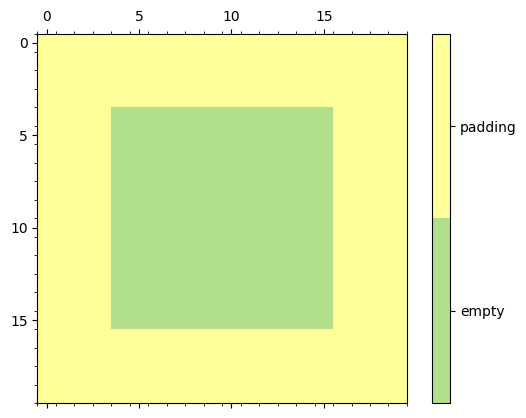
<figcaption>
    Randomly choosen city centers need to be far enougjh away from the border. 
</figcaption>
</figure>
<figure>
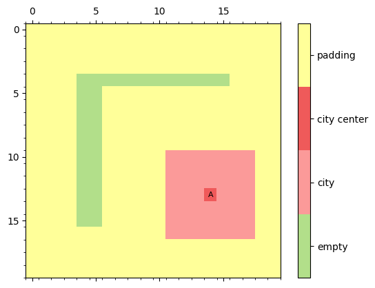
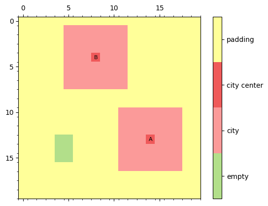
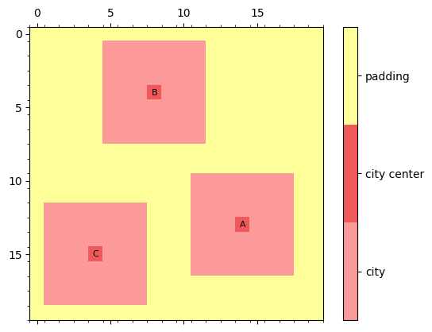
<figcaption>
    Steps of the generation of three Cities A, B and C. Only green cells remain valid city center choices. 
</figcaption>
</figure>

Inner and Outer Connection Points
-------------------------

Inner and outer connection points are added at the borders of the cities on two opposing cardinal directions according to the orientation of the city, which is defined by the direction of its nearest neighbor (by manhattan distance). 

<figure>
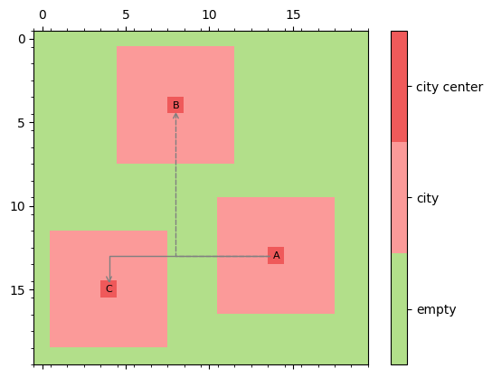
<figcaption>
    City A is checking its manhattan distance to B and C and identifying C as its closest neighor.
</figcaption>
</figure>

The number of pairs of inner tracks is randomly chosen between 1 and $n_\text{inner}$ and defines the number of inner connection points per cardinal direction which is 2 times this number (for $n_\text{inner}=1$ it is always 2). The number of outer connections per cardinal direction is randomly chosen between 1 and $n_\text{inter}$ (or the number of inner connection points if thats lower). The inner connection points are offset such that parallel tracks have their inner connection points not in parallel.  

See below how this plays out for our example:

<figure>
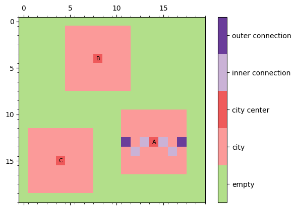
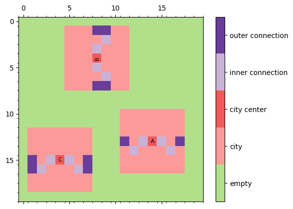
<figcaption>
    City A orients itself towards its nearest neighbor City C and generates inner and outher connection points along the axis of that direction. The other cities do the same. The number of outer (and for larger cities also inner) connection points can vary between cities. 
</figcaption>
</figure>

Pathfinding between Cities 
-------------------------

For each city for each cardinal direction, the nearest city in that direction is found. If no city exists the nearest one 90 degrees counterclockwise, then 90 degrees clockwise is chosen. In each city for each each outer connection point the outer connection point with the closest (manhattan) distance of the in this way found other city is identified. These two outer connection points of different cities are then connected via a rail path. This path is found using an A* path-finding algorithm with a manhattan distance heuristic only allowing cells which are not part of cities and with a penalty on choosing cells which already contain rails (giving them $+1$ distance cost in the heuristic). This process is repeated for each city and each outer connection point. As the rails placed in this way may overwrite existing rail paths, resulting in invalid transitions, some rail cells will need to be fixed later adding switches to allow for all necessary transitions. 

See below how this plays out for our example:

<figure>

<figcaption>
    As the first path the right (west) outer connection point of City A connects to the closest city in that cardinal direction. As there is no more city further right (west), it looks counterclockwise and chooses City B. The closest outer connection point of City B is the lower (north) right one, which is why the pathfinding algorithm finds a closed path between these two outer connection points and places railes/transitions there. 
</figcaption>
</figure>
<figure>
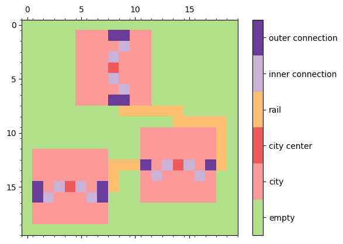
<figcaption>
    The second path start at the left (east) outer connection point of City A and connects to City B as this is the closest city in that cardinal direction. 
</figcaption>
</figure>
<figure>
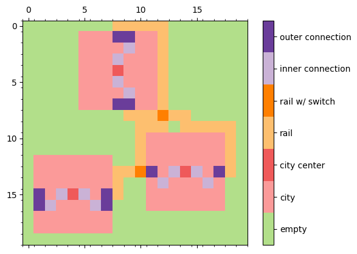
<figcaption>
    The third path starts at the upper (south) left outer connection point of City B. It finds to connect to the left (east) outer connection point of City A. The path requires the crossover over existing rails, which is discouraged by the pathfinding algorithm but might be necessary. The new transistions are simply added to the existing transitions of the cell with might, but not necessarily does, result in a valid transition / switch. 
</figcaption>
</figure>

<figure>
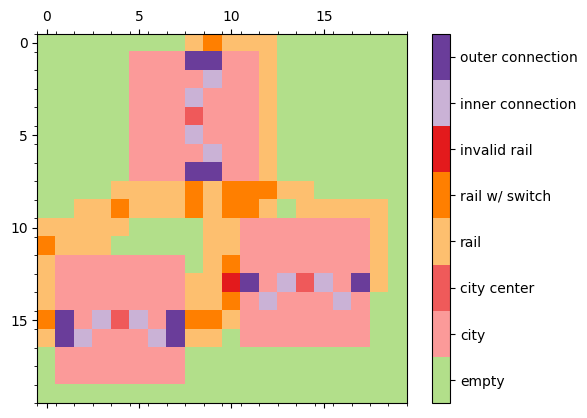
<figcaption>
    The pathfinding is repeated for every outer connection point of every city. After all paths are drawn some invalid transitions exist, which will need do be fixed later.
</figcaption>
</figure>

Inner Cities & Train Stations 
-------------------------

In each cities the inner connection points are connected by straight rail paths. Train stations are places in the middle of these paths and parallel stations/tracks per city labeled starting from 0. Parallel tracks are connected with each other and inner connections points are connected to outer connection points in straight lines (where they both exist). The way these connections are build might result in invalid transitions which are then fixed later. 

See below how this plays out for our example:

<figure>
<!---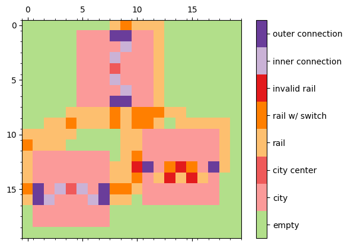--->
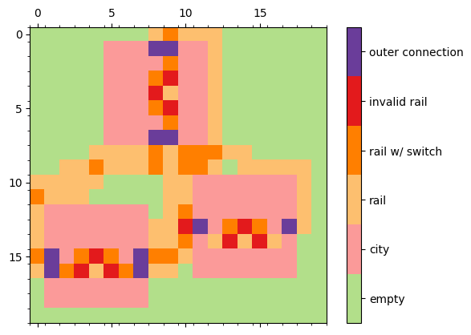
<figcaption>
  The inner rails connect inner connection points in parallel as well as adding additional transitions between the parallel tracks, which do result in invalid transitions, but lay the groundwork for the fixing aligorithm to generate functioning inner cities, with connected parallel tracks. 
</figcaption>
</figure>

<figure>
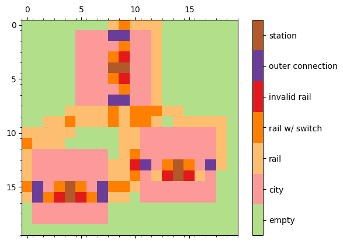
<figcaption>
    Train stations are placed in the middle of the parallel tracks. 
</figcaption>
</figure>

Fixing Transitions 
-------------------------
All cells which are in cities and part of the connections between cities are checked, if their transitions are valid. Invalid transitions are fixed in the process creating switches. Resulting crossings might be level-free. 

See below how this plays out for our example:

<figure>
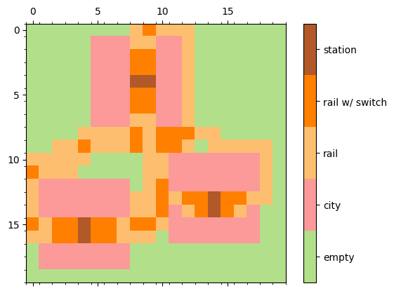
<figcaption>
    After checking an fixing all cells of cities and paths all transitions are valid. 
</figcaption>
</figure>

<figure>
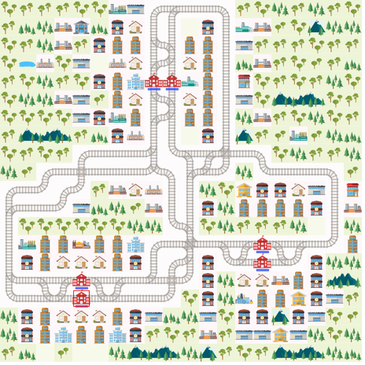
<figcaption>
    The resulting enviroment can now be rendered to look like this. 
</figcaption>
</figure>
