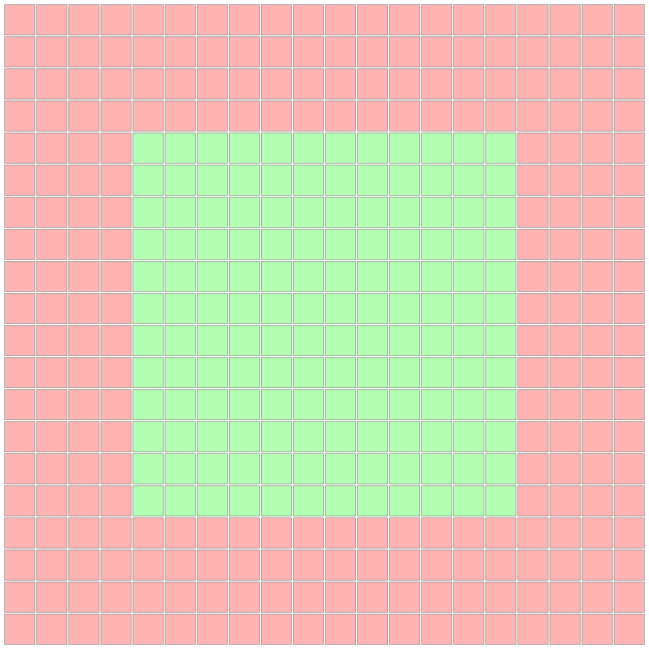
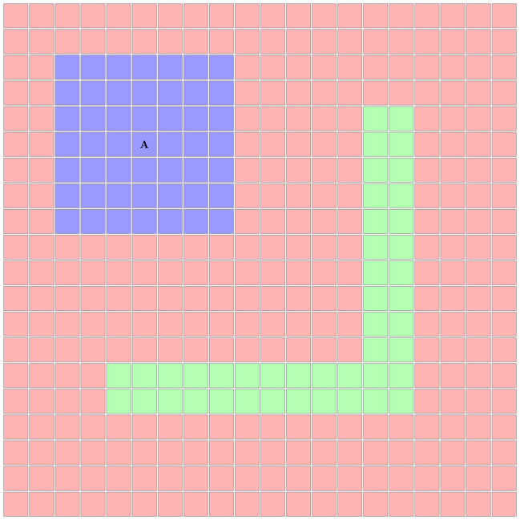
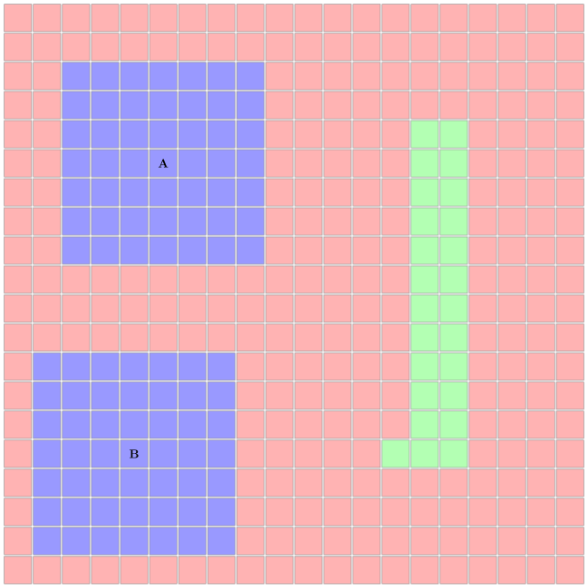
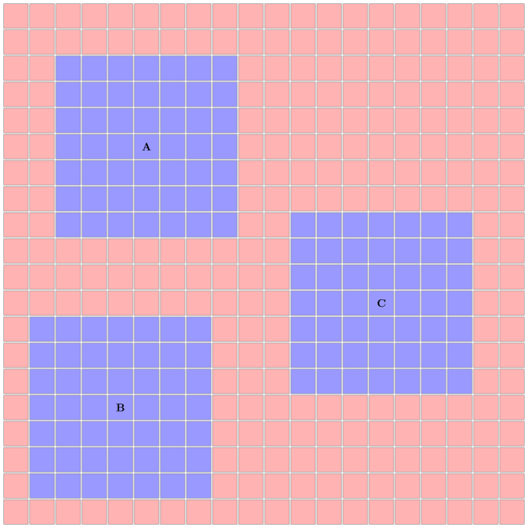

Generation of Railway Networks
============

Flatland provides the [`sparse_rail_generator`](https://github.com/flatland-association/flatland-rl/blob/v4.3.0/flatland/envs/rail_generators.py#L125), which generates realistic-looking railway networks. 

Using this function, networks are generally generated using the following steps:
<ol>
  <li>Cities (square areas of fixed "radius") are placed randomly on the map</li>
  <li>Cities are vested with inner and outer connection points towards and away from its closest neighbor</li>
  <li>Rails are placed on (shortest) paths connecting outer connection points of closest cities </li>
  <li>Rails are placed connecting inner connection points with parallel rails </li>
  <li>Train stations (resp. tracks) are placed on inner city rails </li>
  <li>Rail transitions are fixed (as the placement does not preserves transition validity)  </li>
</ol> 

Find more details and illustrations for  to the different steps below.  

From a graph theoretical perspective we have tightly connected node clusters (cities) which are then connected to their nearest neighbors. Due to the limited spacial resolution of the grid, the overlapping of paths then dynamically merges edges and generates additional nodes between the cities. 

Parameters
-------------------------

The following parameters are relevant for the basic functionality of the generation of the random networks  

- Number of cities to build $n_\text{city}$ (parameter: `max_num_cities`). 

- Number of connection points at city borders $n_\text{inter}$ (parameter: `max_rails_between_cities`).

- Number of parallel tracks in the city $n_\text{inner}$ (parameter: `max_rail_pairs_in_city`).

The size of cities is given by their radius $r_\text{city} = n_\text{inner} + 2$, chosen such that there is sufficient space for tracks and connection points. This results in square cities of size  $(2~r_\text{city}+1) \times (2~r_\text{city}+1)$. 

For the sake of this documentation we consider a generation with $n_\text{city}=3$, $n_\text{inner}=1$, $n_\text{inter}=2$. The cities will thus have the radius $r_\text{city} = 3$.

City Placement
-------------------------

Cities are placed randomly on the grid of given height and width. Coordinates with $r_\text{city}+1$ distance to the borders or $2~(r_\text{city}+1)$ to other city centers are excluded, such that cities do not overlap and have sufficient distance between each other. 

Generation stops when no cities are able to be placed anymore or $n_\text{city}$ is reached. 

Inner and Outer Connection Points
-------------------------

Pathfinding between Cities 
-------------------------

Inner Cities 
-------------------------

Train Stations 
-------------------------

Fixing Transitions 
-------------------------
