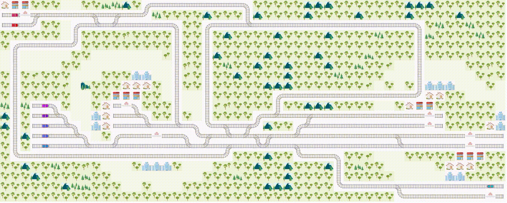

Welcome to Flatland
===



Flatland tackles a major problem in the transportation world:

> **How to efficiently manage dense traffic on complex railway networks?**

This is a hard question! Driving a single train from point A to point B is easy. But how to ensure trains won't block each other at intersections? How to
handle trains that randomly break down?

Flatland is an open-source toolkit to develop and compare solutions for this problem.

[](https://github.com/flatland-association/flatland-rl/actions/workflows/checks.yml)


⚡ Quick start
---

Flatland is easy to use whether you’re a human or an AI:

```console
$ pip install flatland-rl
$ flatland-demo # show demonstration
$ python <<EOF # random agent
import numpy as np
from flatland.envs.rail_env import RailEnv
env = RailEnv(width=30, height=30)
obs, info = env.reset()
while True:
    obs, rew, done, info = env.step({
            0: np.random.randint(0, 5),
            1: np.random.randint(0, 5)
        })
    if done["__all__"]:
        break
EOF
```

Features
---------
The Flatland environment provides simplistic representation of a rail network on a grid world to address the vehicle rescheduling problem (VRSP):

 
* 🔬Flatland is used to develop reinforcement learning (RL) solutions to the VRSP
* 🕹️️Trains are agents with a limited action space (⏸️⬅️⬆️➡️⏹️)
* ⏰ Agents have schedules for their origin, destination and intermediate stops 
* 🛤️Railway network includes switches, slips, crossings and over-/underpasses
* 👀  what can each agent "see"?
* 🌟Rewards: what is the metric used to evaluate the agents?
* 🗺Translation from grid representation of the network to a graph representation is implemented
* 🚨Agents have variable speed profiles
* 🔥Agents can be disrupted (in malfunction)

📑 Flatland Paper
---

You can find the Flatland competition paper on arXiv: [https://arxiv.org/abs/2012.05893](https://arxiv.org/abs/2012.05893)

```
@misc{mohanty2020flatlandrl,
      title={Flatland-RL : Multi-Agent Reinforcement Learning on Trains}, 
      author={Sharada Mohanty and Erik Nygren and Florian Laurent and Manuel Schneider and Christian Scheller and Nilabha Bhattacharya and Jeremy Watson and Adrian Egli and Christian Eichenberger and Christian Baumberger and Gereon Vienken and Irene Sturm and Guillaume Sartoretti and Giacomo Spigler},
      year={2020},
      eprint={2012.05893},
      archivePrefix={arXiv},
      primaryClass={cs.AI}
}
```

🔀 The Vehicle Re-scheduling Problem
---

At the core of this challenge lies the general vehicle re-scheduling problem (VRSP) proposed
by [Li, Mirchandani and Borenstein](https://onlinelibrary.wiley.com/doi/abs/10.1002/net.20199) in 2007:

> The vehicle rescheduling problem (VRSP) arises when a previously assigned trip is disrupted. A traffic accident, a medical emergency, or a breakdown of a
> vehicle are examples of possible disruptions that demand the rescheduling of vehicle trips. The VRSP can be approached as a dynamic version of the classical
> vehicle scheduling problem (VSP) where assignments are generated dynamically.

The Flatland environment aims to address the vehicle rescheduling problem by providing a simplistic grid world environment and allowing for diverse solution
approaches. The problems are formulated as a 2D grid environment with restricted transitions between neighboring cells to represent railway networks. On the 2D
grid, multiple agents with different objectives must collaborate to maximize global reward.

🔖 Design principles
---

### Real-word, high impact problem

The Swiss Federal Railways (SBB) operate the densest mixed railway traffic in the world. SBB maintain and operate the biggest railway infrastructure in
Switzerland. Today, there are more than 10,000 trains running each day, being routed over 13,000 switches and controlled by more than 32,000 signals. The
Flatland challenge aims to address the vehicle rescheduling problem by providing a simplistic grid world environment and allowing for diverse solution
approaches. The challenge is open to any methodological approach, e.g. from the domain of reinforcement learning or of operations research.

### Tunable difficulty

Flatland aims at tunable difficulty, from settings that can be trained with limited compute resources to hard ones. Scenarios are configured through the
[rail, line and timetable generators](environment/scenario_generation) and [malfunctions](environment/environment/stochasticity): grid size, number of cities
and tracks, number of agents, speed profiles, intermediate stops, and malfunction rate and duration. This allows to scale from a single train on a small grid to
dense traffic with disruptions. Challenges use this to define levels of increasing difficulty, see for instance the
[ECML 2026 level configuration](challenges/ecml2026/levelconfig).

### Environment diversity

Flatland aims at environment diversity to prevent agents from overfitting to a fixed set of scenarios. Rail networks, lines and timetables are generated
randomly from a seed, so agents can be trained and evaluated on different, unseen scenarios. This allows to test whether agents learn to manage traffic or
merely memorize specific trajectories.

🚉 Next stops
---

- [Step by step introduction to Flatland](key-concepts/key_concepts.md)
- [Take part in the Flatland Benchmarks](challenges/flatland-benchmarks)
- [Contribute to Flatland](misc/contributing)
- [Sponsor a Challenge](mailto:contact@flatland-association.org)

📱 Communication
---

Use these channels if you have a problem or a question:

- [Discussion Forum](https://github.com/flatland-association/flatland-rl/discussions)
- [Issue Tracker](https://github.com/flatland-association/flatland-rl/issues/)

🤝 Partners
---

<a href="https://sbb.ch" target="_blank" style="margin-right:30px"></a>
<a href="https://www.deutschebahn.com/" target="_blank" style="margin-right:30px"></a>
<a href="https://www.sncf.com/en" target="_blank" style="margin-right:30px"></a>
<a href="https://www.aicrowd.com" target="_blank"></a>
<a href="https://flatland.cloud" target="_blank"></a>


