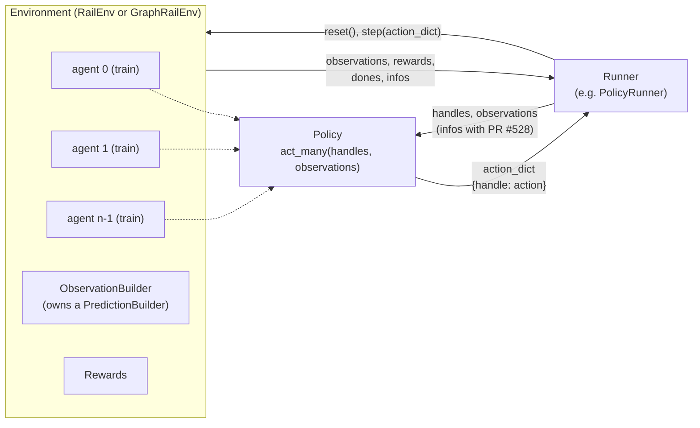
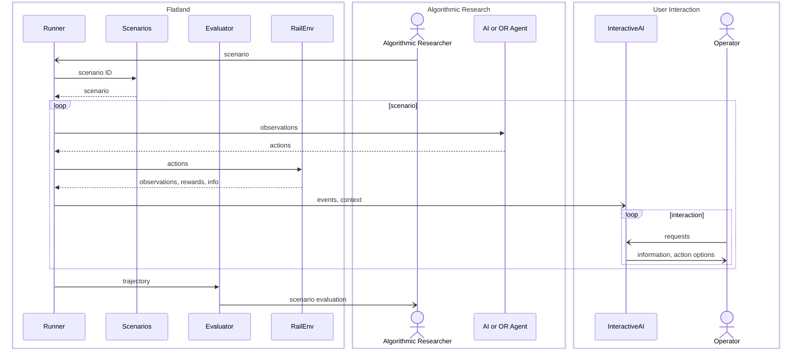
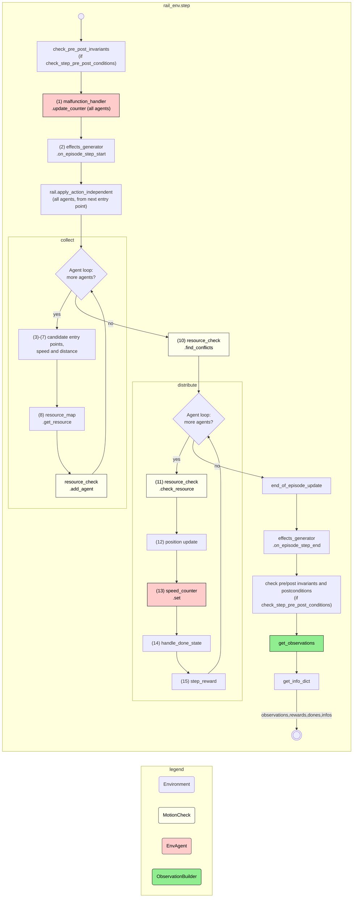
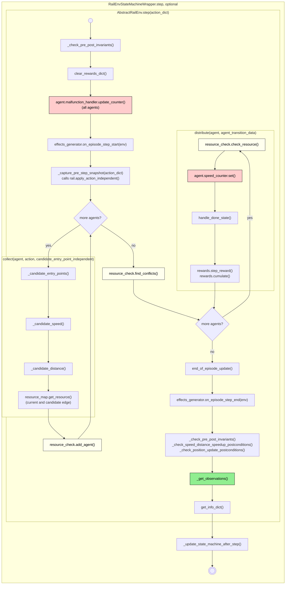
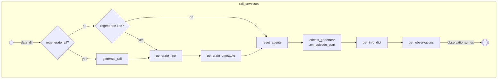

Key Concepts
============
To help you get a high-level understanding of how the Flatland works, on this page, you learn about the key concepts and general architecture.

We use the terms from [arc42](https://docs.arc42.org/section-7/) for the different views.

[//]: # (icon-park icons from  &#40;https://icones.js.org/collection/icon-park&#41;)

Flatland Code Repositories
--------------------------

* [**flatland-rl**](https://github.com/flatland-association/flatland-rl) contains the environment and evaluation code
* [**flatland-baselines**](https://github.com/flatland-association/flatland-baselines) contains baseline controllers/agents
* [**flatland-scenarios**](https://github.com/flatland-association/flatland-scenarios) contains scenarios for illustration, regression testing and benchmarking
* [**flatland-book**](https://github.com/flatland-association/flatland-book) contains the source code for this documentation

Context View
------------

Notation: [Mermaid Architecture Diagram](https://mermaid.js.org/syntax/architecture.html)

```mermaid
architecture-beta
group flatland(ip:railway)[Flatland]
group ai(ip:brain)[Algorithmic Research]
group ui(ip:data-user)[User Interaction]

service algorithmicResearcher(ip:user)[Algorithmic Researcher] in ai
service evaluator(ip:checklist)[Evaluator] in flatland
service runner(ip:refresh-one)[Runner] in flatland

service railEnv(ip:train)[RailEnv] in flatland
service scenarios(ip:database-config)[Scenarios] in flatland
service policy(ip:six-circular-connection)[AI or OR Agent] in ai
service interactiveAI(ip:map-two)[InteractiveAI] in ui
service operator(ip:user)[Operator] in ui

algorithmicResearcher:B -- T:runner
algorithmicResearcher:B -- T:evaluator
runner:R -- L:railEnv
runner:L -- R:evaluator
scenarios:T -- B:runner
railEnv:T -- B:policy
railEnv:R -- L:interactiveAI
interactiveAI:R -- L:operator
```

Agent-Environment Interaction
-----------------------------

Flatland uses the standard terms of reinforcement learning, as in Sutton and Barto's agent-environment interface
([Reinforcement Learning: An Introduction](http://incompleteideas.net/book/the-book-2nd.html), section 3.1): at each time step, the agent observes
the environment and selects an action; the environment responds with a new observation and a reward. An episode runs from `reset()` until the
environment is done. Flatland follows RLlib's [multi-agent environments](https://docs.ray.io/en/latest/rllib/multi-agent-envs.html), where each
train is an agent: flatland-rl's `Environment` (`flatland/core/env.py`) is adapted from RLlib's [`MultiAgentEnv`](https://docs.ray.io/en/latest/rllib/package_ref/env/multi_agent_env.html), and its `Policy`
(`flatland/core/policy.py`) loosely corresponds to RLlib's [`RLModule`](https://docs.ray.io/en/latest/rllib/rl-modules.html), but is much simpler (see their docstrings). `RayMultiAgentWrapper`
(`flatland/ml/ray`) wraps a `RailEnv` as an RLlib `MultiAgentEnv`.

| Sutton and Barto                      | Flatland                                                             | RLlib                                                                                                            |
|:--------------------------------------|:---------------------------------------------------------------------|:-----------------------------------------------------------------------------------------------------------------|
| agent                                 | agent (train), identified by its handle                              | agent                                                                                                            |
| environment                           | environment (`RailEnv`, `GraphRailEnv`)                              | environment (`MultiAgentEnv`)                                                                                    |
| state $S_t$ (observation, if partial) | observation, built by the `ObservationBuilder`                       | observation                                                                                                      |
| action $A_t$                          | action (`RailEnvActions`)                                            | action                                                                                                           |
| reward $R_{t+1}$                      | reward (`Rewards`)                                                   | reward                                                                                                           |
| policy $\pi$                          | policy (`Policy`)                                                    | policy (`RLModule`)                                                                                              |
| time step $t$                         | step (`elapsed_steps`)                                               | timestep                                                                                                         |
| episode, terminal state               | episode, `dones`                                                     | episode, terminated and truncated                                                                                |
| -                                     | runner, e.g. `PolicyRunner`; the episode is recorded as `Trajectory` | [`EnvRunner`](https://docs.ray.io/en/latest/rllib/package_ref/env/env_runner.html), running the interaction loop |

The runner resets the environment, then passes the observations (and, with [flatland-rl PR #528](https://github.com/flatland-association/flatland-rl/pull/528), planned for 5.0.1, the
infos) to the policy and the policy's actions to the environment's `step()`, until `dones["__all__"]` is set. One policy acts for all agents.

Notation: [Mermaid Flowchart](https://mermaid.js.org/syntax/flowchart.html)

Responsibilities:

* The environment's `step()` takes the agents' actions, updates the environment's state and returns observations, rewards, dones and infos. It
  never runs the policy of its own agents. The environment applies an action if it is physically feasible and ignores it otherwise. Deciding what
  to do, e.g. which route to take, is the policy's job; the rewards may penalize bad decisions. The earliest departure at the origin is the one
  exception: `step()` still enforces it, see [flatland-rl issue #559](https://github.com/flatland-association/flatland-rl/issues/559).
* Observations are built by the `ObservationBuilder`, which is part of the environment and may read it directly. Predictions about other agents
  come from a `PredictionBuilder` owned by the observation builder, not by the environment.
* Observations hold dynamic data only (positions, predictions). If every agent observes the same data, e.g. the positions of all trains, the
  observation builder builds it once per step and all agents' observations refer to this one object; copying it into each observation would
  grow with the square of the number of agents. The object is read-only, so that no policy can change what another agent observes.
* Infos hold the data for deciding (`action_required`, `state`, `speed` and `malfunction` per agent). With
  [flatland-rl PR #528](https://github.com/flatland-association/flatland-rl/pull/528), planned for 5.0.1, they also hold the static data, which does not change during an
  episode (map, timetables): the static data is not part of the observations, the infos refer to it as one read-only object, and the runner
  passes the infos to `act_many()`. Up to 5.0.0, `PolicyRunner` passes the observations only.
* A policy acts on its observations and infos, and does not reach into the environment. `FullEnvObservation` (the environment itself as
  observation) is a convenience.

Commonalities and differences with RLlib:

| Aspect                           | Flatland `Environment`                                                                                                                                                                                                                                                                                                                                                                                                           | RLlib `MultiAgentEnv`                                                                                                                                                                                                                            |
|:---------------------------------|:---------------------------------------------------------------------------------------------------------------------------------------------------------------------------------------------------------------------------------------------------------------------------------------------------------------------------------------------------------------------------------------------------------------------------------|:-------------------------------------------------------------------------------------------------------------------------------------------------------------------------------------------------------------------------------------------------|
| Agent ids                        | Integer handles `0..n-1` (strings in `RayMultiAgentWrapper`).                                                                                                                                                                                                                                                                                                                                                                    | Any id, e.g. strings.                                                                                                                                                                                                                            |
| `reset()`                        | Returns observations and infos. Observations are keyed by handle: `{0: obs_0, 1: obs_1}`.                                                                                                                                                                                                                                                                                                                                        | Same, keyed by agent id: `{"agent_1": obs_1, "agent_2": obs_2}`.                                                                                                                                                                                 |
| `step()`                         | Returns observations, rewards, dones and infos. Rewards are keyed by handle: `{0: -1.0, 1: 0.0}`.                                                                                                                                                                                                                                                                                                                                | Returns observations, rewards, terminateds, truncateds and infos, keyed by agent id.                                                                                                                                                             |
| `dones`                          | `{0: True, 1: False, "__all__": False}`: an agent is done once it has arrived. `"__all__"` is set when all agents have arrived or at `max_episode_steps`, which sets all agents done.                                                                                                                                                                                                                                            | Two dicts, terminateds and truncateds, each `{"agent_1": False, "__all__": False}`: terminated once an agent reaches a terminal state, truncated when the episode is cut off, e.g. by a time limit. `"__all__"` ends the episode for all agents. |
| Simultaneous or sequential moves | Simultaneous moves, as in a Markov game, also called stochastic game ([Littman 1994](https://mlanthology.org/icml/1994/littman1994icml-markov)): all agents get observations and may act in every step. `action_required` in the infos says which train has to decide. [PettingZoo](https://pettingzoo.farama.org/) calls this the [Parallel API](https://pettingzoo.farama.org/api/parallel/) (`PettingZooParallelEnvWrapper`). | Simultaneous or sequential (turn-based) moves: only agents with an observation in the dict act in the next step. PettingZoo calls the sequential form the [Agent Environment Cycle (AEC) API](https://pettingzoo.farama.org/api/aec/).           |
| `infos`                          | Keyed by info, then by handle: `{"action_required": {0: True, 1: False}, "malfunction": {0: 0, 1: 3}, "speed": {0: 1.0, 1: 0.0}, "state": {0: TrainState.MOVING, 1: TrainState.MALFUNCTION}}`. `RayMultiAgentWrapper` converts it to RLlib's layout.                                                                                                                                                                             | Keyed by agent id, then by info: `{"agent_1": {...}, "agent_2": {...}, "__common__": {...}}`, with `"__common__"` for data shared by all agents.                                                                                                 |
| Policies                         | One policy for all agents (`act_many()`); a policy that needs different behaviour per agent does the mapping itself.                                                                                                                                                                                                                                                                                                             | Several policies; a mapping function maps each agent to one of them.                                                                                                                                                                             |
| Training                         | Flatland does not train: `Policy` is used for evaluation. Training goes through the RLlib and PettingZoo wrappers.                                                                                                                                                                                                                                                                                                               | RLlib trains the policies.                                                                                                                                                                                                                       |
| Callbacks                        | `EffectsGenerator.on_episode_start()`, `on_episode_step_start()` and `on_episode_step_end()` modify the environment, e.g. for malfunctions.                                                                                                                                                                                                                                                                                      | [`RLlibCallback`](https://docs.ray.io/en/latest/rllib/rllib-callback.html)`.on_episode_start()`, `on_episode_step()` observe the episode; Flatland's names follow them.                                                                          |
| Episode records                  | `Trajectory`, as tables, see [Evaluation](../environment/evaluation).                                                                                                                                                                                                                                                                                                                                                            | [`MultiAgentEpisode`](https://docs.ray.io/en/latest/rllib/package_ref/env/multi_agent_episode.html), as dicts.                                                                                                                                   |

High-Level Runtime View
-----------------------

Notation: [Mermaid Sequence Diagram](https://mermaid.js.org/syntax/sequenceDiagram.html)

Building Block View
-------------------

Notation: [Mermaid Class Diagram](https://mermaid.js.org/syntax/classDiagram.html)

```mermaid
classDiagram
    direction BT
    namespace core {
        class Policy {
            act
        }
        class Environment {
            step
            reset
        }

        class ObservationBuilder
        class PredictionBuilder
        class TransitionMap
        class GridTransitionMap
        class ResourceMap
        class GridResourceMap
        class GraphResourceMap
    }
    namespace callbacks {
        class FlatlandCallbacks {
            on_episode_step
        }
    }
    namespace  core_grid {
        class Transitions
        class Grid4Transitions
        class RailEnvTransitions
    }
    namespace  core_graph {
        class GraphTransitionMap
    }
    namespace env_generation {
        class env_generator {
            generate
        }
    }
    namespace envs {
        class AbstractRailEnv~TransitionMapT, ResourceMapT, EntryPointT~ {
            step
            reset
        }
        class RailEnv
        class GraphRailEnv
        class MotionCheck

        class RailGenerator {
            generate
        }
        class RailGeneratorProduct
        class LineGenerator {
            generate
        }
        class Line
        class TimetableGenerator {
            generate
        }
        class Timetable
        class EnvAgent
        class TreeObsForRailEnv
    }

    namespace evaluators {
        class TrajectoryEvaluator

        class FlatlandRemoteClient
        class FlatlandRemoteEvaluationService
    }

    namespace integrations {
        class FlatlandInteractiveAICallbacks
    }

    namespace ml {
        class PettingzooFlatland {
            wrap
        }
        class PettingZooParallelEnvWrapper
        class RayMultiAgentWrapper
    }

    namespace trajectories {
        class Trajectory
        class PolicyRunner {
            create_from_policy$
        }
    }

    namespace flatland-deadlock-avoidance-heuristic {
        class DeadLockAvoidancePolicy
    }

    namespace pettingzoo {
        class PettingZooParallelEnv["pettingzoo.ParallelEnv"]
    }

    namespace rllib {
        class RllibMultiAgentEnv["ray.rllib.MultiAgentEnv"]
    }
    namespace gymnasium {
        class gymEnv["gymnasium.Env"] {
        }
    }
    RailEnv --|> AbstractRailEnv
    GraphRailEnv --|> AbstractRailEnv
    AbstractRailEnv --|> Environment
    FlatlandInteractiveAICallbacks --|> FlatlandCallbacks
    DeadLockAvoidancePolicy --|> Policy
    Grid4Transitions --|> Transitions
    RailEnvTransitions --|> Grid4Transitions
    GridTransitionMap --|> TransitionMap
    GraphTransitionMap --|> TransitionMap
    GridResourceMap --|> ResourceMap
    GraphResourceMap --|> ResourceMap
    PettingzooFlatland ..> PettingZooParallelEnvWrapper : creates
    PettingZooParallelEnvWrapper --|> PettingZooParallelEnv
    PettingZooParallelEnvWrapper --|> gymEnv
    RayMultiAgentWrapper --|> RllibMultiAgentEnv
    RllibMultiAgentEnv --|> gymEnv
    TreeObsForRailEnv --|> ObservationBuilder
    RailEnv --> "*" EnvAgent
    RailEnv --> "1" GridTransitionMap
    RailEnv --> "1" GridResourceMap
    GraphRailEnv --> "1" GraphTransitionMap
    GraphRailEnv --> "1" GraphResourceMap
    AbstractRailEnv --> "1" MotionCheck : resource_check
    RailEnv --> "1" RailGenerator
    RailEnv --> "1" LineGenerator
    RailEnv --> "1" TimetableGenerator
    RailEnv --> "1" ObservationBuilder
    PettingZooParallelEnvWrapper --> "1" RailEnv
    PolicyRunner ..> Trajectory : creates
    RayMultiAgentWrapper --> "1" RailEnv
    TransitionMap --> "*" Transitions
    TreeObsForRailEnv --> "1" PredictionBuilder
```

`RailEnv` (grid) and `GraphRailEnv` (graph) share the `step()` implementation of `AbstractRailEnv`, which is generic in the transition map, the resource
map and the entry point type, see [Flatland Data and Simulation Model](simulation_model).

Runtime View RailEnv Step
-------------------------

Notation: [Mermaid Flowchart](https://mermaid.js.org/syntax/flowchart.html)

Numbers in brackets refer to the phase comments in `AbstractRailEnv.step()`, `collect()` and `distribute()` in `flatland/envs/rail_env.py`.
`step()` first lets every agent propose a candidate (collect), then resolves the conflicts between all candidates, and then accepts or discards
each agent's candidate (distribute). `step()` neither reads nor writes `agent.state`: there is no action preprocessing and no state machine step in it.
The behaviour follows from the entry points, speed, distance, malfunction counter and earliest departure of the agent. The state machine is an optional
wrapper (`RailEnvStateMachineWrapper`) that updates `agent.state` after `step()`, see [Agents and State Machine](../environment/environment/agent).

| step                                               | description                                                                                                                                                                                                                                                                                                                                                                                            |
|----------------------------------------------------|--------------------------------------------------------------------------------------------------------------------------------------------------------------------------------------------------------------------------------------------------------------------------------------------------------------------------------------------------------------------------------------------------------|
| check_pre_post_invariants                          | Only if `check_step_pre_post_conditions` is set (default `True`): current and next entry point are both `None` (off map) or the next is a successor of the current; no two agents hold the same resource.                                                                                                                                                                                              |
| (1) malfunction_handler.update_counter             | Count down the current malfunctions of all agents, at the start of the step.                                                                                                                                                                                                                                                                                                                           |
| (2) effects_generator.on_episode_step_start        | Hook for external events modifying the env (state) before the agents are updated. The `MalfunctionEffectsGenerator` draws new malfunctions here (`malfunction_handler.generate_malfunction`).                                                                                                                                                                                                          |
| rail.apply_action_independent                      | Apply the action (`RailEnvActions.from_value`, missing actions become DO_NOTHING) to the next entry point (or the initial entry point if the agent is not on the map yet), independent of the other agents. MOVE_LEFT/MOVE_RIGHT are corrected to MOVE_FORWARD where no turn is possible. Returns no entry point if the action is invalid (e.g. MOVE_FORWARD or DO_NOTHING facing a symmetric switch). |
| (3)-(7) candidate entry points, speed and distance | From the pre-step values only, compute the candidate current and next entry point (unchanged mid-cell, the next entry point and the one after it at a cell exit, the initial entry point at map entry), the candidate speed and the candidate distance. `action_valid` is `False` for an invalid action at a cell exit.                                                                                |
| (8) resource_map.get_resource                      | Map the current and the candidate (current, next) entry points to resources (the cell, or the cell and axis at level-free crossings).                                                                                                                                                                                                                                                                  |
| resource_check.add_agent                           | Register the current and the candidate resource with the `MotionCheck` conflict resolution.                                                                                                                                                                                                                                                                                                            |
| (10) resource_check.find_conflicts                 | Find and resolve conflicts between all agents' candidates.                                                                                                                                                                                                                                                                                                                                             |
| (11) resource_check.check_resource                 | Whether the agent's candidate is granted given the other agents' candidates.                                                                                                                                                                                                                                                                                                                           |
| (12) position update                               | If granted, the agent takes its candidate current and next entry point; otherwise they stay unchanged.                                                                                                                                                                                                                                                                                                 |
| (13) speed_counter.set                             | If granted, the agent takes its candidate speed and distance (`None` off map); if a crossing is denied, the speed is set to 0 and the distance stays at the cell boundary.                                                                                                                                                                                                                             |
| (14) handle_done_state                             | Based on the new entry point, check whether the target is reached and remove the agent if `remove_agents_at_target` is set in the env.                                                                                                                                                                                                                                                                 |
| (15) step_reward                                   | Compute step rewards.                                                                                                                                                                                                                                                                                                                                                                                  |
| end_of_episode_update                              | Have all agents terminated? Set dones.                                                                                                                                                                                                                                                                                                                                                                 |
| effects_generator.on_episode_step_end              | Hook for external events modifying the env (state) after the agents are updated and the rewards are computed. Steps are recorded here if `record_steps` is set (`RecordStepsEffectsGenerator`).                                                                                                                                                                                                        |
| check pre/post invariants and postconditions       | Only if `check_step_pre_post_conditions` is set: the invariants as above, and that the new speed, distance and entry points follow from the pre-step values and the actions.                                                                                                                                                                                                                           |
| get_observations                                   | Call observation builder for all agents.                                                                                                                                                                                                                                                                                                                                                               |
| get_info_dict                                      | Prepare infos for all agents.                                                                                                                                                                                                                                                                                                                                                                          |

Runtime View RailEnv Step (Methods)
-----------------------------------

The same step, with each box a method of `flatland/envs/rail_env.py` (or of the component it calls). The pre- and postcondition checks only run if
`check_step_pre_post_conditions` is set. The state machine update only runs if the env is wrapped with `RailEnvStateMachineWrapper`.

Notation: [Mermaid Flowchart](https://mermaid.js.org/syntax/flowchart.html)

`_candidate_entry_points`, `_candidate_speed` and `_candidate_distance` are static methods: they compute the candidate from the pre-step values of the
agent (entry points, speed, distance, malfunction, earliest departure) and the action only, without looking at other agents. `collect` returns the
resource the agent holds on its current edge and the one it would hold on its candidate edge. `distribute` takes the candidate entry points if
`check_resource` grants them and sets the speed and distance with `speed_counter.set`. See [Design by Contract](design_by_contract) for the
pre- and postconditions of these methods.

Resource Check
--------------

The resource check (`env.resource_check`, a `MotionCheck`) resolves the conflicts between the agents' candidates in one go, independent of the order in
which the agents are processed. In the collect phase, each agent registers two resources with `add_agent`: the resource it holds on its current edge
(current and next entry point) and the resource it would hold on its candidate edge. The resource map maps an edge to the resource at its from entry
point, i.e. the cell (or cell and axis at level-free crossings) in the grid, or the node's resource in the graph. `find_conflicts` then decides which
candidates are granted, and `check_resource` returns the decision per agent in the distribute phase:

- An agent that keeps its resource (inside a cell, or not moving on) or that has no resource to acquire (off map and not departing) is always granted.
- Two agents that want to swap their resources (head-on) are both denied.
- Of several agents that want the same resource, the one with the lowest handle is granted; if the resource is held by an agent that does not leave
  it, all of them are denied.
- A denied agent keeps its resource, which can in turn block the agents behind it.

Agents can follow each other closely: an agent can enter the resource that another agent leaves in the same step, so a chain of agents moves
together as long as its first agent moves. A cycle of three or more agents moving on in the same direction is granted as well; only a swap of two agents
is denied.

A train that is stopped or in a malfunction and is given a moving action restarts optimistically: as distance advances by the speed before the step, it
does not cross into the next cell in this step and only registers its current resource again, which is always granted. The train gets its new speed
(and is `MOVING` for the state machine). The resource check for the crossing happens in the next step: if the next cell is still occupied then, the
train is stopped again (speed 0, at the end of its cell). Given a moving action in every step, a blocked train thus alternates between restarting
and being stopped, without progress, until the next cell is free.

The notebook [Agent Close Following](../environment/environment/Agent-Close-Following) shows the conflict resolution of `MotionCheck` in detail. There,
a self-loop marks an agent that keeps its resource; this includes a train that restarts optimistically.

Runtime View Env Reset
----------------------

Notation: [Mermaid Flowchart](https://mermaid.js.org/syntax/flowchart.html)

