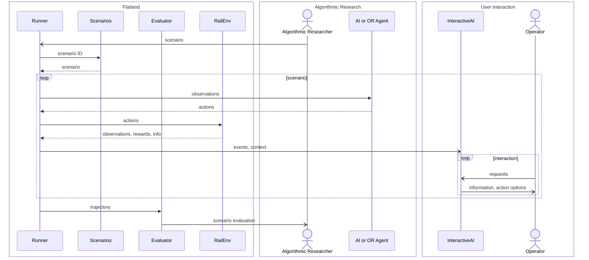
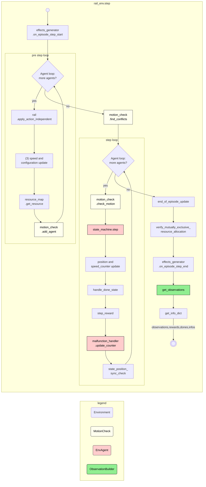
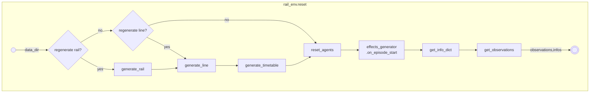

Key Concepts
============
To help you get a high-level understanding of how the Flatland works, on this page, you learn about the key concepts and general architecture.

We use the terms from [arc42](https://docs.arc42.org/section-7/) for the different views.

[//]: # (icon-park icons from  &#40;https://icones.js.org/collection/icon-park&#41;)

Flatland Code Repositories
--------------------------

* [**flatland-rl**](https://github.com/flatland-association/flatland-rl) contains the environment and evaluation code
* [**flatland-baselines**](https://github.com/flatland-association/flatland-baselines) contains baseline controllers/agents
* [**flatland-scenarios**](https://github.com/flatland-association/flatland-scenarios) contains scenarios for illustration, regression testing and benchmarking
* [**flatland-book**](https://github.com/flatland-association/flatland-book) contains the source code for this documentation

Context View
------------

Notation: [Mermaid Architecture Diagram](https://mermaid.js.org/syntax/architecture.html)

```mermaid
architecture-beta
group flatland(ip:railway)[Flatland]
group ai(ip:brain)[Algorithmic Research]
group ui(ip:data-user)[User Interaction]

service algorithmicResearcher(ip:user)[Algorithmic Researcher] in ai
service evaluator(ip:checklist)[Evaluator] in flatland
service runner(ip:refresh-one)[Runner] in flatland

service railEnv(ip:train)[RailEnv] in flatland
service scenarios(ip:database-config)[Scenarios] in flatland
service policy(ip:six-circular-connection)[AI or OR Agent] in ai
service interactiveAI(ip:map-two)[InteractiveAI] in ui
service operator(ip:user)[Operator] in ui

algorithmicResearcher:B -- T:runner
algorithmicResearcher:B -- T:evaluator
runner:R -- L:railEnv
runner:L -- R:evaluator
scenarios:T -- B:runner
railEnv:T -- B:policy
railEnv:R -- L:interactiveAI
interactiveAI:R -- L:operator
```

High-Level Runtime View
-----------------------

Notation: [Mermaid Sequence Diagram](https://mermaid.js.org/syntax/sequenceDiagram.html)

Building Block View
-------------------

Notation: [Mermaid Class Diagram](https://mermaid.js.org/syntax/classDiagram.html)

```mermaid
classDiagram
    direction BT
    namespace core {
        class Policy {
            act
        }
        class Environment {
            step
            reset
        }

        class ObservationBuilder
        class PredictionBuilder
        class TransitionMap
        class GridTransitionMap
    }
    namespace callbacks {
        class FlatlandCallbacks {
            on_episode_step
        }
    }
    namespace  core_grid {
        class Transitions
        class Grid4Transitions
        class RailEnvTransitions
    }
    namespace  core_graph {
        class GraphTransitionMap
    }
    namespace env_generation {
        class env_generator {
            generate
        }
    }
    namespace envs {
        class AbstractRailEnv {
            step
            reset
        }
        class RailEnv

        class RailGenerator {
            generate
        }
        class RailGeneratorProduct
        class LineGenerator {
            generate
        }
        class Line
        class TimetableGenerator {
            generate
        }
        class Timetable
        class EnvAgent
        class TreeObsForRailEnv
    }

    namespace evaluators {
        class TrajectoryEvaluator

        class FlatlandRemoteClient
        class FlatlandRemoteEvaluationService
    }

    namespace integrations {
        class FlatlandInteractiveAICallbacks
    }

    namespace ml {
        class PettingzooFlatland {
            wrap
        }
        class PettingZooParallelEnvWrapper
        class RayMultiAgentWrapper
    }

    namespace trajectories {
        class Trajectory
        class PolicyRunner {
            create_from_policy$
        }
    }

    namespace flatland-deadlock-avoidance-heuristic {
        class DeadLockAvoidancePolicy
    }

    namespace pettingzoo {
        class PettingZooParallelEnv["pettingzoo.ParallelEnv"]
    }

    namespace rllib {
        class RllibMultiAgentEnv["ray.rllib.MultiAgentEnv"]
    }
    namespace gymnasium {
        class gymEnv["gymnasium.Env"] {
        }
    }
    RailEnv --|> AbstractRailEnv
    AbstractRailEnv --|> Environment
    FlatlandInteractiveAICallbacks --|> FlatlandCallbacks
    DeadLockAvoidancePolicy --|> Policy
    Grid4Transitions --|> Transitions
    RailEnvTransitions --|> Grid4Transitions
    GridTransitionMap --> TransitionMap
    PettingzooFlatland ..> PettingZooParallelEnvWrapper : creates
    PettingZooParallelEnvWrapper --|> PettingZooParallelEnv
    PettingZooParallelEnvWrapper --|> gymEnv
    RayMultiAgentWrapper --|> RllibMultiAgentEnv
    RllibMultiAgentEnv --|> gymEnv
    TreeObsForRailEnv --|> ObservationBuilder
    RailEnv --> "*" EnvAgent
    RailEnv --> "1" GridTransitionMap
    RailEnv --> "1" RailGenerator
    RailEnv --> "1" LineGenerator
    RailEnv --> "1" TimetableGenerator
    RailEnv --> "1" ObservationBuilder
    PettingZooParallelEnvWrapper --> "1" RailEnv
    PolicyRunner ..> Trajectory : creates
    RayMultiAgentWrapper --> "1" RailEnv
    TransitionMap --> "*" Transitions
    TreeObsForRailEnv --> "1" PredictionBuilder
```

Runtime View RailEnv Step
-------------------------

Notation: [Mermaid Flowchart](https://mermaid.js.org/syntax/flowchart.html)

Numbers in brackets refer to the phase comments in `AbstractRailEnv.step()` in `flatland/envs/rail_env.py`. Phase (3) and the position and
speed_counter update are inline code in `step()`, without a method of their own. Phases (2) and (5) gather the state transition signals, phase (7) fetches the saved transition data.

| step                                         | description                                                                                                                                                                                                                                                                                                                                                                                  |
|----------------------------------------------|----------------------------------------------------------------------------------------------------------------------------------------------------------------------------------------------------------------------------------------------------------------------------------------------------------------------------------------------------------------------------------------------|
| effects_generator.on_episode_step_start      | Hook for external events modifying the env (state) before the agents are updated. The `MalfunctionEffectsGenerator` draws new malfunctions here (`malfunction_handler.generate_malfunction`).                                                                                                                                                                                                 |
| (1) rail.apply_action_independent            | Apply the action (`RailEnvActions.from_value`, missing actions become DO_NOTHING) to the current configuration (or the initial configuration if the agent is not on the map yet), independent of the other agents. MOVE_LEFT/MOVE_RIGHT are corrected to MOVE_FORWARD where no turn is possible. Returns no configuration if the action is invalid (e.g. MOVE_FORWARD or DO_NOTHING facing a symmetric switch). |
| (3) speed and configuration update           | Compute the new speed: 0 if the action is invalid, accelerate when starting from STOPPED/MALFUNCTION with a moving action or on MOVE_FORWARD running straight, brake on STOP_MOVING. Compute the new configuration: the initial configuration when departing, the next cell at a cell exit, otherwise the current configuration.                                                            |
| (4) resource_map.get_resource                | Map the current and the new configuration to resources (the cell, or the cell and axis at level-free crossings).                                                                                                                                                                                                                                                                             |
| (5) motion_check.add_agent                   | Register the current and the new resource with the MotionCheck conflict resolution.                                                                                                                                                                                                                                                                                                          |
| (6) motion_check.find_conflicts              | Find and resolve conflicts.                                                                                                                                                                                                                                                                                                                                                                  |
| (8) motion_check.check_motion                | Check whether the agent may move to the new resource given the other agents' desired updates; this sets the `movement_allowed` signal.                                                                                                                                                                                                                                                       |
| (9) state_machine.step                       | With the transition signals (incl. MotionCheck's decision for this agent), do the agent state machine transition.                                                                                                                                                                                                                                                                            |
| position and speed_counter update            | Based on the new state, update the configuration and the speed counter: a MOVING agent takes the new configuration, an agent going from MALFUNCTION_OFF_MAP to STOPPED is placed at its initial configuration.                                                                                                                                                                       |
| (11) handle_done_state                       | Based on the new configuration, check whether the target is reached and remove the agent if `remove_agents_at_target` is set in the env.                                                                                                                                                                                                                                                     |
| (12) step_reward                             | Compute step rewards.                                                                                                                                                                                                                                                                                                                                                                        |
| (13) malfunction_handler.update_counter      | Count down current malfunctions.                                                                                                                                                                                                                                                                                                                                                             |
| state_position_sync_check                    | Check at agent level whether on map and off map states match with the configuration being None.                                                                                                                                                                                                                                                                                              |
| end_of_episode_update                        | Have all agents terminated? Set dones.                                                                                                                                                                                                                                                                                                                                                       |
| verify_mutually_exclusive_resource_allocation| Verify that no two agents occupy the same resource (cell, or cell and axis at level-free crossings); warns otherwise.                                                                                                                                                                                                                                                                         |
| effects_generator.on_episode_step_end        | Hook for external events modifying the env (state) after the agents are updated and the rewards are computed. Steps are recorded here if `record_steps` is set (`RecordStepsEffectsGenerator`).                                                                                                                                                                                              |
| get_observations                             | Call observation builder for all agents.                                                                                                                                                                                                                                                                                                                                                     |
| get_info_dict                                | Prepare infos for all agents.                                                                                                                                                                                                                                                                                                                                                                |

Runtime View Env Reset
----------------------

Notation: [Mermaid Flowchart](https://mermaid.js.org/syntax/flowchart.html)

