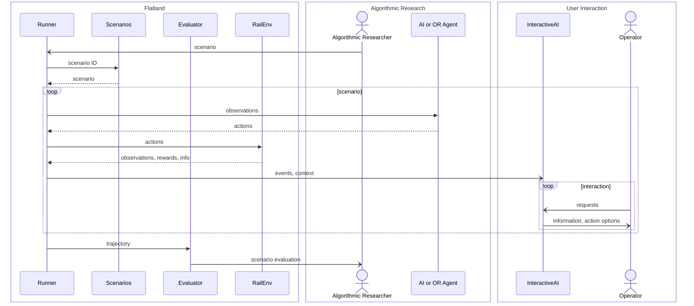
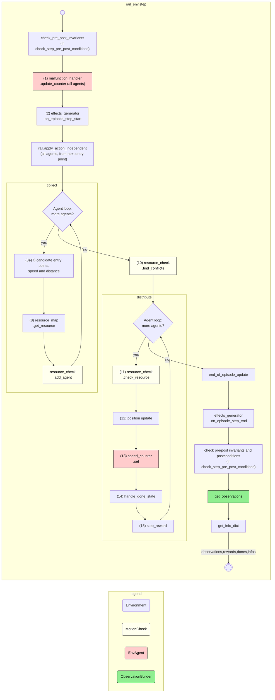
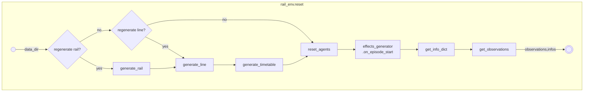

Key Concepts
============
To help you get a high-level understanding of how the Flatland works, on this page, you learn about the key concepts and general architecture.

We use the terms from [arc42](https://docs.arc42.org/section-7/) for the different views.

[//]: # (icon-park icons from  &#40;https://icones.js.org/collection/icon-park&#41;)

Flatland Code Repositories
--------------------------

* [**flatland-rl**](https://github.com/flatland-association/flatland-rl) contains the environment and evaluation code
* [**flatland-baselines**](https://github.com/flatland-association/flatland-baselines) contains baseline controllers/agents
* [**flatland-scenarios**](https://github.com/flatland-association/flatland-scenarios) contains scenarios for illustration, regression testing and benchmarking
* [**flatland-book**](https://github.com/flatland-association/flatland-book) contains the source code for this documentation

Context View
------------

Notation: [Mermaid Architecture Diagram](https://mermaid.js.org/syntax/architecture.html)

```mermaid
architecture-beta
group flatland(ip:railway)[Flatland]
group ai(ip:brain)[Algorithmic Research]
group ui(ip:data-user)[User Interaction]

service algorithmicResearcher(ip:user)[Algorithmic Researcher] in ai
service evaluator(ip:checklist)[Evaluator] in flatland
service runner(ip:refresh-one)[Runner] in flatland

service railEnv(ip:train)[RailEnv] in flatland
service scenarios(ip:database-config)[Scenarios] in flatland
service policy(ip:six-circular-connection)[AI or OR Agent] in ai
service interactiveAI(ip:map-two)[InteractiveAI] in ui
service operator(ip:user)[Operator] in ui

algorithmicResearcher:B -- T:runner
algorithmicResearcher:B -- T:evaluator
runner:R -- L:railEnv
runner:L -- R:evaluator
scenarios:T -- B:runner
railEnv:T -- B:policy
railEnv:R -- L:interactiveAI
interactiveAI:R -- L:operator
```

High-Level Runtime View
-----------------------

Notation: [Mermaid Sequence Diagram](https://mermaid.js.org/syntax/sequenceDiagram.html)

Building Block View
-------------------

Notation: [Mermaid Class Diagram](https://mermaid.js.org/syntax/classDiagram.html)

```mermaid
classDiagram
    direction BT
    namespace core {
        class Policy {
            act
        }
        class Environment {
            step
            reset
        }

        class ObservationBuilder
        class PredictionBuilder
        class TransitionMap
        class GridTransitionMap
    }
    namespace callbacks {
        class FlatlandCallbacks {
            on_episode_step
        }
    }
    namespace  core_grid {
        class Transitions
        class Grid4Transitions
        class RailEnvTransitions
    }
    namespace  core_graph {
        class GraphTransitionMap
    }
    namespace env_generation {
        class env_generator {
            generate
        }
    }
    namespace envs {
        class AbstractRailEnv {
            step
            reset
        }
        class RailEnv

        class RailGenerator {
            generate
        }
        class RailGeneratorProduct
        class LineGenerator {
            generate
        }
        class Line
        class TimetableGenerator {
            generate
        }
        class Timetable
        class EnvAgent
        class TreeObsForRailEnv
    }

    namespace evaluators {
        class TrajectoryEvaluator

        class FlatlandRemoteClient
        class FlatlandRemoteEvaluationService
    }

    namespace integrations {
        class FlatlandInteractiveAICallbacks
    }

    namespace ml {
        class PettingzooFlatland {
            wrap
        }
        class PettingZooParallelEnvWrapper
        class RayMultiAgentWrapper
    }

    namespace trajectories {
        class Trajectory
        class PolicyRunner {
            create_from_policy$
        }
    }

    namespace flatland-deadlock-avoidance-heuristic {
        class DeadLockAvoidancePolicy
    }

    namespace pettingzoo {
        class PettingZooParallelEnv["pettingzoo.ParallelEnv"]
    }

    namespace rllib {
        class RllibMultiAgentEnv["ray.rllib.MultiAgentEnv"]
    }
    namespace gymnasium {
        class gymEnv["gymnasium.Env"] {
        }
    }
    RailEnv --|> AbstractRailEnv
    AbstractRailEnv --|> Environment
    FlatlandInteractiveAICallbacks --|> FlatlandCallbacks
    DeadLockAvoidancePolicy --|> Policy
    Grid4Transitions --|> Transitions
    RailEnvTransitions --|> Grid4Transitions
    GridTransitionMap --> TransitionMap
    PettingzooFlatland ..> PettingZooParallelEnvWrapper : creates
    PettingZooParallelEnvWrapper --|> PettingZooParallelEnv
    PettingZooParallelEnvWrapper --|> gymEnv
    RayMultiAgentWrapper --|> RllibMultiAgentEnv
    RllibMultiAgentEnv --|> gymEnv
    TreeObsForRailEnv --|> ObservationBuilder
    RailEnv --> "*" EnvAgent
    RailEnv --> "1" GridTransitionMap
    RailEnv --> "1" RailGenerator
    RailEnv --> "1" LineGenerator
    RailEnv --> "1" TimetableGenerator
    RailEnv --> "1" ObservationBuilder
    PettingZooParallelEnvWrapper --> "1" RailEnv
    PolicyRunner ..> Trajectory : creates
    RayMultiAgentWrapper --> "1" RailEnv
    TransitionMap --> "*" Transitions
    TreeObsForRailEnv --> "1" PredictionBuilder
```

Runtime View RailEnv Step
-------------------------

Notation: [Mermaid Flowchart](https://mermaid.js.org/syntax/flowchart.html)

Numbers in brackets refer to the phase comments in `AbstractRailEnv.step()`, `collect()` and `distribute()` in `flatland/envs/rail_env.py`.
`step()` first lets every agent propose a candidate (collect), then resolves the conflicts between all candidates, and then accepts or discards
each agent's candidate (distribute). `step()` neither reads nor writes `agent.state`: there is no action preprocessing and no state machine step in it.
The behaviour follows from the entry points, speed, distance, malfunction counter and earliest departure of the agent. The state machine is an optional
wrapper (`RailEnvStateMachineWrapper`) that updates `agent.state` after `step()`, see [Agents and State Machine](../environment/environment/agent).

| step                                               | description                                                                                                                                                                                                                                                                                                                                                                                            |
|----------------------------------------------------|--------------------------------------------------------------------------------------------------------------------------------------------------------------------------------------------------------------------------------------------------------------------------------------------------------------------------------------------------------------------------------------------------------|
| check_pre_post_invariants                          | Only if `check_step_pre_post_conditions` is set (default `True`): current and next entry point are both `None` (off map) or the next is a successor of the current; no two agents hold the same resource.                                                                                                                                                                                              |
| (1) malfunction_handler.update_counter             | Count down the current malfunctions of all agents, at the start of the step.                                                                                                                                                                                                                                                                                                                           |
| (2) effects_generator.on_episode_step_start        | Hook for external events modifying the env (state) before the agents are updated. The `MalfunctionEffectsGenerator` draws new malfunctions here (`malfunction_handler.generate_malfunction`).                                                                                                                                                                                                          |
| rail.apply_action_independent                      | Apply the action (`RailEnvActions.from_value`, missing actions become DO_NOTHING) to the next entry point (or the initial entry point if the agent is not on the map yet), independent of the other agents. MOVE_LEFT/MOVE_RIGHT are corrected to MOVE_FORWARD where no turn is possible. Returns no entry point if the action is invalid (e.g. MOVE_FORWARD or DO_NOTHING facing a symmetric switch). |
| (3)-(7) candidate entry points, speed and distance | From the pre-step values only, compute the candidate current and next entry point (unchanged mid-cell, the next entry point and the one after it at a cell exit, the initial entry point at map entry), the candidate speed and the candidate distance. `action_valid` is `False` for an invalid action at a cell exit.                                                                                |
| (8) resource_map.get_resource                      | Map the current and the candidate (current, next) entry points to resources (the cell, or the cell and axis at level-free crossings).                                                                                                                                                                                                                                                                  |
| resource_check.add_agent                           | Register the current and the candidate resource with the `MotionCheck` conflict resolution.                                                                                                                                                                                                                                                                                                            |
| (10) resource_check.find_conflicts                 | Find and resolve conflicts between all agents' candidates.                                                                                                                                                                                                                                                                                                                                             |
| (11) resource_check.check_resource                 | Whether the agent's candidate is granted given the other agents' candidates.                                                                                                                                                                                                                                                                                                                           |
| (12) position update                               | If granted, the agent takes its candidate current and next entry point; otherwise they stay unchanged.                                                                                                                                                                                                                                                                                                 |
| (13) speed_counter.set                             | If granted, the agent takes its candidate speed and distance (`None` off map); if a crossing is denied, the speed is set to 0 and the distance stays at the cell boundary.                                                                                                                                                                                                                             |
| (14) handle_done_state                             | Based on the new entry point, check whether the target is reached and remove the agent if `remove_agents_at_target` is set in the env.                                                                                                                                                                                                                                                                 |
| (15) step_reward                                   | Compute step rewards.                                                                                                                                                                                                                                                                                                                                                                                  |
| end_of_episode_update                              | Have all agents terminated? Set dones.                                                                                                                                                                                                                                                                                                                                                                 |
| effects_generator.on_episode_step_end              | Hook for external events modifying the env (state) after the agents are updated and the rewards are computed. Steps are recorded here if `record_steps` is set (`RecordStepsEffectsGenerator`).                                                                                                                                                                                                        |
| check pre/post invariants and postconditions       | Only if `check_step_pre_post_conditions` is set: the invariants as above, and that the new speed, distance and entry points follow from the pre-step values and the actions.                                                                                                                                                                                                                           |
| get_observations                                   | Call observation builder for all agents.                                                                                                                                                                                                                                                                                                                                                               |
| get_info_dict                                      | Prepare infos for all agents.                                                                                                                                                                                                                                                                                                                                                                          |

Runtime View Env Reset
----------------------

Notation: [Mermaid Flowchart](https://mermaid.js.org/syntax/flowchart.html)

