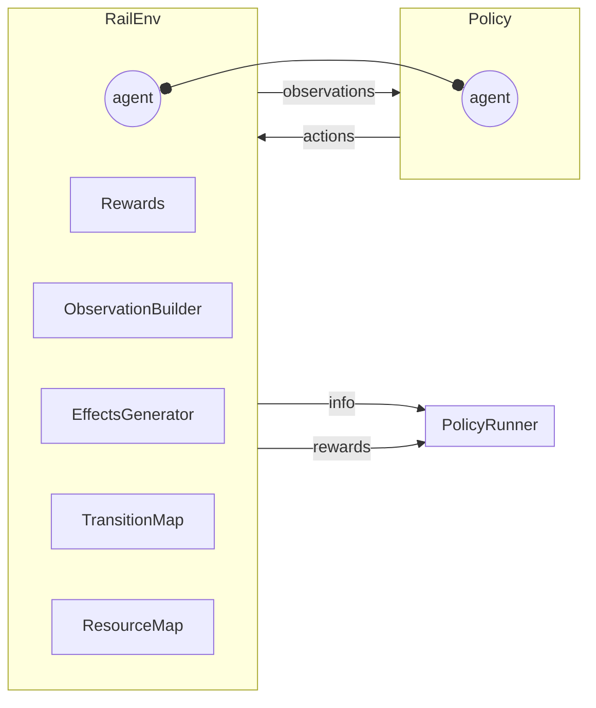
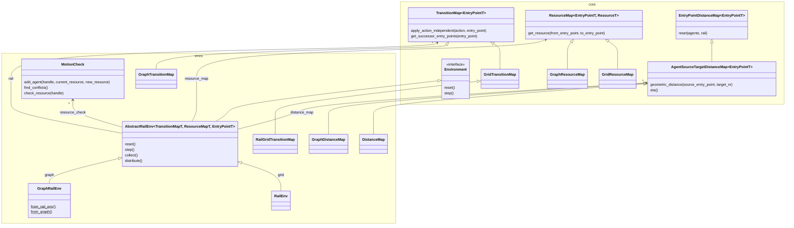

# Flatland Data and Simulation Model

## Overview

The following digram shows the RL control loop,

```python
obs, rewards, dones, info = env.step(action_dict)
```

showing the flow of inputs and outputs of `step`:



Adapted from [RLlib](https://docs.ray.io/en/latest/rllib/rllib-env.html#rllib-environments-doc).

## Glossary

### Flatland Environment

| Concept             | Description                                                                                                                                                                                                                                                                |
|---------------------|----------------------------------------------------------------------------------------------------------------------------------------------------------------------------------------------------------------------------------------------------------------------------|
| Agent               | Each train is a single agent in Flatland.                                                                                                                                                                                                                                  |
| (MA)RL Loop         | (Multi-Agent) Reinforcement Learning Loop is a control loop: a policy receives observations from the env and outputs actions. See above.                                                                                                                                   |
| Policy              | Recevies an observation for each agent and outputs an action for each agent. The policy may consist of a single sub-policy applied to each agent unilaterally or it may have different sub-policies for each agent individually or even consider all observations jointly. |
| Policy Runner       | Takes an env and a policy and runs the MARL loop for evaluation by calling `obs, rewards, dones, info = env.step(action_dict)` iteratively until done.                                                                                                                     |
| Callbacks           | Callbacks at the start and end of an episode (`on_episode_start`, `on_episode_end`) and after each env step (`on_episode_step`), called by the policy runner.                                                                                                              |
| Trajectory          | The output of a policy run: actions, positions, rewards.                                                                                                                                                                                                                   |
| Actions             | An action for each agent.                                                                                                                                                                                                                                                  |
| Rewards             | A reward (number or dict) for each agent. Also used for the component building the rewards during `step`.                                                                                                                                                                  |
| Effects Generator   | Called by the env at the start of an episode (`on_episode_start`, in `reset`) and at the start and end of each `step` (`on_episode_step_start`, `on_episode_step_end`) to modify the env's state, e.g. injecting disruptions.                                              |
| Observation Builder | Called by env to build the observation from the env's state.                                                                                                                                                                                                               |
| Entry Point         | Each agent is at an entry point, i.e. a cell and the direction in which it entered it in the grid or a node in the graph, and has already chosen its next entry point. Updated by env during a `step`.                                                                     |
| Transition Map      | Defines the topology the agents live in, i.e. the entry points and transitions between them as well as actions required for the transition.                                                                                                                                |
| Resource Map        | Defines which resource an agent holds on its way from one entry point to the next, e.g. rails can be allocated only mutually exclusively. Keyed by the edge (from and to entry point); the resource is the one at the from entry point.                                    |

Grid and graph environments share one `step()` implementation: `AbstractRailEnv` is generic in the transition map, the resource map and the entry
point type (`AbstractRailEnv[TransitionMapT, ResourceMapT, EntryPointT]`). `step()` only works with entry points: it asks the transition map for
the successor of an entry point under an action and the resource map for the resource held on an edge, and it never looks at grid cells or graph
nodes directly. Rewards and observations get the distances to the targets from the distance map. `RailEnv` (grid) and `GraphRailEnv` (graph) bind
the type parameters and implement only the parts that depend on the representation, i.e. generating the rail, the resource map and the agents.



| Type parameter / component | `RailEnv` (grid)                                                                   | `GraphRailEnv` (graph)                                                                   |
|----------------------------|------------------------------------------------------------------------------------|------------------------------------------------------------------------------------------|
| `EntryPointT`              | `((row, column), direction)`                                                       | `str`, a node of the graph                                                               |
| `TransitionMapT`           | `RailGridTransitionMap` (a `GridTransitionMap`)                                    | `GraphTransitionMap`                                                                     |
| `ResourceMapT`             | `GridResourceMap`: the cell, or the cell and the axis at level-free crossings      | `GraphResourceMap`: a given mapping from node to resource                                |
| distance map               | `DistanceMap`                                                                      | `GraphDistanceMap`                                                                       |

The resource map is keyed by the edge, i.e. the current and the next entry point (`get_resource(from_entry_point, to_entry_point)`); the resource held
is the one at the from entry point. The distance maps derive from `EntryPointDistanceMap`, which stores the distance from every entry point to the
target entry points, and `AgentSourceTargetDistanceMap`, which answers per agent (`geometric_distance`, `eta`).

### Flatland Transition Maps

| Concept        | Grid                                                                                                                                                                                                                                                | Graph                                                                                                                                                      |
|----------------|-----------------------------------------------------------------------------------------------------------------------------------------------------------------------------------------------------------------------------------------------------|------------------------------------------------------------------------------------------------------------------------------------------------------------|
| Coordinate     | Row, column, direction how cells can be entered: `((r,c),d)`.                                                                                                                                                                                       | A **node** (`str`), i.e. a cell entry pin.                                                                                                                 |
| Transition Map | For each entry point, which are possible successor entry points (`get_successor_entry_points`).                                                                                                                                                     | The directed graph: a pair of **node**s defines a directed **edge**; successors of a node via `get_successor_entry_points`.                                |
| Entry Point    | Row, column and the direction in which the cell was entered: `((r,c),d)`. The agent is on its way from its current to its next entry point, `speed_counter.distance` is the offset; speed and malfunction counter are kept separately in the agent. | A node.                                                                                                                                                    |
| Agent State    | `current_entry_point` and `next_entry_point`, the offset `speed_counter.distance`, the speed, the malfunction counter (`malfunction_handler`), and `target_entry_point` (set once arrived, i.e. done).                                              | The **edge** `(current_entry_point, next_entry_point)`, the offset on it, speed, malfunction counter and done.                                             |
| Resource Map   | Each `row,col=cell` is a mutually exclusively allocatable resource; at level-free crossings, the cell and the axis `(position, direction % 2)`.                                                                                                     | Each node is mapped to a mutually exclusively allocatable resource (`GraphResourceMap`); nodes reflecting common physical infrastructure share a resource. |

Up to `flatland 4.3.0`, entry points were called configurations (`initial_configuration`, `current_configuration`, `target_configuration`, `ConfigurationDistanceMap`).
Since `flatland 5.0.0`, they are entry points (`initial_entry_point`, `current_entry_point`, `target_entry_point`, `EntryPointDistanceMap`), and the agent
additionally holds its `next_entry_point`.

### Flatland Rail

| Concept               | Description                                                                                                                                                                                                                                                                     |
|-----------------------|---------------------------------------------------------------------------------------------------------------------------------------------------------------------------------------------------------------------------------------------------------------------------------|
| Malfunction Generator | An instance of effects generator, changing agent's state.                                                                                                                                                                                                                       |
| Rail (Generator)      | Outputs a transition map and stopping points, and, optionally, stations and links.                                                                                                                                                                                              |
| Line (Generator)      | Outputs a sequence of stops, which are sets of entry points. The first is a singleton called initial entry point; the last is called target; the others are called intermediate stops.                                                                                          |
| Timetable (Generator) | Adds a time window (earliest, latest) for each stop. Earliest of the initial entry point is enforced by the simulation (`step()` lets an agent depart from step `earliest_departure` on); the remaining are used in the rewards for penalizing late arrival or early departure. |
| Station               | Collection of stopping points and gates.                                                                                                                                                                                                                                        |
| City                  | In sparse rail generator, internally used alias for station.                                                                                                                                                                                                                    |
| Stopping Point        | "Bahnhofsmitte" entry points where agents can stop.                                                                                                                                                                                                                             |
| Gate                  | A collection of pins.                                                                                                                                                                                                                                                           |
| Link                  | Connects two gates. Has fibres. Not all pairs of pins in the gate need be connected.                                                                                                                                                                                            |
| Fibre                 | A sequence of transitions linking two pins of a link.                                                                                                                                                                                                                           |
| Pin                   | A single entry point attached to a gate.                                                                                                                                                                                                                                        |
| Chain                 | A sequence of links terminating/starting at the same station at different reachable gates.                                                                                                                                                                                      |
