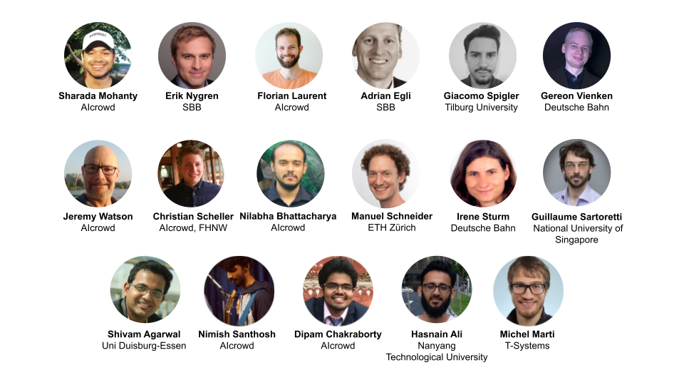

Credits
===

<!-- ## Contributors -->

<!--  -->

Core Team and Organizers
-----------

* Sharada Mohanty <mohanty@aicrowd.com>
* Erik Nygren <erik.nygren@sbb.ch>
* Florian "MasterScrat" Laurent <florian@aicrowd.com>
* Adrian Egli <adrian.egli@sbb.ch>
* Christian Eichenberger <christian.markus.eichenberger@sbb.ch>
* Christian Baumberger <christian.baumberger@sbb.ch>
* Giacomo Spigler <giacomo.spigler@gmail.com>
* Jeremy Watson <jeremy@aicrowd.com>
* Christian Scheller <christian.scheller@fhnw.ch>
* Nilabha Bhattacharya <nilabha2007@gmail.com>
* Manuel Schneider <manuel.schneider@hest.ethz.ch>
* Irene Sturm <irene.sturm@deutschebahn.com>
* Sven Koenig <skoenig@usc.edu>
* Nimish Santhosh <nimish@aicrowd.com>
* Dipam Chakraborty <dipam@aicrowd.com>
* Michel Marti <michel.marti@t-systems.com>
* Charlie Amaudruz <charles-frederick.amaudruz@sncf.fr>
* François Ramond <francois.ramond@sncf.fr>

Acknowledgements
----------------
* Guillaume Sartoretti <guillaume.sartoretti@nus.edu.sg>
* Shivam Agarwal <shivam.agarwal@paluno.uni-due.de>

Contributors
------------

Contributors to this book and to the Flatland environment are listed on GitHub:
[flatland-book contributors](https://github.com/flatland-association/flatland-book/graphs/contributors) and
[flatland-rl contributors](https://github.com/flatland-association/flatland-rl/graphs/contributors). Why not [join them](contributing)?
